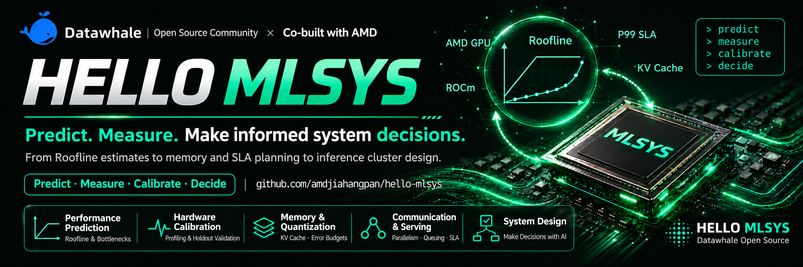

<div align="center">
  
  <p><strong>Predict first, then verify: back every system decision with evidence 🚀</strong></p>
</div>

<div align="center">

*Simulation for prediction · Measurement for evidence · Calibration for honesty · Decisions as the goal*

<p align="center">
  <a href="./README_en.md"></a>
  <a href="./README.md"></a>
</p>

</div>

<div align="center">

<a href="https://datawhalechina.github.io/hello-mlsys/"></a> | <a href="https://datawhalechina.github.io/hello-mlsys/curriculum/"></a> | <a href="https://github.com/datawhalechina/hello-rocm"></a> | <a href="https://github.com/datawhalechina/hello-gpu"></a>

</div>

<p align="center">
  
  &nbsp;&nbsp;&nbsp;&nbsp;
  
</p>

> [!CAUTION]
> ⚠️ Alpha preview: this is an early internal build. It is incomplete and may contain errors. Issues with bug reports or suggestions are welcome.
>
> The tutorial body is currently written in Chinese; this English README gives an overview of the project.

&emsp;&emsp;As LLM inference moves into real services, getting a model to run is only the first step. The next questions are harder: How long a context fits on this card, and how many concurrent requests can it sustain? Where does P99 latency start to bend upward? If you switch quantization, add a GPU, or change inference frameworks, how much do you actually gain, and what does it cost?

&emsp;&emsp;However, **knowing how to deploy a model is not the same as knowing how to design a system**. These questions involve trade-offs among **model, hardware, configuration, workload, SLA, quality, cost, and energy**. Trial and error is slow and expensive; formulas and papers alone do not tell you how far a prediction is from real hardware. Most learning material stops at "how to use framework X" or "what metric Y means", and rarely walks through the full chain of predicting, measuring, explaining the error, calibrating the model, and finally making a decision.

&emsp;&emsp;**hello-mlsys** is built for exactly this path. Using the **AMD Radeon RX 9070 XT** as the main experimental platform, every core experiment first uses a simulator to predict performance, capacity, or design boundaries, then picks a small number of informative configurations to measure on real AMD hardware. You explain the deviations, calibrate the model, validate it on new configurations that were not used for fitting, and then make a design decision. Every chapter follows the same learning loop:

> **Define scenario and constraints → Run the simulator and record the prediction → Choose measurement points → Validate on AMD hardware → Explain the error and calibrate → Holdout validation → Design decision**

&emsp;&emsp;**This is not a user manual for inference frameworks. It aims to build the core MLSys mindset: use models to predict, use measurements as evidence, use calibration to stay honest, and use decisions to answer the question. Anyone is welcome to open an issue or submit a PR to help build and maintain this project.**

> &emsp;&emsp;**hello-rocm gets you running, hello-gpu makes your kernels fast, and hello-mlsys teaches you to guide system design with simulation, then validate and calibrate it on real AMD hardware.** For environment setup and deployment, see [hello-rocm](https://github.com/datawhalechina/hello-rocm); for kernel tuning, see [hello-gpu](https://github.com/datawhalechina/hello-gpu). This tutorial does not repeat either topic.

> &emsp;&emsp;***Study tip: start with [Chapter 0: Protocol and Paper Drill](https://datawhalechina.github.io/hello-mlsys/part0-intro/chapter0/) to align on measurement units such as tokens, GB/GiB, and latency, and walk through the learning loop on paper. Then study Part 1 in the order "performance → calibration → memory → quantization → communication → parallelism → serving → frameworks", and move on to the integrated design work in Part 2. No AMD GPU at hand? The Roofline predictions in Chapter 1 and the memory ledger in Chapter 3 can be done on CPU alone, and Chapter 2 provides a CPU reference line as an entry point for prediction.***

### News

- *2026.11.8:* **[Tutorial site](https://datawhalechina.github.io/hello-mlsys/) launched**: full curriculum, chapter navigation, site search, and light/dark themes.

### Completed Chapters

<p align="center">
  <strong>✨ One complete loop per chapter: recorded prediction · real-hardware measurement · error attribution · holdout validation ✨</strong><br>
  <em>Main platform: RX 9070 XT · every chapter ships with experiment code, raw measurement records, and plotting scripts</em><br>
  <a href="https://datawhalechina.github.io/hello-mlsys/curriculum/">Curriculum</a> · <a href="https://datawhalechina.github.io/hello-mlsys/part0-intro/chapter0/">Chapter 0: Measurement Protocol</a>
</p>

<table align="center" border="0" cellspacing="0" cellpadding="0" style="border-collapse: collapse; border: none !important;">

  <tr>
    <td colspan="2" align="center" style="border: none !important;"><strong>Protocol · Paper Drill</strong></td>
  </tr>
  <tr>
    <td valign="top" width="50%" style="border: none !important;">
      • Tutorial positioning, hardware map, and unified measurement protocol<br>
      • Fill in a complete experiment worksheet from simulator output<br>
    </td>
    <td valign="top" width="50%" style="border: none !important;">
      • <a href="https://datawhalechina.github.io/hello-mlsys/part0-intro/chapter0/">Chapter 0 text</a><br>
      • <a href="./docs/public/part0-intro/chapter0/experiment-draft.yaml">Experiment worksheet template</a><br>
    </td>
  </tr>
  <tr>
    <td colspan="2" align="center" style="border: none !important;"><strong>Performance Prediction · Roofline and Bottlenecks</strong></td>
  </tr>
  <tr>
    <td valign="top" width="50%" style="border: none !important;">
      • Arithmetic intensity and compute-bound / memory-bound classification<br>
      • Prefill / decode breakdown and theoretical lower bounds on time<br>
    </td>
    <td valign="top" width="50%" style="border: none !important;">
      • <a href="https://datawhalechina.github.io/hello-mlsys/part1-modeling/chapter1/">Chapter 1 text</a><br>
      • <a href="./code/part1-modeling/chapter1">Code and measurement records</a><br>
    </td>
  </tr>
  <tr>
    <td colspan="2" align="center" style="border: none !important;"><strong>Hardware Calibration · Profiling and Holdout Validation</strong></td>
  </tr>
  <tr>
    <td valign="top" width="50%" style="border: none !important;">
      • Hardware readiness checks, minimal profiling, and error attribution<br>
      • Calibration-set fitting, holdout validation, and a CPU reference line<br>
    </td>
    <td valign="top" width="50%" style="border: none !important;">
      • <a href="https://datawhalechina.github.io/hello-mlsys/part1-modeling/chapter2/">Chapter 2 text</a><br>
      • <a href="./code/part1-modeling/chapter2">Code and measurement records</a><br>
    </td>
  </tr>
  <tr>
    <td colspan="2" align="center" style="border: none !important;"><strong>Capacity Planning · Weight and KV Cache Memory Ledger</strong></td>
  </tr>
  <tr>
    <td valign="top" width="50%" style="border: none !important;">
      • Three ledgers: static weights, per-token KV, and runtime overhead<br>
      • Reconciling formula / allocator / device readings and finding the serving boundary<br>
    </td>
    <td valign="top" width="50%" style="border: none !important;">
      • <a href="https://datawhalechina.github.io/hello-mlsys/part1-modeling/chapter3/">Chapter 3 text</a><br>
      • <a href="./code/part1-modeling/chapter3">Code and measurement records</a><br>
    </td>
  </tr>
  <tr>
    <td colspan="2" align="center" style="border: none !important;"><strong>Quantization Choices · Precision and Error Budgets</strong></td>
  </tr>
  <tr>
    <td valign="top" width="50%" style="border: none !important;">
      • Four budgets: memory, decode speed, time to first token, and quality<br>
      • Why lower bit-width is not always faster: dequantization overhead and kernel attribution<br>
    </td>
    <td valign="top" width="50%" style="border: none !important;">
      • <a href="https://datawhalechina.github.io/hello-mlsys/part1-modeling/chapter4/">Chapter 4 text</a><br>
      • <a href="./code/part1-modeling/chapter4">Code and measurement records</a><br>
    </td>
  </tr>
</table>

## Why This Project

&emsp;&emsp;What is MLSys?

> MLSys (Machine Learning Systems) studies how to run machine learning models efficiently, reliably, and economically on real hardware under real workloads. It is less about how fast a single kernel is and more about how the whole system trades off model, hardware, configuration, workload, and service targets.

&emsp;&emsp;Models keep growing and inference keeps getting more expensive. Once a model runs, the next questions are whether it can hold up under load and whether it is worth the cost. Capacity planning, quantization, parallel partitioning, and framework choice each affect memory, latency, throughput, and cost. Yet most material either stops at deployment tutorials or at paper formulas: the former tells you how to run something but not why it is configured that way; the latter gives you a model but not how far it is from real hardware.

&emsp;&emsp;This project uses the **AMD Radeon RX 9070 XT** as its main experimental platform, and the cluster design chapter uses **multiple W7900D 48 GB GPUs**. A consumer GPU lets students and small labs do real-hardware calibration, while Roofline, memory ledgers, the α–β communication model, and queueing theory hold on any platform; switching hardware only means switching the parameter table.

&emsp;&emsp;Along this path, the tutorial sticks to three keywords:

| Keyword | Meaning | How you practice it |
| ---- | ---- | ---- |
| **Simulator-Driven** | Predict with a simulator first, then decide what to measure | Record predictions before measuring, and measure only the few most informative configurations |
| **Calibration-Honest** | Real hardware judges the prediction, and every error must be explained | Fit calibration coefficients and validate on configurations not used for fitting |
| **Decision-Oriented** | Every chapter ends in a quantifiable design decision | Memory feasibility regions, quantization schemes, parallel partitioning, SLA capacity, cluster configuration |

&emsp;&emsp;The tutorial focuses on **LLM inference systems**. Training memory, kernel tuning, and cluster scheduling platforms are optional reading and outside the main line of the book.

&emsp;&emsp;***We hope every learner can work out the numbers first, measure them properly, and stand behind every system decision with evidence.***

## Who This Is For

&emsp;&emsp;This project is for:

* Students and engineers who can run models with PyTorch and want to understand where system performance comes from;
* Learners who want to enter MLSys / AI Infra / inference optimization and build a "predict → measure → calibrate" engineering method;
* Developers who need to do capacity planning, quantization selection, or framework selection for inference services but lack a systematic basis for judgment;
* Learners who want to understand LLM inference system design in the AMD GPU / ROCm ecosystem.

> &emsp;&emsp;You do not need kernel development experience, but you should be comfortable with Python, PyTorch, Linux, and reading English documentation.

## Roadmap and Progress

&emsp;&emsp;The book is organized along the path "**establish measurement conventions → modeling and calibration → designing with AI → electives**", with 4 parts and 6 appendices. Every chapter is a complete "predict → measure → calibrate → decide" loop, and later chapters reuse models calibrated earlier, so reading in order is recommended.

### Repository Layout

```
hello-mlsys/
├── docs/                      # VitePress tutorial site sources
│   ├── part0-intro/           # Part 0: Introduction
│   ├── part1-modeling/        # Part 1: Modeling and Calibration
│   ├── part2-ai-design/       # Part 2: Designing with AI
│   ├── part3-electives/       # Part 3: Electives and Case Library
│   ├── appendix/              # Appendices A–F
│   ├── curriculum/            # Full curriculum (generated from the outline)
│   └── .vitepress/            # Site config and book outline (outline.mjs)
├── code/                      # Per-chapter experiment code, measurement records, and plotting scripts
├── notebooks/                 # Hands-on notebooks
└── scripts/                   # Environment setup, build, and check scripts
```

## Contents

> Links point to the Chinese chapter text.

| Chapter | Summary | Status |
| ---- | ---- | ---- |
| **Part 0: Introduction** | | |
| [Chapter 0 Protocol and Paper Drill](./docs/part0-intro/chapter0/index.md) | Tutorial positioning, hardware map, unified measurement protocol, simulator toolchain and its limits | 🚧 |
| **Part 1: Modeling and Calibration** | | |
| [Chapter 1 Simulator Estimates, Roofline, and Bottlenecks](./docs/part1-modeling/chapter1/index.md) | Roofline, arithmetic intensity, compute-bound / memory-bound classification, order-of-magnitude time estimates | 🚧 |
| [Chapter 2 First Real-Hardware Profile and Performance Calibration](./docs/part1-modeling/chapter2/index.md) | Hardware readiness checks, minimal profiling, error attribution, calibration and holdout sets | 🚧 |
| [Chapter 3 Memory Estimation: Model Weights and KV Cache](./docs/part1-modeling/chapter3/index.md) | Weight memory, KV cache, activation and fragmentation overhead, maximum servable context and concurrency | 🚧 |
| [Chapter 4 Precision, Quantization, and Error Budgets](./docs/part1-modeling/chapter4/index.md) | Numeric formats, precision / latency / memory trade-offs, error budget allocation | 🚧 |
| [Chapter 5 Communication Cost Models and Scale-in / Scale-up](./docs/part1-modeling/chapter5/index.md) | Intra-node and inter-node interconnects, collective communication primitives, α–β cost model | 🚧 |
| [Chapter 6 Model Parallelism and Memory / Compute Partitioning](./docs/part1-modeling/chapter6/index.md) | DP / FSDP, TP, PP, and when communication eats the gains from partitioning | 🚧 |
| [Chapter 7 Serving, Queueing, and SLA](./docs/part1-modeling/chapter7/index.md) | TTFT, TPOT / ITL, latency percentiles, concurrency and throughput, queueing knee, load generation and stress testing | 🚧 |
| [Chapter 8 Inference Framework Trade-offs, Profiling, and Performance Analysis](./docs/part1-modeling/chapter8/index.md) | Framework-level trade-offs, framework-level profiling, configuration-space prediction and failure modes | 🚧 |
| **Part 2: Designing with AI** | | |
| [Chapter 9.1 On-Device Deployment Assistant](./docs/part2-ai-design/chapter9-1/index.md) | Choosing model, precision, context, and KV configuration under tight resource limits | 🚧 |
| [Chapter 9.2 Meeting an SLA on a Single Machine](./docs/part2-ai-design/chapter9-2/index.md) | Single-GPU capacity planning: memory and queueing upper bounds, measured knee, holdout validation | 🚧 |
| [Chapter 9.3 Workload-Driven Inference Cluster Design](./docs/part2-ai-design/chapter9-3/index.md) | Minimizing total wall-clock time on a frozen deep-research trace: 32B/7B model collaboration and multiple parallel strategies, screened in simulation and then measured on a multi-GPU W7900D 48 GB cluster | 🚧 |
| **Part 3: Electives and Case Library** | | |
| [Electives and Case Library](./docs/part3-electives/index.md) | Priority electives and extended case cards | 🚧 |
| **Appendices** | | |
| [Appendix A Hardware Parameters](./docs/appendix/appendix-a-hardware/index.md) | Coming soon | 🚧 |
| [Appendix B Model Cards](./docs/appendix/appendix-b-model-cards/index.md) | Coming soon | 🚧 |
| [Appendix C Glossary](./docs/appendix/appendix-c-glossary/index.md) | Coming soon | 🚧 |
| [Appendix D References](./docs/appendix/appendix-d-references/index.md) | Coming soon | 🚧 |
| [Appendix E Community](./docs/appendix/appendix-e-community/index.md) | Coming soon | 🚧 |
| [Appendix F Common Failure Modes and Troubleshooting Checklist](./docs/appendix/appendix-f-troubleshooting/index.md) | Coming soon | 🚧 |

## Contributors

### Core Contributors

- Yao Lu - Faculty Advisor (Assistant Professor, School of Computing, National University of Singapore)
- yuzhou - Project Lead (PhD student, ShanghaiTech University)
- [Jiahang Pan - Project Lead](https://github.com/amdjiahangpan) (Software Engineer, AMD)
- [Weihong Liu - Project Member](https://github.com/Weihong-Liu) (Datawhale member)
- yanhui - Project Member (MComp student, National University of Singapore)
- jiyan - Project Member (MComp student, National University of Singapore)

> Note: more contributors are welcome!

### Others

- If you have any ideas, feel free to contact us, and please open issues
- Special thanks to everyone who has contributed to the tutorial!
- Thanks to the AMD University Program for supporting this project!

<div align="center">
  <a href="https://github.com/datawhalechina/hello-mlsys/graphs/contributors">
    
  </a>
</div>

## Contributing

&emsp;&emsp;All kinds of contributions are welcome, for example:

* Improving existing chapters or adding new ones
* Fixing errors and bugs
* Re-running experiments on other AMD GPUs and adding measurement and calibration data
* Sharing suggestions and ideas

&emsp;&emsp;Before contributing, please read the **[Contributing Guide CONTRIBUTING_en.md](./CONTRIBUTING_en.md)**. It covers where content belongs, chapter and measurement-record conventions, local preview, and the PR workflow.

- If you find a problem, please open an issue;
- If you would like to contribute, please open a pull request and we will review it as soon as possible.

## License

<a rel="license" href="http://creativecommons.org/licenses/by-nc-sa/4.0/"></a><br />This work is licensed under a <a rel="license" href="http://creativecommons.org/licenses/by-nc-sa/4.0/">Creative Commons Attribution-NonCommercial-ShareAlike 4.0 International License</a>.

---

<div align="center">

**Let's predict first, verify next, and design every system with evidence!** 💪

Made with ❤️ by the hello-mlsys community

</div>
