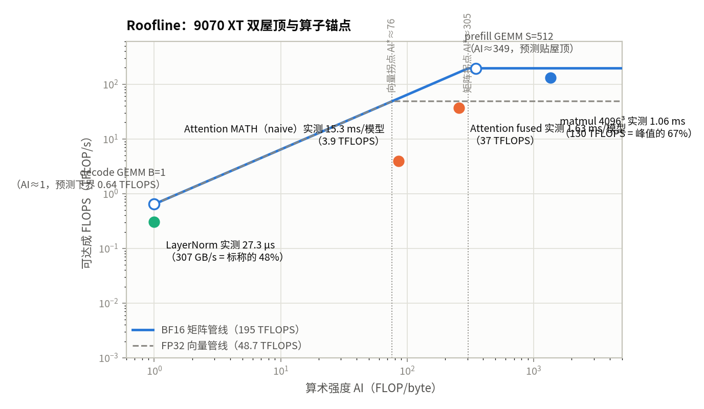
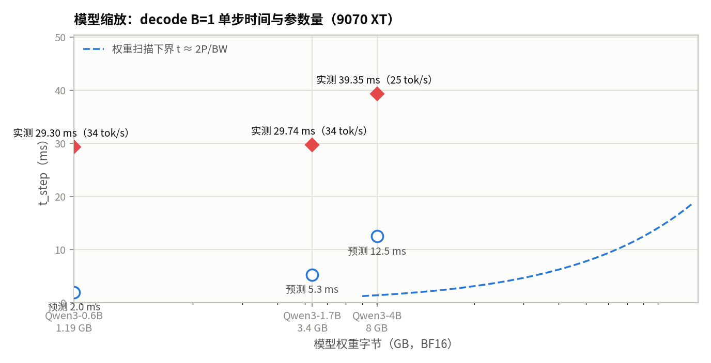
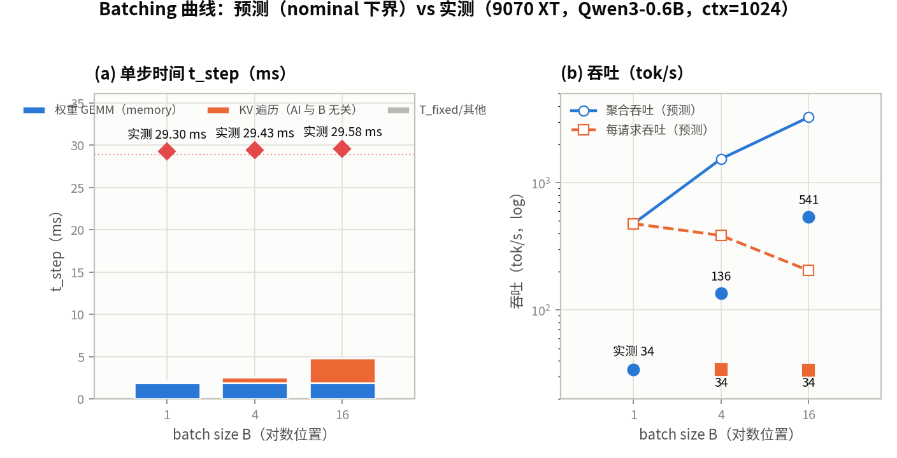
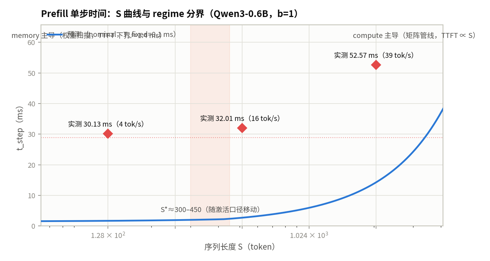

# 第 1 章 模拟器估算、Roofline 与瓶颈

::: danger ⚠️ Alpha内测版本警告
此为早期内部构建版本，尚不完整且可能存在错误，欢迎大家提Issue反馈问题或建议。
:::

## 本章导读

> 本章建立性能预测的第一层直觉：一个算子在给定硬件上的理论上限是多少，瓶颈落在计算还是访存。全书运转在两个飞轮上：**快飞轮**是解析模拟器——便宜、毫秒级、能穷举配置空间，但输出是"解析估计，不是测量"，不一定准（快飞轮由两个模拟器构成——广泛使用的参考模拟器 mlsysim 与自研的 msys-simulator，分工见本章"两个模拟器"一节）；**慢飞轮**是真机——昂贵、慢、资源有限，但它是裁决快飞轮预测、提供校准的地方。书的价值不在任何一个飞轮里，而在两者之间的**对账**：预测先留痕，只测信息量最大的少数点，残差归因到机制。本章是这两个飞轮的第一圈——nominal Roofline 模拟器（快）+ 9070 XT 上卡锚定（慢，不拟合）；"快飞轮不准"不是缺陷，量化并归因这些差距本身就是教学内容（§1.4 的 14 个锚定点）。读完后，你应该能先用模拟器给出预测，再带着预测去看真机数据。

## 教学目标

- 能写出 Roofline 模型 Attainable FLOPS = min(Peak FLOPS, AI × Peak Bandwidth) 的含义与适用边界；
- 能计算算子的算术强度，判断它是 Compute-bound 还是 Memory-bound；
- 能用模拟器预测矩阵乘、LayerNorm、FlashAttention 在目标卡上的瓶颈类型与时间量级；
- 能识别"看起来像 Compute-bound、实际受带宽限制"的算子，并解释直觉错在哪里。

## 两个模拟器：参考模拟器与自研模拟器

全书的"快飞轮"由两个模拟器支撑，角色不同——先分清再展开（§1.4 调用的"模拟器"即其中自研的那个）：

- **MLSys·im（mlsysim）—— 广泛使用的参考模拟器**。来自 Harvard CS249r 教材 [mlsysbook.ai](https://mlsysbook.ai)（Vijay Janapa Reddi 等，MIT Press，CC BY-NC-SA 4.0）配套的现成系统建模模拟器：roofline、372 个公式、102 份硬件参数档案；其 "The Math" 给出单步解析式 `T = max(compute, memory) + Dispatch_Tax` 的完整推导与效率 η 的典型范围。它是**广泛使用**的参考实现——本课程直接借它的方法与公式做 Roofline 解析层（§1.1 的 max 形式、§1.2 的计数口径、§1.3 的组件合成都从它的公式出发），并把它作为**参考模拟器**：学生手算与自研模拟器的输出都拿它对照，作为"解析层对不对"的第三方标尺。
- **mlsys-simulator —— 本课程自研的确定性 CPU 服务模拟器**。[私有仓库](https://github.com/eyuansu62/mlsys-simulator)、许可证待定、未发布 PyPI；核心无必需第三方运行依赖，**不执行真实 GPU 张量**，用确定性模型在 CPU 上推进服务过程。建模：请求到达、continuous batching、KV 内存压力、抢占与重算、TP/PP 切分（microbatch / stage 独立推进）、多副本路由与负载均衡、Prefix Cache、Chunked Prefill、混合 prefill/decode batching、可选 CPU KV swap；输出逐请求时间线、逐 rank 显存账本与服务指标（TTFT/TPOT/SLA）。其解析层与 mlsysim 同构——per-macro 的 FLOPs / HBM Bytes / launch 计数走同一套 Roofline 口径，§1.4 的 `simulate` / `predict` 与六元组契约调的就是它。

mlsys-simulator 的实验按**六元组契约**组织：`workload / infra / strategy / calibration / evaluation / execution`，其中 `calibration` 必须是显式参数（不得隐式）——这是全书"预测先留痕"纪律在接口层的落实。CLI 入口：`mlsys-sim simulate`（完整服务仿真）与 `mlsys-sim predict`（shape 分析：各 stage 成本、TP/P2P 通信、显存可行性、batch 上限；不含到达与排队，会显式报 `SHAPE_ANALYSIS_HAS_NO_ARRIVALS_OR_QUEUEING`），另有 `calibrate` / `compare` / `validate`。一次运行落盘 `manifest.json / result.json / requests.jsonl / events.jsonl / logs.txt` 五个产物（§1.4"模拟器接口与产物"的清单）；单位约定 ms、bytes、十进制 GB/s、TFLOP/s。

**v1.15 更新（2026-11-06）：量化权重/KV 存储。** 引入"声明式有效字节宽度"契约：`weight_bytes` / `kv_bytes` / `activation_bytes` 由用户显式声明（正数、≤ 8），例如 FP8/INT8 = 1.0、INT4/FP4 = 0.5，以及带 block/scale 元数据的 GPTQ-128 ≈ 0.515625、NVFP4 ≈ 0.5625、MXFP4 ≈ 0.53125（元数据由用户声明，绝不从标签推断）；字节账用精确 ceiling 算术，小数宽度不会低估物理字节。反量化开销显式建模，三档 `weight_dequant`：`none`（不建模）、`fused`（反量化 FLOPs 计入 GEMM）、`materialized`（单独一遍 `params × (weight_bytes + 2×activation_bytes)`，每层一次 launch，仅对 packed 存储有效）；`CalibrationSpec.dequant_flops_per_weight`（默认 1.0）控制强度，KV 反量化在 attention macro 内 on-the-fly 融合。dequant 模式进入 Profile 身份——量化实验不能复用非量化的 Profile。详见其 `docs/quantization.md`。这一更新让**第 4 章的精度实验**在模拟器侧有了对应能力（字节账 + 反量化开销），但注意下面的边界。

**边界（务必声明）**：mlsys-simulator **不做精度/质量建模**——量化只建字节账与反量化开销，不预测 PPL 或任何质量指标（精度只能真机/真模型裁决，第 4 章）；无 NVMe swap（仅可选 CPU KV swap）；真机 Profile 采集当前仅覆盖 BF16 域（live 捕获仍拒绝量化模型）；现有覆盖率不代表通用硬件准确率。因此它的输出永远是"确定性模型下的解析/模拟估计"，不是测量；与真机的对账飞轮自第 2 章起。

## 1.1 Roofline 模型

### 硬件的两条速度上限

一块 GPU 同时受两条互不相干的速度上限约束：

1. **计算上限**：每秒能执行多少 FLOP（Peak FLOPS，再乘以实际效率 η）；
2. **访存上限**：每秒能在 HBM 与计算单元之间搬运多少字节（Peak Bandwidth）。

一个算子 step 的耗时由两条上限中**先被触及的那条**决定——这两类资源是**并行**工作的，不是串联的：

```
t_step = max( FLOPs / (Peak FLOPS × η) ,  Bytes / Peak Bandwidth ) + T_fixed
         └────────── 计算项 ──────────┘  └──────── 访存项 ────────┘  └─ 固定开销（launch 等，本章未校准）
```

**取 max 而不是 sum** 是最容易搞错的一点。把两项相加等于假设"先把数据搬完、再算"；但实际执行中数据是一边读一边被消费的：如果计算先读完，计算单元就空转等数据，step 时间由较慢的那条决定，较快的那条被"浪费"了。参考课程（mlsysbook）把同一件事表述为："a step takes at least as long as its compute time or its memory-transfer time, whichever is larger"。

### 吞吐量视角：屋顶与拐点

把上式改写为"给定算子最多能跑多少 FLOPS"（两边对时间取吞吐），就得到 Roofline 的经典形式：

```
Attainable FLOPS = min( Peak FLOPS ,  AI × Peak Bandwidth )
```

其中 AI（arithmetic intensity，算术强度，§1.2 定义）是算子每搬运 1 字节所执行的 FLOP 数。min 的两个参数就是两条"屋顶"：

- AI 小时，访存先成为限制：可达成 FLOPS 随 AI 线性增长（屋顶的斜坡）；
- AI 大时，计算天花板先被触及：可达成 FLOPS 封顶在 Peak FLOPS（屋顶的平顶）。

两线交点即**拐点（ridge point / machine balance point）**：

```
AI* = Peak FLOPS / Peak Bandwidth
```

拐点左侧 memory-bound，右侧 compute-bound。同一硬件、同一个算子，仅仅因为 batch size 或序列长度不同，就可以在两条完全不同的区域之间移动：

```
        可达成 FLOPS
              │
    Peak ─────┤━━━━━━━━━━━━━━━━━━━  计算屋顶（AI ≥ AI*）
              │        ╱
              │       ╱
              │      ╱      访存斜坡（AI < AI*）
              │     ╱
              │    ╱
              │   ╱
              │  ╱
              │ ╱
              └─────────────────────────  AI (FLOP/byte)
              0            AI* = Peak/BW
```

参考课程的 ResNet-50/A100 例子（b=1，FP16）展示了"贴着拐点"的情形：AI≈146，A100 拐点≈153，访存项 0.028 ms 以微弱优势压过计算项 0.026 ms，两者都远小于 0.515 ms 的固定 dispatch 开销——"总时间大部分是开销，所以 batching 在这里收益巨大"。我们的主算例（decode B=1，AI≈1 vs AI*≈305）则远在拐点左侧，判定是稳健的，不依赖真实 kernel 的效率。两种位置（贴拐点 / 远离拐点）都要会读。

### 9070 XT 的两个拐点

注意：**Peak FLOPS 不是一个数**。算子走哪条计算管线（矩阵管线 / 向量管线）、用什么精度，决定了屋顶该用哪个峰值。9070 XT（T1，标称参数与来源见第 0 章 §0.2）至少有两个与本章相关的拐点：

| 计算路径 | Peak | 带宽 | 拐点 AI* |
| ---- | ---- | ---- | ---- |
| BF16 矩阵管线（GEMM / 线性层） | 195 TFLOPS | 640 GB/s | ≈305 FLOP/byte |
| FP32 向量管线（Element-wise / Norm 等） | 48.7 TFLOPS | 640 GB/s | ≈76 FLOP/byte |

即：GEMM 要到 AI≈305 以上才 compute-bound；Element-wise 算子通常 AI≈1–2，对着 ≈76 的向量拐点永远是带宽受限。**选对峰值是判定的一部分**，用错峰值（比如拿矩阵峰值去判 Norm）会得到错误结论。

把两条屋顶与本章用到的算子画在同一张图上（空心点 = nominal 下界预测，实心点 = 9070 XT 实测，§1.4 上卡锚定）：



读图：三个实心实测点全部落在对应屋顶之下（下界语义的实证）——matmul 4096³ 到达矩阵屋顶的 ≈67%（GEMM kernel 效率），LayerNorm 只跑到标称带宽的 ≈48%（小 kernel 未饱和），两个 attention 口径都远低于屋顶（fused 与 naive 的差距见 §1.4）。注意 attention 实心点的 AI（fused 256 / naive 85）与 §1.2 的 GQA 口径（AI≈343/93）不同：实测算子按 MHA 16/16 等头口径计数，两者同量级、同侧（拐点附近）。

### 标称（η=1）预测的含义：下界，不是预言

本章的模拟器全部运行在**标称参数**下（η=1、带宽取标称值）。这决定了如何阅读它的输出：

- `t = max(FLOPs/Peak, Bytes/BW)` 是**理论下界**：真实 kernel 不可能比它更快，只会更慢（η<1、launch 开销、调度气泡）；参考课程对同一结构有完全相同的表述——"both times use peak rates (efficiency η = 1 and full bandwidth), so they are lower bounds"；
- η 是**校准对象**：第 2 章在校准集上拟合它（或等价修正系数），在留出集上检验泛化；本章不拟合，只声明；
- 因此模拟器输出是**解析估计，不是测量**（证据级别 `simulated`，见第 0 章 §0.4）。它的价值不在于给出精确毫秒数，而在于把约束显式化：参考课程对解析模拟器的承诺是——"outputs are analytical estimates, not measurements"，"the most reliable conclusions are binding constraints, crossover points, and sensitivity rankings"（最可靠的结论是约束绑定关系、交叉点与敏感度排序）。本章的输出按这个标准验收：瓶颈判定、交叉点（B\*、S\*）、配置间的相对排序，而不是绝对时间。

本章所有预测均标记 `calibration=nominal`。真实推理相对理想下界通常慢 1.5–2 倍（参考课程的实测范围），误差方向可预期（系统性偏大）——这正是第 2 章校准的入口。

### 与第 0 章 Iron Law 的关系

第 0 章 §0.1 的 Iron Law 是 **sum 形式**：`T ≈ D/BW + O/(R·η) + L`。它适用于**串联**的阶段（先搬数据、后计算，例如一次完整调用的端到端流程）。Roofline 是 **max 形式**：适用于**并行**的资源（单个 kernel 执行期间计算与访存同时进行）。两者不矛盾，模拟器按层次组合：

```
组件内部：  t_c = max(t_compute, t_memory)    （资源并行）
组件之间：  t_step = Σ t_c + T_fixed          （kernel 按层序串联执行）
```

为什么"组件间必须相加"而不是再取一次 max，§1.3 用算例说明。

### 适用边界

Roofline 是**单算子模型**，用它时假设要显式声明：

1. **单算子、无重叠**：假设该算子独占 GPU。真实系统中 kernel 可重叠、多 stream 并发，单算子 Roofline 只是 step 的一阶近似；
2. **Bytes = HBM 流量**：cache（L1/LLC）命中会减少真实 HBM 流量。标称模拟器按"未融合、无缓存复用"口径计数（§1.2 冻结口径）；口径与真机的差距属于校准误差的一部分，不是模型错误；
3. **峰值是上限，不是当前 kernel 的实际上限**：即便 compute-bound 的算子，实际也远低于峰值（η 常远低于 1）。Roofline 回答"瓶颈在哪里"，不回答"还有多少优化空间"；
4. **模型级判定必须由组件级判定合成**：不能把整个模型当成一个算子套 Roofline——不同组件绑定的资源不同，模型级 t_step 是组件级结果的合成（§1.3）。

### 口径提示：memory-bound ≠ 显存不足

Roofline 文献把拐点左侧的区域叫 "memory-bound"。本书沿用该词：**memory-bound 指"带宽成为瓶颈"（bandwidth-bound），不是"显存容量装不下"（capacity / OOM）**。参考课程特意改用 "bandwidth-bound" 一词，就是为了把它与容量耗尽区分开。容量账（什么放得下）是另一本账，放在第 3 章；本章只回答"多快"。

## 1.2 算术强度与瓶颈判定

### 定义与计数口径

算术强度（arithmetic intensity）：

```
AI = FLOPs / Bytes
```

- **FLOPs**：算子执行的浮点运算数。口径：**1 次 FMA（乘加）= 2 FLOPs**；
- **Bytes**：该算子本 step 在 HBM 与计算单元之间**搬运**的字节数（读 + 写），**不是数据在显存里的占用量**。参考课程强调这一区分：它"是建模的传输量，不是存储的参数占用"（modeled transfer volume, not the stored parameter footprint）。权重表占 1.19 GB，decode B=1 时 GEMM 把它读一遍 = 1.19 GB；B=16 时仍然只读一遍 = 1.19 GB（多出的字节来自激活与 KV，不来自权重）。

计数口径全书冻结，模拟器与手算共用同一套：

| 口径 | 约定 |
| ---- | ---- |
| 1 次 FMA | 2 FLOPs |
| BF16 元素 | 2 bytes |
| Bytes 计 | 本 step HBM 读 + 写：权重 + KV + 激活流量 |
| 寄存器 / 片上共享内存中的中间结果 | **不计入**（这正是 FlashAttention 的意义） |
| GEMM M×N×K | FLOPs = 2·M·N·K；权重 = 2·N·K B；激活入 = 2·M·K B，出 = 2·M·N B |

### 三类算子的公式

以 Qwen3-0.6B 配置（28 层，hidden 1024，16 q 头 / 8 kv 头，head_dim 128 → d_q = 2048，d_kv = 1024；参数与来源见第 0 章 §0.2）给出三类宏观组件的 per-step 公式。

**① GEMM 类（QKV/O 投影 + FFN 线性层）**

Decode（M = B 个 token）：

```
FLOPs ≈ 2·P·B        （P = 参与本 step GEMM 的参数数，0.6B ≈ 596M，含 LM head）
Bytes ≈ 2·P          （全量权重扫描，与 B 无关）+ O(B) 激活流量
AI(B) ≈ B            ← 核心恒等式：权重复用次数 = batch size
```

这是本章最重要的结论：**decode GEMM 的算术强度约等于 batch size**。B=1 → AI≈1；B=16 → AI≈16；对照 9070 XT 矩阵拐点 ≈305，全部 memory-bound。step 时间被钉在权重扫描时间 ≈ 2P/BW 上。交叉点 B\* ≈ AI\* ≈ 305：单卡 decode 要到 B≈300 量级，GEMM 才翻转为 compute-bound。

Prefill（M = S 个 token，单请求）：

```
FLOPs ≈ 2·P_linear·S    （P_linear = 每 token 线性参数，0.6B ≈ 440M；LM head 仅末 token，忽略）
Bytes ≈ 2·P_linear + O(S) 激活流量    （权重仍只读一遍）
AI(S) 随 S 线性增长
```

存在交叉序列长 S\*（0.6B / 9070 XT：S\* ≈ 300–400，§1.3 算例；随激活流量口径移动 ±30%——口径必须冻结，否则交叉点漂移）：S < S\* memory-bound（权重扫描主导），S > S\* compute-bound（矩阵管线主导）。**同一个模型，短 prefill 带宽受限、长 prefill 计算受限**——prefill/decode 两种 phase 的硬件行为差异从这里开始。

**② Attention 类**

Prefill（稠密 attention，b=1，S token，L 层）：

```
FLOPs ≈ 4·S²·d_q·L        （QK^T 与 Softmax·V 各贡献 2·S²·d_q）
Bytes ≈ 2·S·(2d_q + 2d_kv)·L    （读 Q/K/V + 写 O；不计 S² 中间结果）
AI ≈ 0.67·S               （0.6B 配置代入 d_q=2048, d_kv=1024）
```

- S=512 → AI≈341，贴着拐点 305 上方 → compute-bound（贴边）；
- S=128 → AI≈85 < 305 → memory-bound。此时 S² 项太小：attention 仅 ≈3.8 GFLOP，而同 step 的 GEMM ≈113 GFLOP——瓶颈仍在权重扫描。这是**短序列 prefill 陷阱**：直觉上"prefill 是 S² 计算，一定 compute-bound"，但 S=128 时不成立。

大 S 方向上还有第二个陷阱，FlashAttention 直接针对它：若把 S×S attention 矩阵物化进 HBM（naive 实现，写一遍读一遍），则

```
Bytes_naive ≈ 2·n_heads·S²·2·L（attention 矩阵读写）+ 上式线性项
AI_naive → 0.5 FLOP/byte   （S → ∞ 的有界上限）
```

naive attention 无论 S 多大都**钉死在访存斜坡上**。FlashAttention 用 tiling + recomputation 把 S² 中间结果留在片上：FLOPs 多约 13%（重算代价），HBM 流量降约 9 倍。参考课程（CMU 15-442 Week 5）的 A100 实测对照：标准 attention 66.6 GFLOPs / 40.3 GB / 41.7 ms，FlashAttention 75.2 GFLOPs / 4.4 GB / 7.3 ms——**多花 13% 的 FLOPs，省 9 倍访存，快 5.7 倍**。这是 Roofline 最经典的应用：花计算换访存，把算子从拐点左侧推到右侧。

Decode（B 个请求，上下文 S_ctx，GQA：d_q/d_kv = 2）：

```
FLOPs ≈ 4·B·S_ctx·d_q·L
Bytes ≈ 2·B·S_ctx·d_kv·2·L     （KV Cache 遍历，每请求读一遍）
AI = d_q/d_kv = 2   （0.6B；与 B、S_ctx 均无关）
```

与 GEMM 的关键对照：**decode attention 的 AI 与 B 无关**——FLOPs 与 KV 流量随 B 同倍增长。batching 救得了 GEMM（AI：1→16），救不了 KV 遍历（恒 AI≈2）。这是 GQA 设计的基本动机之一（压 d_kv 缩短 KV 扫描），也是"KV 扫描成本"在后续章节反复出现（KV 量化、prefix cache）的屋顶线根源。

**③ Element-wise / 向量类（RMSNorm、RoPE、激活函数）**

```
FLOPs ≈ O(1) FLOP/元素；Bytes ≈ 2 bytes/元素（读 + 写）
AI ≈ 1–2
```

对照向量管线拐点 ≈76，此类算子**恒为带宽受限**，时间按带宽下界估算（t ≈ Bytes/BW）。单步时间很小（<10 μs 量级），但它是 batching 消不掉的固定项，在极小 batch 时构成 step 下界的一部分。

### 判定规则与交叉点

给定算子，瓶颈判定的完整流程：

1. 选对计算管线（矩阵 / 向量）→ 取对应峰值与拐点 AI\*；
2. 按冻结口径算该算子的 AI；
3. AI < AI\* → memory-bound，t ≈ Bytes/BW；AI > AI\* → compute-bound，t ≈ FLOPs/Peak（均为标称下界）；
4. **逐组件判定，再合成 step**——模型级"判定"是组件级判定的合成，不是模型级的一个 AI（§1.3）。

模型最有价值的输出不是单个数字，而是**交叉点与敏感度排序**：9070 XT 上 decode GEMM B\*≈305、prefill GEMM S\*≈300–400、ctx=1024 时 batching 的成本被 KV 扫描接管（§1.3 算例 B）。每个交叉点都是后续设计决策（batch 开到多大、是否分离 prefill/decode、KV 是否量化）的直接输入，第 7、9 章会用到这些数字。

## 1.3 计算时间量级估算

### 从 AI 到时间：组件内 max，组件间 sum

对每个组件 c：

```
t_c = max( FLOPs_c / (Peak_c × η) ,  Bytes_c / BW )    （η=1 标称）
t_step = Σ_c t_c + T_fixed                             （T_fixed：launch 开销，本章未校准）
```

为什么"组件内 max、组件间 sum"是正确结构，而不能对整段取一次 max：组件（各层 GEMM、attention、norm）作为 kernel **按层序串联执行**，step 时间至少是各组件时间之和；组件内部计算与访存**并行**，取 max。对全 stage 的总 FLOPs 与总 Bytes 取一个 max，等于假设所有组件的计算与访存彼此完全重叠。数学上恒有

```
Σ_c max(t_comp_c, t_mem_c)  ≥  max( Σ_c t_comp_c ,  Σ_c t_mem_c )
```

两边相等**当且仅当所有组件绑定同一资源**（全 memory-bound 或全 compute-bound）。一旦有组件跨过拐点、绑定资源不同，stage 级 max 就系统性偏小——偏小的量正是各组件中"被并行浪费掉的较快那一项"之和。本卡的 decode 恰好全 memory-bound（两边相等，见算例 A/B），但 prefill step（GEMM 与 attention 分处拐点两侧，见算例 C）和 B>B\* 的大 batch decode 都会打开这个差距。模拟器的 per-component 结构（Gist 开发计划 ①②：每组件输出 FLOPs/Bytes/AI/判定/t）就是为这个合成而存在的。

量级纪律：本章输出一律保留 1–2 位有效数字 + 数量级，并始终标注"离硬件极限还有多远"（t / 下界 ≥ 1，差距即 η 与工程优化的空间）。

### 算例 A：Qwen3-0.6B decode B=1（ctx=1024）——组件表

在第 0 章 §0.5.3 纸面演练（权重扫描 1.19 GB、KV 112 KiB/token、t_step≈2.0–2.3 ms）基础上，补全 AI 与判定：

| 组件 | FLOPs | Bytes (HBM) | AI | t_comp (μs) | t_mem (ms) | t_c (ms) | 判定 |
| ---- | ---- | ---- | ---- | ---- | ---- | ---- | ---- |
| GEMM（线性层 + LM head） | 1.19e9 | 1.19e9 | 1.0 | 6.1 | 1.86 | 1.86 | memory |
| Attention（QK^T + Softmax·V） | 2.3e8 | 1.17e8（KV 遍历） | 2.0 | 1.2 | 0.18 | 0.18 | memory |
| Element-wise（RMSNorm/RoPE/SiLU） | <1e7 | <1e6 | 1–2 | <0.1 | <0.002 | ≈0 | memory（带宽下界） |
| **t_step（标称下界）** | | | | | | **≈2.05 + T_fixed** | 全组件 memory-bound |

- t_step ≈ 2.0–2.3 ms（含未校准 T_launch），上限 ≈430–500 tok/s——与第 0 章纸面演练一致（1.85/1.86 为同一数值的不同舍入口径），但每个数字背后现在都有 AI 与判定；
- 结论：decode B=1 **完全 memory-bound**，step 时间 91% 被权重扫描钉住（1.86 / 2.05 ms）。能改变这一项的只有两条路：减少每权重字节数（量化，后续章节）或提高权重复用次数（batching，算例 B）。

模型缩放（同卡，B=1，ctx=1024，权重扫描下界 t ≈ 2P/BW）：

| 模型 | 权重字节 | t_step 下界 | 上限吞吐 |
| ---- | ---- | ---- | ---- |
| Qwen3-0.6B | 1.19 GB | ≈2.0 ms | ≈430–500 tok/s |
| Qwen3-1.7B | ≈3.4 GB | ≈5.3 ms | ≈180–190 tok/s |
| Qwen3-4B | ≈8.0 GB | ≈12.5 ms | ≈80 tok/s |

decode 上限吞吐 ∝ 1/P：**同一张卡上，decode 吞吐与参数量成反比**——这是屋顶线层面的"为什么小模型在消费级卡上 decode 快"。



三个模型的实测点（红钻）全部落在 2P/BW 下界线之上，但彼此间距远扁于下界线：实测 4B/0.6B = 39.3/29.3 = 1.34×，而权重字节比是 8.0/1.19 = 6.7×。eager 协议下 decode 单步 wall 由 kernel 数（层数：36/28 = 1.29×）与每 kernel CPU dispatch（T_launch）决定，GPU 饥饿（§1.4 上卡锚定诊断）——"模型放大 k 倍 → step 变慢 k 倍"是**去掉 launch 开销后的 GPU 侧关系**，本图实测点恰好把它暴露出来。

### 算例 B：batching 曲线——成本被 KV 扫描接管

0.6B，ctx=1024，9070 XT，标称。组件时间：GEMM t_mem ≈ 1.86–1.91 ms（t_comp = 6–98 μs，始终远小于 t_mem）；KV 遍历 t = 0.18 / 0.73 / 2.94 ms；Element-wise 忽略。step = 组件 sum：

| B | GEMM AI | KV 字节 | t_step (ms) | 聚合吞吐 | 每请求吞吐 |
| ---- | ---- | ---- | ---- | ---- | ---- |
| 1 | 1.0 | 117 MB | ≈2.1 | ≈480 tok/s | ≈480 tok/s |
| 4 | 4.0 | 469 MB | ≈2.6 | ≈1,540 tok/s | ≈385 tok/s |
| 16 | 16 | 1.88 GB | ≈4.9 | ≈3,300 tok/s | ≈206 tok/s |

读表（敏感度排序——模型最可靠的输出）：

1. **B=1→16，聚合吞吐 ×6.8**：GEMM 被 batching 救起（AI 1→16，权重字节复用 16 倍）——decode batching 的第一杠杆，也是第 7 章 continuous batching 直觉的屋顶线来源；
2. **每请求吞吐单调下降（480→206）**：ctx=1024 不算短，KV 扫描（AI 与 B 无关）随 B 线性增长；B=16 时 KV 字节（1.88 GB）已超过权重字节（1.19 GB），成为 step 的主要成本；
3. **stage 级"AI≈B"在这里会误导**：把整个 decode step 的 AI 写成 ≈B、得出"B=16 仍远低于 305，所以整体还是 memory-bound"，无法解释每请求吞吐为何塌掉——必须把 GEMM 与 Attention 拆开，成本结构才可见。这正是 per-component 输出（而非 stage 级一个 max）的教学理由。



实测（红钻/实心点）验证了表的**形状**读数：聚合吞吐随 B 上升（34→136→541 tok/s）、每请求吞吐单调下降（34.1→33.8 tok/s）。但实测 t_step 近乎平坦（29.3→29.6 ms）：eager 协议下 T_launch 主导单步 wall，表内预测的 "B=16 时 KV 扫描接管"（2.1→4.9 ms）被压缩进 GPU 侧 12–13 ms 的时间尺度里，压不过 T_launch 地板（归因与诊断见 §1.4 上卡锚定）。GPU 侧趋势未被推翻，只是在本协议下不可见。

### 算例 C：prefill S 曲线与 phase 不对称

0.6B，b=1，9070 XT，标称。GEMM 用 P_linear≈440M；激活流量按**未融合 kernel** 口径计数（约 0.8 MB/token），S\* 会随融合口径在 300–450 之间移动——口径冻结后该移动才成为可解释的校准项：

| S | GEMM t_comp | GEMM t_mem | GEMM 判定 | Attention t | t_step ≈ | step 判定 |
| ---- | ---- | ---- | ---- | ---- | ---- | ---- |
| 128 | 0.58 ms | ≈1.4–1.5 ms | memory | 0.07 ms（memory） | ≈1.5 ms | **memory**（权重扫描） |
| 512 | 2.3 ms | ≈2.0 ms | compute（贴边） | 0.31 ms（compute，AI≈341） | ≈2.7 ms | **compute**（GEMM） |
| 2048 | 9.3 ms | ≈4.0 ms | compute | 4.9 ms（compute，AI≈1365） | ≈14 ms | **compute** |

- 交叉点 **S\*≈300–450**：其下 prefill 同样被权重扫描钉住（TTFT 下界 ≈1.4 ms，与 S 几乎无关）；其上进入矩阵管线（TTFT 下界 ∝ S）；
- **phase 不对称**：同一个 0.6B，decode（B∈{1,4,16}）全 memory-bound，prefill S≥512 全 compute-bound。prefill 与 decode 是硬件利用率的两种不同 regime——"PD 分离"（分离 prefill/decode，第 9 章）的屋顶线动机在此；
- 量级换算：prefill S=512 ≈ 2.7 ms（η=1 下界）；取 η≈0.4（参考课程推理典型范围 0.35–0.5）则 ≈6–7 ms，prefill 速率 ≈ 70–100 tok/s（标称估计，测前记录）。



实测点（红钻）坐落在 ≈30 ms 的 launch 地板上（与 decode 同源：eager 全模型 forward ≈1591 kernels/step、CPU dispatch ≈29 ms，§1.4 诊断），S=128 与"1.5 ms 下界"并不重合——短 prefill 贴着权重扫描下界这一 regime 结构在 **GPU 侧增量**上依然成立：S=128→2048 实测 30.1→52.6 ms（增量 22.4 ms）≈ η=1 下界增量（≈12.5 ms）的 1.8×，即 GPU 侧 ~1.8× 下界，量级与 kernel 效率 η + 口径差一致（regime 分界 S\*≈300–450 在增量上不变；归因见 §1.4 上卡锚定）。

### 预测留痕

本章产生的每个预测（以上全部算例 + §1.4 模拟器实验的全部点）按第 0 章 §0.5 底稿模板记录：

```
prediction_id: pred_ch1_<experiment_id>_<config_id>
calibration_version: nominal
stored_at: <ISO 时间戳，必须先于第 2 章测量开始>
metrics: { 每组件 FLOPs/Bytes/AI/判定/t_c, t_step, 吞吐上限, ... }
```

本章预测以 nominal 为基准。**留痕必须先于测量**：§1.4 的上卡锚定按 config_id 对照实测（先记录后测量，同一纪律）；第 2 章同配置上真机做 η 校准时，按 config_id 查回这些记录得到预测值。先看了测量值再拟合只算回拟合，不算验证（§0.3 纪律）。

## 1.4 模拟器实验：预测典型算子的瓶颈与时间

本章主体实验在模拟器上完成（nominal 参数；真机 η 拟合与 Profile 自第 2 章开始）。实验分两个任务：**任务 1** 用 step 级宏分解覆盖 Qwen3 三个规模的 prefill/decode 配置（§1.2/§1.3 公式的执行版）；**任务 2** 用三个 primitive 算子建立"直觉 vs 判定"的校准练习。此外，**上卡锚定**一节在 9070 XT 上完成一组实测：不拟合 η，只验证 nominal 预测是"下界"（实测 ≥ 预测）、给出 η 与口径差距的量级，并为本章配图提供实测点。

### 实验设置

| 项 | 内容 |
| ---- | ---- |
| 模型 | Qwen3-0.6B / Qwen3-1.7B / Qwen3-4B（BF16，config 以 HF 仓库为准，§0.2 硬件表） |
| 硬件 | RX 9070 XT 16GB（T1，标称参数完整）；W7900D（T4，48 GB，≥4 卡，算力/带宽/互联参数待确认——T4 行走 CPU 预测路径，全部结论标注"待确认参数"，不混入 T1 结论） |
| 负载 | **离线 batch**（负载定义见 Ch0 §0.3）：prefill b=1，S∈{128, 512, 2048}；decode B∈{1, 4, 16}，平均 ctx=1024（closed-loop，与模拟器一致） |
| 校准 | calibration=nominal（标称参数，η=1，T_fixed 未校准） |

**轴从哪来**（负载定义见 Ch0 §0.3，本表是其"离线 batch"形式的具体取值）：离线 batch 没有到达时间，用**轴**而非逐条 trace 描述——可问的是"把某根轴扫过去，性能怎么变"。`S`（prefill 输入长度）取 128 / 512 / 2048：从短（S 增量尚小、发射地板占主导）到长（进入 compute-bound、S² attention 项显现），跨两个数量级、接近 2 的幂，正好覆盖"短 / 中 / 长"三档 prefill regime。`B`（decode batch）取 1 / 4 / 16：B=1 是 AI≈1 的纯 memory-bound 单点（§1.2 decode GEMM 的直觉陷阱），B 向 16 抬升演示"batching 把 GEMM 从 memory 斜坡推向 compute 屋顶"（AI≈B），但 ctx=1024 固定后 B 增大又让 KV 扫描开始接管——三点恰好跨"batching 救 GEMM"与"KV 接管"两个机制区，为第 7 章 continuous batching 埋下这根轴。`ctx=1024` 固定，保证各 decode 点同 ctx 可比。**这些是扫描轴，不是在线到达**——在线到达（到达间隔分布 + 输入/输出长度分布）与容量拐点在第 7 章用 DES 处理（Ch0 §0.3 负载定义的前向链接）。

### 任务 1：step 级宏分解（per-component 输出）

对每个 (模型, 配置) 点，把单 step 拆成三类组件并分别预测：

| 组件类 | 覆盖算子 | 预测口径 |
| ---- | ---- | ---- |
| GEMM | QKV/O 投影 + FFN 线性层（含 LM head） | §1.2 ①：FLOPs≈2·P·B（decode）/ 2·P_linear·S（prefill），Bytes≈权重字节（decode B≤B\*） |
| Attention | QK^T + Softmax·V（FlashAttention 口径） | §1.2 ②：prefill FLOPs≈4S²d_qL；decode FLOPs≈4B·S_ctx·d_qL，Bytes 含 KV Cache 遍历访存 |
| Element-wise | RMSNorm / RoPE / SiLU / 残差加法 | 带宽下界估算：t ≈ Bytes/BW，AI≈1–2 恒 memory-bound |

每组件在 result.json 中输出固定字段集（Gist 开发计划 ②）：

```json
{
  "component": "gemm | attention | elementwise",
  "flops": 0.0, "bytes": 0.0, "ai": 0.0, "ridge": 0.0,
  "bound": "compute | memory",
  "t_compute_ms": 0.0, "t_memory_ms": 0.0, "t_ms": 0.0
}
```

step 级再输出 t_step（= Σ t_ms + T_fixed 口径）与整体 FLOPs/Bytes/AI——**整体 AI 仅作参考展示，不得用于瓶颈判定**（算例 B 的第 3 条：stage 级 AI≈B 会掩盖 KV 接管）。

判定核对：每个组件的 `bound` 必须与 §1.2 手算判定一致；不一致即为模拟器计数 bug（不是"测量误差"），归因并修正后重跑。

### 任务 2：三个 primitive 算子——直觉校准

9070 XT 标称参数下，对三个代表性算子做"先猜判定，再算 AI"的练习：

| 算子 | FLOPs | Bytes | AI | t_comp (ms) | t_mem (ms) | 判定 | 先直觉猜什么 |
| ---- | ---- | ---- | ---- | ---- | ---- | ---- | ---- |
| matmul M=N=K=4096，BF16 | 137.4 GFLOP | 100.7 MB | ≈1365 | 0.70 | 0.16 | **compute** | compute（对） |
| LayerNorm S=2048, d=1024，BF16 | ≈8.4 MFLOP | ≈8.4 MB | ≈1 | <0.001 | 0.013 | **memory** | memory（对） |
| FlashAttention S=512（Qwen3-0.6B，28 层全模型） | ≈60 GFLOP | ≈174 MB | ≈343 | 0.31 | 0.27 | **compute**（FA，贴边）；naive 版 ≈1.0 ms **memory** | 容易猜错 |

第三个算子是本章直觉校准的关键（§1.2 ② 的 CMU A100 表是同一现象的公开数据）：attention S=512 的 FLOPs（~S² 项）不低（60 GFLOP），但 naive 实现还要读写 S×S 注意力中间矩阵（S=512 上额外 ≈472 MB），把 Bytes 推到 ≈646 MB、AI 掉到 ≈93——远低于 305 拐点，memory-bound（§1.2 的 AI→0.5 是它的 S→∞ 渐近值，S=512 还没到那里）。FA 用 tiling + 重计算消掉这块 S² 读写（CMU A100 表实测访存 ÷9），把算子**从 memory 斜坡推上 compute 屋顶**：本模型 S=512 上 646→174 MB、AI 93→343。先猜"attention 很重 FLOPs，应该 compute-bound"、再算出 naive 版 AI≈93 仍 memory-bound 的人，恰好完成了教学目标 4 的练习。

**decode GEMM B=1 是第二个直觉校准算子**：它每 step 的 FLOPs 就是模型的总 FLOP 计数（0.6B 上 1.19 GFLOP/step），直觉上"每 step 都在做全部乘法"像 compute-bound；实际 AI≈1 ≪ 305，纯 memory-bound，被 1.86 ms 权重扫描钉死。两个校准算子互为镜像——decode GEMM：FLOPs 不小、AI 很小；naive attention：FLOPs 不小、访存被 S² 项撑爆。直觉错处的共同点：**数了 FLOPs，没数"这些 FLOPs 复用了多少字节"**。

### 上卡锚定（9070 XT 实测锚点）

**目的**（与第 2 章校准的区别）：不拟合 η（校准集/留出集协议属于第 2 章）。本节做三件事：① 验证 nominal 预测是**下界**（逐点检查实测 ≥ 预测）；② 量化差距的量级与归因（kernel 效率 / 软件开销 / 口径差 / launch 开销）；③ 为本章 4 张配图提供实测点。

**环境**：宿主机 ROCm（本机唯一 docker 镜像 python:3.12-slim 无 ROCm 运行时，故用宿主 torch）——python 3.13.11 / torch 2.16.0.dev+rocm10.1 / transformers 5.16.1；AMD Radeon RX 9070 XT 15.9 GiB（本机 device 1，`HIP_VISIBLE_DEVICES=1` 重映射为 0）；模型 `/mnt/public/models`（Qwen3-0.6B/1.7B/4B），BF16，`attn_implementation="sdpa"`。

**SDPA 口径**：ROCm fused kernel 要求等头数 dense 输入；Qwen3 是 GQA 16q/8kv → transformers 先 `repeat_kv` 把 K/V 展开到 16 头再走 MHA fused 路径（backend 探测：展开后 flash/efficient/math 均可用、cudnn 不可用；未展开的 GQA dense 输入直接被 fused 拒绝）。repeat_kv 展开的每步额外 HBM 流量（decode B=1，ctx=1024）：读原 KV ≈117 MB + 写展开 KV ≈235 MB ≈ 352 MB/step ≈ 0.55 ms（名义 640 GB/s）——名义 FA 口径预测**未计入**的口径差，下表归因项之一。

**协议**（Ch0 §0.3）：ops/decode warmup 10 + 50 采样 × 3 轮；prefill warmup 3 + 10 × 3；seed 42；`torch.cuda.Event` 逐步计时 + 每步 sync；decode 闭环（每 32 步用同 seed 输入重新 prefill 重置 cache，采样窗口 [ctx+1, ctx+32]）；报中位数，3 轮 = 方差（消费级卡 boost 时钟：run 内 <7%，run 间 ~5–30%）。脚本 `bench_ops.py` / `bench_qwen.py` / `diag_launch.py`，产物 `results/ops_9070xt.json` / `qwen_9070xt.json` / `launch_diag_9070xt.json`。

**预测 vs 实测**（预测 = §1.3/任务 2 冻结的 nominal 值，T_fixed=0；**14 点全部实测 ≥ 预测，下界语义成立**）：

| config_id | 预测 (ms) | 实测 (ms) | 比值 | 归因 |
| ---- | ---- | ---- | ---- | ---- |
| matmul 4096³ BF16（op） | 0.70（compute） | 1.06 | 1.5× | GEMM kernel 效率：130/195 TFLOPS，η_gemm≈0.67 |
| LayerNorm S=2048（op） | 0.013（memory） | 0.027 | 2.1× | 小 kernel 未饱和带宽：307/640 GB/s = 48% |
| attention fused 28L S=512（op） | 0.31（FA 口径） | 1.63 | 5.3× | MHA 16/16 口径 + kernel 效率 + launch 开销 |
| attention MATH 28L S=512（op） | 1.0（naive 口径） | 15.31 | 15.3× | 软件墙：S×S 物化 + softmax 多趟 + bmm 低效（全模型 3.9 TFLOPS） |
| fused / MATH | — | 9.4× | — | FA vs naive 的本地锚点（CMU A100 公开值 5.7×） |
| decode-B1-ctx1024 · 0.6B | 2.0 | 29.30 | 14.7× | T_launch 主导（下方诊断）；GPU 侧 12.3 vs 2.0 ms |
| decode-B4 · 0.6B | 2.6 | 29.43 | 11.3× | 同上：t_step 对 B 近平坦 |
| decode-B16 · 0.6B | 4.9 | 29.58 | 6.0× | 同上 |
| decode-B1 · 1.7B | 5.3 | 29.74 | 5.6× | t ∝ 层数（28L），不 ∝ 权重字节 |
| decode-B1 · 4B | 12.5 | 39.35 | 3.1× | t ∝ 层数（36L）：39.3/29.3 = 1.34 ≈ 36/28 |
| prefill-S128 · 0.6B | 1.5 | 30.13 | 20.1× | ≈30 ms launch 地板 + S 相关增量 |
| prefill-S512 · 0.6B | 2.7 | 32.01 | 11.9× | 同上 |
| prefill-S2048 · 0.6B | 14 | 52.57 | 3.8× | 增量 22.4 ms ≈ 1.8× η=1 增量（12.5 ms） |
| prefill-S512 · 1.7B | ≈7.8（补记） | 37.46 | 4.8× | 同上 |
| prefill-S512 · 4B | ≈18.5（补记） | 62.44 | 3.4× | 同上 |

（"补记"行不在 18 个冻结配置点内，按 §1.3 同一公式（GEMM max + attention FA 口径 + T_fixed=0.1 ms）即得，属补记预测——留痕纪律的例外项，显式标注。）

算例 A 的 "2.0–2.3 ms（含未校准 T_launch）" 现在可以具体化：T_launch（eager）≈ 28.9 ms，比当时假设的舍入项大一个数量级。

**为什么 decode 是 29 ms：T_launch 诊断**（`diag_launch.py`，0.6B B=1）：实测 decode t_step 对 B 与参数量都近乎平坦（29.30/29.43/29.58；1.7B 29.74；4B 39.35）——若 GPU 侧（权重扫描）主导，4B 应是 0.6B 的 6.7×、B=16 应是 B=1 的 2.4×，均不成立。三个测量互相印证：每步 sync 28.9 ms ≈ burst（仅一次 sync）28.7 ms ≈ 纯 CPU enqueue 29.5 ms；`torch.profiler` 数出**单步 1591 个 CUDA kernel**，GPU self 时间合计仅 12.3 ms（≈wall 的 42%）。归因：每 kernel CPU dispatch ≈18.6 μs vs GPU 执行 ≈7.7 μs——eager 全模型步是 **CPU kernel 发射受限（GPU 饥饿）**，实测 wall ≈ CPU 发射速率，而不是 GPU 屋顶线。这就是 §1.1 T_fixed 项在全模型 eager 步上的实现：~19 μs × 1591 kernels ≈ 29 ms，不是零头。GPU 侧 12.3 ms 本身也 ≈6× nominal 2.0 ms 下界（repeat_kv 口径差 ≈0.55 ms + kernel 效率 + 小 kernel 效率）。推理框架用 CUDA Graphs / compile 消除这部分开销（第 2 章及以后）；本锚点只记录 "eager 协议下 T_launch 主导"，不改 GPU 侧屋顶线结论——也提示第 2 章的 η 校准应针对**去除 T_launch 后的 GPU 侧时间**（或显式建模 T_launch）。

**未覆盖**：W7900D（参数待确认，TODO 嘉航）；18 个模拟器配置点仍 paper-only（"手算对模拟器"待执行）；CUDA Graphs / torch.compile 口径（第 2 章起）。

### 模拟器接口与产物

本节接口属于自研模拟器 msys-simulator（两个模拟器的角色与分工见本章"两个模拟器"一节）。按第 0 章 §0.4 六元组契约调用（calibration 显式传参，不得隐式）：

```
simulate(workload, infra, strategy, calibration="nominal", evaluation, execution)
  → manifest.json / result.json / requests.jsonl / events.jsonl / logs.txt
```

本章用到的预测接口（Gist 开发计划 ③：calibration 必须是显式参数）：

```
predict_prefill(batch_tokens=S, model_spec, device, calibration="nominal")
predict_decode_step(batch_size=B, context_lengths=[1024]*B, model_spec, device, calibration="nominal")
```

每个配置点的输出含 prediction_id 与 stored_at（§1.3 预测留痕），写入实验底稿（`docs/public/part0-intro/chapter0/experiment-draft.yaml` 模板），先于第 2 章任何测量。

### 手算对模拟器：第一条"预测对预测"校准记录

重跑第 0 章 §0.5.3 的纸面演练场景（0.6B decode B=1 ctx=1024），两列对照：

| 指标 | 手算（§0.5.3 / §1.3） | 模拟器 nominal（待执行，填入） | 9070 XT 实测（eager，§1.4） |
| ---- | ---- | ---- | ---- |
| t_weight (ms) | 1.85 | <待执行> | 不拆分（GPU 侧 12.3 ms 含全部 kernel） |
| t_attn_kv (ms) | 0.18 | <待执行> | 不拆分 |
| t_step (ms) | 2.0–2.3（含未校准 T_fixed） | <待执行> | 29.30（T_launch 主导） |
| 吞吐上限 (tok/s) | 430–500 | <待执行> | 34 per-request / 541 聚合（B=16） |

两侧同为 nominal，**应一致到计数口径级**：若差值非零，是模拟器的计数/公式 bug（哪个组件的 FLOPs 或 Bytes 公式写错），按"归因 → 修正 → 重跑"处理，不得标注为测量误差。这是全书第一条预测对预测校准记录（模拟器校准到手算锚点）；第 2 章起，两者一起被校准到真机。

**实测列不参与"应一致"检查**：eager 协议的 T_launch（≈29 ms）不在手算或模拟器的任何口径内，它的作用是下界检查（29.30 ≥ 2.3，成立）与差距量级（逐项归因见上卡锚定表）。模拟器"待执行"填入后，手算/模拟器两列仍须一致到计数口径级；第 2 章的真机校准对象是**去除 T_launch 后的 GPU 侧时间**（12.3 ms，不是 29.30 ms）——用 29.30 去拟合 η 会把 launch 开销误标为 kernel 效率。

### 验收清单

本章完成的判据（全部满足才算完成）：

1. 3 模型 × (3 prefill + 3 decode) = 18 个配置点，每个点输出完整 per-component 字段集（flops/bytes/ai/ridge/bound/t_compute_ms/t_memory_ms/t_ms）+ step 级 t_step；
2. 两张 Roofline 拐点图（9070 XT 矩阵/向量两条线；W7900D 一条线标注"待确认参数"），图上标注全部 18 个预测点位置；
3. 全部组件判定与 §1.2 手算一致；不一致项已归因并修正；
4. 算例 B/C 的表格可由模拟器复现（同配置点输出与表内数值一致到舍入口径）；
5. 全部预测点有 prediction_id + stored_at，且 stored_at 先于第 2 章任何测量；
6. W7900D 行全部标注"待确认参数"，未混入 T1 结论；
7. 上卡锚定：14 个实测点（4 op + 10 模型配置）全部满足实测 ≥ 预测（下界成立），每个比值有归因（kernel 效率 / 软件墙 / 口径差 / launch 开销）；T_launch 诊断（`diag_launch.py`）量化每 kernel dispatch 量级（~19 μs × 1591 kernels）；
8. 4 张中文配图（fig1–fig4）的实测点与 `results/*.json` 完全一致，`figs/make_figs.py` 可重跑再生成。

实验产物与代码目录：`code/part1-modeling/chapter1/`。

## 实验设计

- **模拟器实验**：Qwen3-0.6B / 1.7B / 4B × (prefill S∈{128, 512, 2048}, decode B∈{1, 4, 16}, ctx=1024)，nominal 参数。输出：per-component FLOPs/Bytes/AI/瓶颈判定、Roofline 拐点图（9070 XT 两线 + W7900D 待确认线）、step 时间与吞吐上限的量级（含 decode GEMM 与 naive attention 两个直觉校准算子）。
- **真机实验：上卡锚定**（9070 XT，`bench_ops.py` + `bench_qwen.py`，§1.4"上卡锚定"）：primitive 算子（matmul / LayerNorm / attention 双口径）+ Qwen3 三模型 decode（B∈{1,4,16}/1/1，ctx=1024）与 prefill（S∈{128,512,2048}/512/512）锚点。目的：验证 nominal 预测是下界（实测 ≥ 预测）、量化 η 与口径差距（含 GQA repeat_kv 展开项）、为配图提供实测点。**不拟合 η**——η 校准确认属于第 2 章（校准集/留出集协议）。
- **闭环与交付**：
  - 预测：每个配置点的瓶颈判定（per-component）、预测 step 时间 / 吞吐上限、选点理由，全部带 prediction_id + stored_at；
  - 实测：9070 XT 上卡锚定（`results/ops_9070xt.json`、`results/qwen_9070xt.json`，协议与 config_id 见 §1.4；W7900D 未覆盖——参数待确认）；
  - 校准：η 拟合无（第 2 章执行）。本章校准记录 = ① 手算 vs 模拟器一致性检查（§1.4"手算对模拟器"）；② 实测/预测比值的逐项归因记录（§1.4 上卡锚定表：kernel 效率 / 软件开销 / 口径差 / launch 开销）；
  - 决策：场景定义（Qwen3 × AMD T1/T4）+ 预测曲线（batching 曲线、prefill S 曲线）+ Roofline 图（含实测锚点）+ 瓶颈判定说明（per-component，含两个直觉陷阱：decode GEMM B=1 与 naive attention）。

## 本章小结

- **Roofline 单算子模型**：`t = max(FLOPs/(Peak·η), Bytes/BW) + T_fixed`，取 max 而非 sum——计算与访存并行执行，step 时间至少是二者中较慢者；吞吐视角下 Attainable FLOPS = min(Peak, AI×BW)，拐点 AI\* = Peak/BW（9070 XT 矩阵管线 ≈305、向量管线 ≈76，**选对峰值是判定的一部分**）。
- **计数口径必须冻结**：AI = FLOPs/Bytes，1 FMA=2 FLOPs，BF16=2B，Bytes 是 HBM 流量（权重 + KV + 激活读写），**不是显存占用**，寄存器/片上中间结果不计入；GEMM M×N×K 对应 2·M·N·K FLOPs、(MN+MK+NK)×2B 权重流量。
- **核心恒等式**：decode GEMM AI≈B、B\*≈305（batching 救 GEMM 的杠杆）；decode Attention AI=d_q/d_kv=2，与 B 和 S_ctx 无关（GQA 下 KV 遍历成本不被 batching 摊薄）；prefill naive attention AI→0.5，FA 口径 AI≈0.67S、S\*≈300–450（+13% FLOPs 换 ÷9 访存）。
- **nominal（η=1）是下界不是预言**：解析估计的可靠性排序——瓶颈判定（binding constraint）> 交叉点位置（crossover）> 敏感度排序 > 单点数值；单点时间典型偏离真实 1.5–2×，§2 用真机拟合 η。
- **phase 不对称**：同一模型 decode 全 memory-bound、prefill S≥512 全 compute-bound——PD 分离（第 9 章）的屋顶线动机；batching 在 ctx 较长时成本被 KV 扫描接管（算例 B 每请求吞吐 480→206 tok/s）。
- **两个直觉陷阱**：decode GEMM B=1 数着全部 FLOPs 却 AI≈1（纯 memory-bound）；naive attention S² FLOPs 不小却被 S² 中间矩阵访存推回 memory 斜坡。共同错误：数了 FLOPs，没数字节复用。
- **双飞轮（全书的固定学习循环）**：快飞轮 = 解析模拟器（本章 nominal Roofline；两个模拟器的角色见"两个模拟器"一节），慢飞轮 = 真机（本章 9070 XT 上卡锚定，第 2 章起 η 校准）。快飞轮的输出永远是"假设 / 下界"，必须带口径与误差预算，不能裸当预测；慢飞轮贵且慢，只测信息量最大的少数点——钱花在哪由快飞轮决定；慢飞轮的测量回流成校准（第 2 章的 η）与残差归因（§1.4 锚定表：kernel 效率 / 软件墙 / 口径差 / launch 开销）。第 2 章起每章的对账表就是飞轮的一圈：快飞轮的误差预算逐章收紧，归因逐章变细。
- **上卡锚定（9070 XT，eager 协议）**：14 个实测点全部实测 ≥ 预测（下界语义成立）；matmul 4096³ 达矩阵峰值 67%（η_gemm 的量级）、LayerNorm 为名义带宽 48%、fused/naive attention = 9.4×（CMU A100 公开 5.7×）；全模型 decode 单步 wall ≈ T_launch（1591 kernels × ~19 μs CPU dispatch，GPU 饥饿至 ~42% busy）——T_fixed 不是零头，是 CUDA Graphs / compile 的直接动机（第 2 章起），且第 2 章 η 校准应对去除 T_launch 后的 GPU 侧时间。
- **交付**：`code/part1-modeling/chapter1/` 下 18 个配置点的 per-component 预测（含 prediction_id + stored_at，先于第 2 章测量）+ 两张 Roofline 拐点图 + 手算 vs 模拟器一致性记录 + 上卡锚定实测（14 点，`results/*.json`，协议 Ch0 §0.3）+ 4 张中文配图（`figs/make_figs.py`）+ launch 诊断（`diag_launch.py`）。

## 延伸阅读

- **mlsysbook.ai（Harvard CS249r 教材）**：Vol I "System Paradigms" 章（Roofline 形式化、ridge/machine balance point、ResNet-50/A100 b=1 贴着拐点算例、"bandwidth-bound vs 显存不足"命名区分）；[mlsysim 文档 "The Math"](https://mlsysbook.ai)（T = max(...) + Dispatch_Tax 的完整推导与 η 典型范围）。
- **mlsys-simulator（本课程自研模拟器）**：[私有仓库](https://github.com/eyuansu62/mlsys-simulator)——确定性 CPU LLM 服务模拟器（continuous batching / KV 内存压力 / TP·PP / Prefix Cache / Chunked Prefill / 多副本路由），v1.15 起支持声明式量化权重/KV 存储与反量化开销建模（`docs/quantization.md`）；边界：不做精度建模、无 NVMe swap、真机采集仅 BF16 域。
- **CMU 15-442/15-642（msyscourse.org）**：Week 5 Transformers/Attention slides（FlashAttention 在 A100 上的 FLOPs/访存/时间对照表——本章任务 2 的公开数据来源）；Week 9 LLM Serving slides（prefill/decode timeline、static batching 问题、continuous batching、PagedAttention）。
- Williams, Waterman & Patterson, *"Roofline: An Insightful Visual Performance Model for Multicore Architectures,"* Communications of the ACM, 2009（Roofline 原始论文）。
- Dao et al., *"FlashAttention: Fast and Memory-Efficient Exact Attention with IO-Awareness,"* 2022（tiling + recomputation 的 IO 复杂度分析）。
- 本书第 0 章（协议、纸面演练、硬件表）与 `curriculum/measurement-protocol.md`；第 2 章（η 拟合与误差归因）；第 3 章（显存账：容量维度的三条账）。
- [hello-gpu / hello-rocm](https://github.com/datawhalechina/hello-gpu)（datawhalechina，GPU/ROCm 基础参考写法）。
