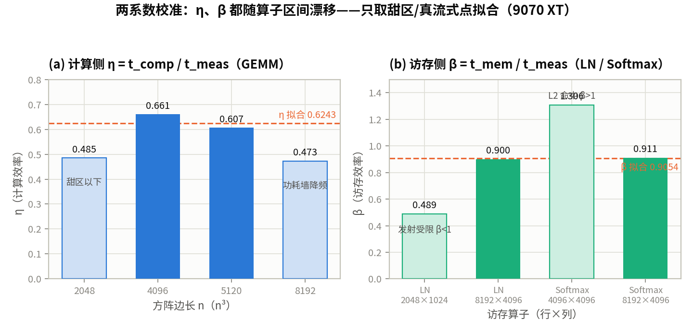
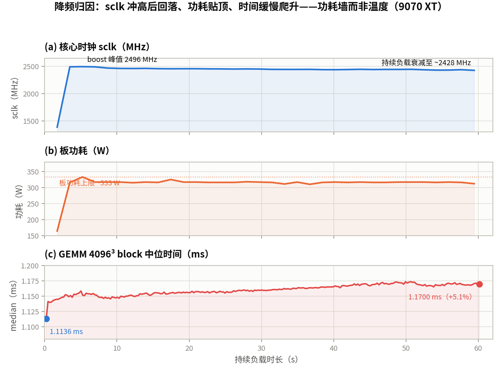
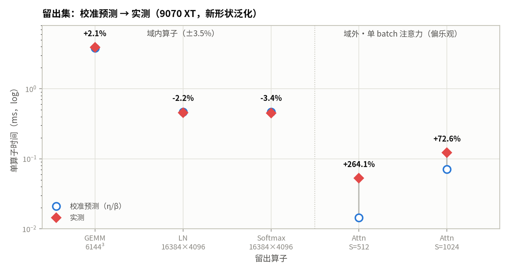
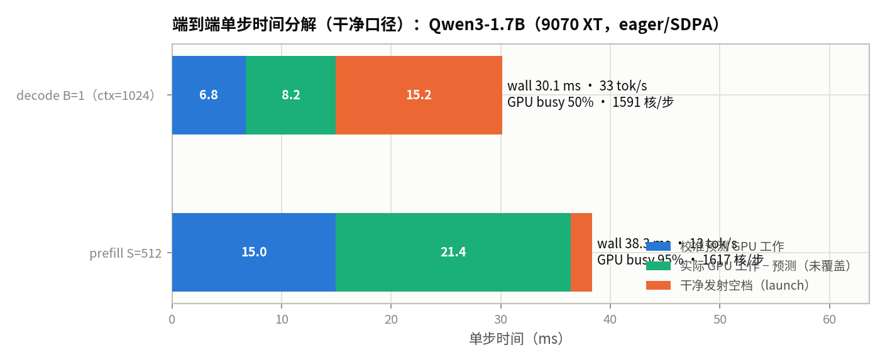

# 第 2 章 第一次真机 Profile 与性能校准

::: danger ⚠️ Alpha内测版本警告
此为早期内部构建版本，尚不完整且可能存在错误，欢迎大家提Issue反馈问题或建议。
:::

## 本章导读

> 本章第一次把模拟器预测带上真机：先跑通最小 Profile，再用校准集拟合修正系数，最后在留出配置上检验修正能否泛化。读完后，你应该能完成一次完整的"预测 → 实测 → 校准 → 留出验证"。

## 教学目标

- 能完成真机准入检查，并记录可复现的实验环境（硬件、驱动、ROCm 版本）；
- 能跑通第一次最小 Profile，确认 profiler 工具链可用；
- 能计算模拟器预测与真机实测的误差百分比，并用校准集拟合"模拟器修正系数"；
- 能在未参与拟合的留出配置上验证修正是否泛化，并逐项记录误差归因（降频、内存碎片、版本/架构不一致）。

本章的主线是**把第 1 章的标称（η=1）下界，校准成带两个修正系数的真机模型**：

```
名义模型（Ch1 冻结）：  t_c = max( FLOPs / PEAK ,  Bytes / BW )
校准模型（本章拟合）：  t_c = max( FLOPs / (PEAK·η) ,  Bytes / (BW·β) )
```

- **η**（计算侧系数）：compute-bound 算子的实测耗时相对 `FLOPs/PEAK` 的倒数——kernel 实际跑到峰值的几分之几；
- **β**（访存侧系数）：memory-bound 算子的实测耗时相对 `Bytes/BW` 的倒数——实际跑到标称带宽的几分之几。

两个系数都不是"真机的一个常数"，而是**随算子区间漂移的**——这正是本章最重要的发现（§2.3），也是误差归因（§2.4）的入口。

## 2.1 真机准入检查

上任何 kernel 之前，先用 `env_check.py` 做一次准入检查并记录可复现的环境快照（产物 `results/env_9070xt.json`）。准入检查的价值不是"确认机器能用"，而是**在测量开始前把工具链/架构的不一致暴露出来**——否则它会在 §2.4 变成一条无法归因的误差。

**环境与硬件快照**（全部写入同一 schema，跨章对账）：

| 项 | 值 |
| ---- | ---- |
| GPU | AMD Radeon RX 9070 XT（gfx1201 / RDNA4），15.9 GiB |
| 同机第二卡 | RX 7900 XTX（gfx1100）——本章不用，实验固定走 `HIP_VISIBLE_DEVICES=1` 重映射为 device 0 |
| Python | 3.13.11 |
| PyTorch | 2.16.0.dev20261019+rocm10.1 |
| ROCm | 7.16.26385 |
| 驱动 | 6.16.13 |
| 系统 | Linux 6.14.0-37-generic（glibc 2.41） |
| 名义常数（Ch0/Ch1 冻结） | BF16 195 TFLOPS / 640 GB/s / 拐点 304.7 |

**三项关键准入判定**（`checks` 字段，`all_ok=true`）：

1. **profiler 工具链 —— 三个 AMD 工具分属不同用途，逐个确认可用性**。ROCm 的 profiler 不是单一工具，准入检查逐个确认（`env_check.py`）：
   - **`rocprofv3`**（kernel dispatch 追踪 + 可选 PMC 深计数器/ATT）：**在 gfx1201 上可用**——`--kernel-trace` 实测能追踪并归属 kernel（§2.2，v1.4.1）。它是本章"看 kernel"的底座。
   - **`rocprof-compute`**（原 Omniperf，roofline / 深硬件计数器）：`profile` 模式**不支持本机架构**——支持列表是 `gfx908/gfx90a/gfx94x/gfx950/gfx115x`，而本机是 `gfx1100 + gfx1201`。所以大纲里写的"`rocprof-compute profile` 跑通一个 kernel"在这张卡上**不可用**；要 roofline 深计数器应走 `rocprofv3 --pmc`，而非 `rocprof-compute`。
   - **`rocprof-sys`**（原 Omnitrace，全系统 CPU+GPU 时间线）：本机**不在 PATH**（`rocprof_sys_present=false`）；本章也不需要（单 GPU 负载不需要全系统 trace）。
   - **`torch.profiler`（HIP activity）**：跨架构兜底，用于**进程内** e2e profile（§2.6）——它能直接嵌入 Python 会话，且不受 `rocprofv3` 子进程与 `transformers` 加载路径的 LLVM 冲突影响（§2.6 末）。
   - **RDNA4 perfmon 坑**：gfx1201 的深硬件计数器在默认 AUTO 性能档下被门控关闭（ROCm PR #7455），跑 `--pmc` 需先强制固定性能档；但本章只用到 `--kernel-trace`，不受影响。
   处理：本章以 `rocprofv3 --kernel-trace` 为"看 kernel"底座、`torch.profiler` 做进程内 e2e、`rocm-smi` 采样时钟/功耗。这是一条被准入检查主动捕获、而非在实验中途踩出来的"工具/架构不一致"（§2.4 的第三类误差来源）。
2. **SDPA backend 口径 —— 确认 repeat_kv 口径**。等头 dense 输入（MHA 16/16）可用 `FLASH / EFFICIENT / MATH`（`CUDNN` 不可用）；GQA 原始 dense 输入（16q/8kv）只可用 `FLASH / MATH`，`EFFICIENT / CUDNN` 被拒。即 Qwen3 的 GQA 必须**先 `repeat_kv` 把 K/V 展开到 16 头再走 fused 路径**——与第 1 章 §1.4 的 SDPA 口径一致，本章全部预测也按 repeat_kv 口径计数。
3. **模型可加载可运行**。Qwen3-1.7B（`/mnt/public/models`）加载成功、prefill 前向 OK、decode 单步 OK；config 实测：28 层 / hidden 2048 / inter 6144 / 16 q 头 / 8 kv 头 / head_dim 128 / vocab 151936 / `tie_word_embeddings=true`。

空闲读数：温度 35°C、功耗 26 W、fclk 219 MHz——作为 §2.4 降频诊断的基线（"降频"必须是相对这个空闲态的负载后读数，而不是相对某个假设）。

## 2.2 第一次最小 Profile

跑通 profiler 的最小单元：单个 `GEMM 4096³（bf16）`，做**两个 profiler 的头对头**，外加干净 baseline 与 CPU 发射读数（`minimal_profile.py` → `results/minimal_profile_9070xt.json`）。同一 GEMM、同一会话、同一张量、同一协议（warmup 10 + 50×3、event+sync、median）：

| 读数 | 条件 | 值 |
| ---- | ---- | ---- |
| **A** event 每迭代 + sync（无 profiler） | 干净 GPU 时间线时间 | **1.054 ms** |
| **B** CPU enqueue 32 连发不 sync | CPU 发射一个 GEMM 的开销 | **0.0253 ms/iter** |
| **C** `rocprofv3 --kernel-trace`（event-in-trace） | 开 v3 后 event wall | **1.0665 ms → ×1.012** |
| **D** `torch.profiler`（event-in-profile） | 开 torch 后 event wall | **1.0710 ms → ×1.016** |

两个 profiler 都只报 **1 个 GEMM kernel/iter**、Σ GPU self ≈ **1.036 ms（v3）/ 1.032 ms（torch）**——kernel 计数与 GPU 侧耗时跨工具一致，差异只在测量扰动。这也直接验证了 `rocprofv3` 的 kernel dispatch 追踪在 gfx1201 上**可用**（§2.1 里不可用的是 `rocprof-compute` 的 profile 模式，不是 v3 的 kernel-trace）。

三个关键读数：

- **A = 1.054 ms** 是这一个 GEMM 的干净 GPU 时间线时间，对应 130.4 TFLOPS（= 峰值 195 的 ≈67%）——与第 1 章 §1.4 上卡锚定的 matmul 4096³（η_gemm≈0.67）跨章一致。
- **B = 25.3 μs** 是 CPU 发射一个**大型** GEMM 的开销：单个大 kernel 的 enqueue 并不贵。这解释了为什么第 1 章的全模型 decode 会慢到 29 ms——那里是 **1591 个** kernel 各发射一次（§2.6），发射成本随 kernel 数线性累加，而不是随单个 kernel 的大小。
- **C/D 的膨胀系数都在 ×1.01–×1.02**（v3 ×1.012 / torch ×1.016），差异在噪声量级。**这就是 profiler 开销的本质：它是"每次 kernel 发射"的固定成本**——对 1 个 1 ms 的大 kernel，这点固定成本被摊薄成 ~1%。早期脚本里"单迭代 torch.profiler ×1.9"是**冷启动假象**：新进入 profile 区域的第一次发射会触发 profiler 初始化（~1 ms 一次性开销）；把整套 warmup+samples 放进区域内取 median 后，真实 per-iter 开销就是 ×1.02。

**结论：profiler 是"看"的工具，不是"计时"的工具——而且它的扰动量由 kernel 数决定。** 两个 profiler 对单 kernel 负载的扰动都 ≈1%；但每次发射的固定成本随 kernel 数线性累加，所以在 §2.6 的 1591-kernel decode 上会被放大到 ×~1.9（§2.2 的 GEMM 只是"1 个 kernel"的特例）。因此：

1. 任何"干净 wall"必须**在无 profiler 的条件下**单独测（§2.6 的 decode/prefill wall 都这样测）；
2. 任何"GPU 侧 busy / launch 空隙"必须**在同一个 profile 区域内**同条件取（wall 与 Σ self 都在 profiler 下），不能拿 profiler 膨胀过的 Σ self 去减无 profiler 的 wall；
3. 跨 profiler / 跨进程比较膨胀系数时，只有 **compute-bound** 负载（如 GEMM）的 wall 稳定、可比；launch-bound 负载的干净 wall 本身随 CPU 时钟态漂移，跨进程的 clean vs profiler 比值不干净。

这条"同条件纪律"贯穿 §2.6。

## 2.3 校准集：预测与实测对比

校准集全部**先实测**，再**只取代表区间的点**拟合系数（`bench_cal.py` → `results/cal_9070xt.json`）。协议同 Ch0 §0.3：warmup 10 + 50 样本 × 3 轮，逐迭代 event + sync，median，seed 42。

**校准集覆盖三类算子**（覆盖计算侧与访存侧）：

- **GEMM（计算侧，η 的 size 曲线）**：bf16 方阵 2048³ / 4096³ / 5120³ / 8192³；
- **LayerNorm（访存侧）**：2048×1024 / 8192×4096（dim=-1）；
- **Softmax（访存侧）**：4096×4096 / 8192×4096（dim=-1）。

逐点系数（`η_point = t_comp / t_meas`，`β_point = t_mem / t_meas`）：

| 算子 | 形状 | AI | 名义 t (ms) | 实测 median (ms) | 逐点系数 | 进拟合 | 非拟合点的归因（§2.4）|
| ---- | ---- | ---- | ---- | ---- | ---- | ---- | ---- |
| GEMM | 2048³ | 682.7 | 0.0881（compute） | 0.1817 | **η=0.4848** | 否 | 计算甜区以下（小 GEMM 未饱和矩阵管线） |
| GEMM | 4096³ | 1365.3 | 0.7048（compute） | 1.0668 | **η=0.6607** | 是 | — |
| GEMM | 5120³ | 1706.7 | 1.3766（compute） | 2.2671 | **η=0.6072** | 是 | — |
| GEMM | 8192³ | 2730.7 | 5.6385（compute） | 11.9214 | **η=0.4730** | 否 | 功耗墙降频（§2.4，单发大 GEMM 持续贴顶） |
| LayerNorm | 2048×1024 | 1.0 | 0.0131（memory） | 0.0268 | **β=0.4891** | 否 | 发射受限（小算子未饱和带宽） |
| LayerNorm | 8192×4096 | 1.0 | 0.2097（memory） | 0.2331 | **β=0.8996** | 是 | — |
| Softmax | 4096×4096 | 1.0 | 0.1049（memory） | 0.0803 | **β=1.3061** | 否 | L2 命中（β>1，比 DRAM 下界还快） |
| Softmax | 8192×4096 | 1.0 | 0.2097（memory） | 0.2301 | **β=0.9113** | 是 | — |



**拟合口径（只取代表区间，避免把小尺寸/缓存/降频的偏离混进系数）：**

```
η = Σ t_comp / Σ t_meas   （GEMM 4096³ + 5120³，计算甜区两点，AI ≫ 305）
  = (0.7048 + 1.3766) / (1.0668 + 2.2671)  = 0.6243

β = Σ t_mem  / Σ t_meas   （LN 8192×4096 + Softmax 8192×4096，真流式两点）
  = (0.2097 + 0.2097) / (0.2331 + 0.2301)  = 0.9054
```

**为什么不把 8 个点都拟合进去**——因为非拟合点各自偏离，而偏离是**可解释的**，不是噪声：

- GEMM 的 η 在 size 轴上先升后降：0.4848（2048，小）→ **0.6607 / 0.6072（4096/5120，甜区）** → 0.4730（8192，降频）。甜区在中间，两端各有一个独立原因（§2.4）。
- 访存侧的 β 跨算子跨度极大：0.4891（LN 小，发射受限）→ ≈0.9（真流式）→ **1.3061（Softmax 4096，β>1）**。β>1 意味着实测**比名义带宽下界还快**——唯一的解释是 L2 命中减少了 HBM 流量，而这正是名义模型"Bytes = 未复用 HBM 流量"口径没有计入的部分。这样一个 β>1 的点若进拟合，会把带宽系数拉歪。

拟合结果：**η = 0.6243，β = 0.9054**（`stored_at` 先于留出实测，见 §2.5 留痕）。

## 2.4 误差归因

误差归因必须逐项落到"降频 / 内存碎片 / 版本架构不一致"三类之一，不能留"未解释残差"。本章用 `diag_clocks.py`（→ `results/clock_drift_9070xt.json`）+ §2.3 的非拟合点完成归因。

**① 降频（本章主因）：功耗墙，而非温度。** 方法是 GEMM 4096³ 的 fresh / sustained / hot 三段，负载期间后台线程每 1.5 s 用 `rocm-smi` 采样 sclk / fclk / 功耗 / 温度：

- **fresh**（空闲刚上卡，20 连发 median）= **1.11448 ms**；**hot**（持续 60 s 负载后立即测）= **1.16668 ms**；Δ = **+4.68%**；
- **sclk**：负载上来后约 5 s 内 boost 到峰值 **2496 MHz**，随后**单调衰减**到 ~**2428 MHz**（60 s 末）；
- **功耗**：贴顶在 **~316–333 W**（板功耗上限，峰值 333 W，首采样 164 W 是空闲→负载的过渡）；
- **温度**：只从 53°C 温和爬升到 **67°C**（远未触及消费级卡的温度墙）；
- **fclk**：全程恒定 1889 MHz（fabric 时钟不受影响）；
- **GEMM block-median**：随 60 s 负载缓慢爬升 **1.11363 → 1.17004 ms（+5.1%）**——是**缓慢漂移**，不是阶跃。



**判定：sclk 衰减而功耗钉死在板顶、温度仍温和 → 这是板功耗上限（power-cap）降频，不是温度降频。** 它直接解释 §2.3 里 8192³ GEMM 的 η=0.473：8192³ 是体量最大、持续时间最长的单发 GEMM，全程贴着功耗墙，sclk 按上表的规律衰减，实际 FLOPS 低于 4096/5120 甜区 → η 掉到 0.473。+4.68% 的 fresh→hot 漂移是这一效应的直接量级，8192³ 的更大偏离是"单发就持续贴顶"的加强版。

**② 内存碎片：排除。** 60 s 负载前后 `allocated` 恒为 0.062 GiB、`reserved` 一次性从 0.062 → 0.172 GiB 后稳定，无随负载增长的趋势——不存在碎片导致的显存占用漂移。

**③ 版本/架构不一致：准入已捕获。** §2.1 确认了三个 profiler 工具的可用性边界：`rocprofv3 --kernel-trace` 在 gfx1201 **可用**（本章"看 kernel"底座），`rocprof-compute profile` **不支持** gfx1201（深计数器改走 `rocprofv3 --pmc` + 强制固定性能档）。§2.2 的头对头还厘清了 profiler 开销的机制——它是**每次 kernel 发射的固定成本**（对 1 个 1 ms 大 kernel 摊薄成 ×1.01，v3 ×1.012 / torch ×1.016），而早期脚本里"单迭代 ×1.9"是新进入 profile 区域的第一次发射触发的一次性初始化（**冷启动假象**）。两者都是"测量工具与卡/版本"的产物，已在准入与最小 Profile 阶段显式记录并隔离（同条件纪律），不作为硬件特性混进 η/β。

## 2.5 留出验证

留出集验证"预测 → 修正 → 再预测"是否泛化。**留痕纪律**：留出预测在**实测之前**写入 JSON（`holdout_prediction.stored_at = 2026-11-04T13:51:25Z`，早于留出实测）——先看测量值再拟合只算回拟合，不算验证（Ch0 §0.3）。

**留出集 = 新形状，均不在拟合点里**：

- **GEMM 6144³**（计算侧，落在 4096 与 8192 之间）；
- **LayerNorm 16384×4096 / Softmax 16384×4096**（访存侧，更大的真流式形状）；
- **注意力 fused MHA16**：S=512（AI=256 < 305 → 访存侧）与 S=1024（AI=512 > 305 → 计算侧），单次 SDPA 算子、16 头、不含层数因子——这是**超出拟合域的压力测试**。

| config | 绑定（按 AI） | 预测 (ms) | 实测 (ms) | 误差 | 逐点系数 | 域 |
| ---- | ---- | ---- | ---- | ---- | ---- | ---- |
| GEMM 6144³ | compute（AI 2048） | 3.8103 | 3.8921 | **+2.1%** | η 0.6112 | 域内 |
| LayerNorm 16384×4096 | memory（AI 1） | 0.4633 | 0.4529 | **−2.2%** | β 0.9261 | 域内 |
| Softmax 16384×4096 | memory（AI 1） | 0.4633 | 0.4475 | **−3.4%** | β 0.9372 | 域内 |
| Attn MHA16 S=512 | memory（AI 256<305） | 0.0145 | 0.0527 | **+264.1%** | 40.7 TFLOPS | 域外 |
| Attn MHA16 S=1024 | compute（AI 512>305） | 0.0706 | 0.1218 | **+72.6%** | 70.5 TFLOPS | 域外 |



**读数分两半：**

- **域内（GEMM / LN / Softmax 的新形状）：±3.5%。** 逐点系数也贴合拟合值（η 0.611 vs 0.6243；β 0.926 / 0.937 vs 0.9054）——两个系数在拟合的**同一 regime 内**对**新尺寸**是稳定可泛化的。这是校准成功的那一半。
- **域外（单 batch 注意力）：+264%（S=512）/ +73%（S=1024），模型系统性偏乐观。** 原因不是"算错了"，而是**单 SDPA kernel 在 b=1 下利用率太低**：S=512 只跑到 40.7 TFLOPS（峰值的 21%），S=1024 只到 70.5 TFLOPS（36%）——它既没饱和矩阵管线，也不是干净的访存流。η/β 是从**饱和** GEMM 和**流式** LN/Softmax 上学的两个标量，覆盖不了这个低利用率 regime。这正是校准集里"超出模型域的压力测试"要暴露的东西，也是后续章节做 **batching**（b>1 抬高注意力的 AI 与利用率）与**融合**（FlashAttention 改它的 Bytes）的屋顶线动机。

一句话：**校准模型在它声明的域内（饱和计算 + 流式访存）泛化良好；离开这个域，它偏乐观——而偏乐观的方向（低利用率处）恰好是优化要发力的地方。**

## 2.6 端到端模型运行与 Profile

跑通 Qwen3-1.7B（BF16，`sdpa`，repeat_kv 口径，B=1）的端到端推理与 Profile（`profile_e2e.py` → `results/e2e_1p7b_9070xt.json`）。用 §2.3 拟合的 η/β 做**逐组件 GPU 侧校准预测**，与**干净 wall**（无 profiler）和**同条件 profile** 三相对照。

**测量协议**：decode B=1、ctx=1024，warmup 10 + 50 × 3 轮，**闭环 greedy 单 token**（先用一次 ctx 长度 prefill 建 KV cache，之后每步只喂 1 个采样 token，测量窗口内不周期性 reset，保证单步 ctx 稳定、profile 窗口不含 reset）；prefill S=512，warmup 3 + 10 × 3 轮，单次前向恰好 S=512 token（与预测口径对齐）。profile 用 `torch.profiler`（**进程内、同会话、同张量、同协议**）。`rocprofv3 --kernel-trace` 在 §2.2 已验证可用，但**全模型 decode/prefill 被 v3 子进程包裹时触发 LLVM 冲突而 SIGABRT**（`import transformers` 的加载路径加载的第二份 LLVM，与 v3 注入的 LLVM 注册了同名命令行选项 → "CommandLine option registered more than once"）。故 e2e 的 kernel 级读数以进程内 `torch.profiler` 为准，v3 失败被捕获并留痕（`profiler_overhead.rocprofv3_fullmodel_error`），不静默吞掉。

| 项 | decode（B=1, ctx=1024） | prefill（S=512） |
| ---- | ---- | ---- |
| GPU 校准预测（Σ组件） | **6.754 ms** | **14.965 ms** |
| ├ GEMM（权重 / 权重×激活） | memory 5.938 | compute 14.472 |
| ├ Attention（repeat_kv） | memory 0.811 | memory 0.494 |
| └ Norms/elementwise（量级估计） | memory 0.005 | — |
| 干净 wall（无 profiler） | **30.116 ms** | **38.332 ms** |
| 吞吐 | 33.2 tok/s | 13.4 tok/s |
| kernels/步 | **1591** | **1617** |
| 实际 Σ GPU self | **14.943 ms** | **36.402 ms** |
| 干净 GPU busy（Σself / 干净 wall） | **49.6%** | **95.0%** |
| 干净发射空档（干净 wall − Σself） | **15.17 ms** | **1.93 ms** |
| Σself − 校准预测（未覆盖的 GPU 工作） | 8.19 ms | 21.44 ms |
| `torch.profiler` 膨胀（同协议、同 fresh cache） | ×1.913 | ×1.528 |
| `rocprofv3` 膨胀 | N/A（LLVM 冲突，见上） | N/A |



**干净 wall 拆三段，每段都可独立解释**（§2.2 同条件纪律的用武之地；Σself 取自 `torch.profiler`，kernel 自身耗时与 profiler 无关，扰动全在 CPU 发射侧，所以它可当"干净 GPU 工作"用）：

- **干净发射空档**（干净 wall − 实际 Σself）＝ GPU 在 kernel 之间的空档。decode **15.17 ms**（busy 49.6%）≫ prefill **1.93 ms**（busy 95.0%）。
- **实际 Σself** 再拆两段：校准预测的部分 + **未覆盖部分**（Σself − 预测）。decode 未覆盖 **8.19 ms**、prefill **21.44 ms**——**两个 phase 校准模型都低估了实际 GPU 工作约 2.2× / 2.4×**（§2.5 域外效应在 e2e 规模的延续，下面看它来自哪）。
- **§2.2 的教训在这里兑现**：若拿**膨胀后**的 profile wall（decode 57.6 ms / prefill 58.6 ms）去减 Σself，会把 profiler 扰动（torch ×1.9 / ×1.5）误当成发射空档。旧口径里 prefill "发射空档 18.4 ms、busy 66.6%"就是这种混淆；**干净口径下 prefill 发射空档只有 1.93 ms、busy 95.0%**。

**decode：发射受限 + 未建模 pointwise 核，双重主导。**

- **发射受限（launch-bound）**：干净 busy 只有 49.6%，一半时间 GPU 在等 CPU dispatch 1591 个 kernel（15.17 ms ÷ 1591 ≈ **9.5 μs/核**，落在 §2.2 单核发射量级内——25.3 μs 是大 GEMM 的发射，decode 的小 kernel 更接近其下界）。与第 1 章 §1.4 的 T_launch / GPU 饥饿诊断同源，是 **CUDA Graphs / compile / batching** 要消的部分。
- **校准模型低估了实际 GPU 工作（8.19 ms）**：top-kernel 表里，GEMM（`Cijk`）实际 ≈ 6.95 ms/步 vs 预测 5.938（≈ −15%）、attention（`flyc_attn_fwd`）≈ 0.88 ms/步 vs 预测 0.811（≈ −8%）——这两者基本到位；缺口几乎全在 **pointwise/elementwise 核**（`elementwise_kernel`、`reduce_kernel`、`CatArrayBatchedCopy`、dtype 转换，合计 ≈ 7 ms/步），而模型只把它们粗略记成"norms 0.005 ms"量级。**双系数模型只建模 GEMM/attention 的 roofline，不建模 pointwise 核的数量级**——这是 §2.5 域外（低利用率、非纯 roofline 算子）的 e2e 版本。
- **kernel 数由算子图驱动，不由序列长驱动**：decode 1591 vs prefill 1617 几乎相同——同一套 28 层 × ~59 kernel/层 op 图。同 kernel 数、不同 per-kernel 工作量，才拉开 busy：decode 每核只算 1 token（活小）→ GPU 挨饿；prefill 每核算 S=512（活大）→ GPU 喂满。这是"decode GEMM 的 AI≈B"（第 1 章 §1.2）的真机具体化——**batching 能把发射成本摊薄**。

**prefill：接近 GPU 饱和，缺口几乎全在校准模型，不在发射。**

- 干净 busy **95.0%**、发射空档仅 1.93 ms——1617 个 kernel 在 S=512 的较大 per-kernel 工作量下基本把 GPU 喂满，发射不再是瓶颈。
- 干净 wall 38.3 ms vs 校准预测 15.0 ms，**缺口的 21.4 ms 几乎全是"未覆盖的 GPU 工作"**（不是发射）：GEMM 在 M=512 下没到甜区（用甜区 η=0.6243 偏乐观，同 §2.5）+ pointwise 核数量级低估。**含义：prefill 别急着上 CUDA Graphs（发射不是瓶颈），要先把 GPU 侧预测补准——形状相关 η + 建模 pointwise。**

**回扣主线**：η/β 在饱和/流式算子上校准，正确预测了两个 phase 的 **roofline 部分**（GEMM/attention），但对 **pointwise 核**与**低利用率 regime** 系统性低估（decode Σself 是预测的 2.2×、prefill 2.4×）。**干净 wall** 在 decode 由发射 + 未建模双重主导（busy 49.6%）、在 prefill 接近 GPU 饱和（busy 95.0%）——**两系数模型既不建模 T_launch、也不建模 pointwise 核**，这正是后续章节的发力点：用 **CUDA Graphs / torch.compile** 消发射、用 **batching / 融合** 抬高 per-kernel 利用率、并把 pointwise 核的 roofline 补进预测。

## 实验设计

- **模拟器实验（预测 → 校准闭环）**：复用第 1 章标称预测，叠加本章 η/β 校准模型，逐组件输出 FLOPs/Bytes/AI/判定/t。核心动作是**先留痕（stored_at 先于实测）→ 实测 → 拟合 → 留出验证**，而不是"看实测再反推系数"。
- **真机实验（RX 9070 XT 16 GB 主线，`HIP_VISIBLE_DEVICES=1`，协议 Ch0 §0.3：warmup 10 + 50 × 3、event+sync、median、seed 42；prefill warmup 3 + 10 × 3）**：
  - 准入检查：`env_check.py` → `results/env_9070xt.json`（含三 profiler 工具可用性 + rocprof-compute 架构不匹配、SDPA backend、模型 config 快照）；
  - 最小 Profile：`minimal_profile.py` → `results/minimal_profile_9070xt.json`（GEMM 4096³ 的 A/B/C/D 四读数：干净 wall / CPU 发射 / `rocprofv3` / `torch.profiler`，双 profiler 膨胀系数头对头）；
  - 校准集 + 拟合：`bench_cal.py`（cal 部分）→ `results/cal_9070xt.json`（GEMM 4 + LN 2 + Softmax 2 实测，拟合 η/β）；
  - 误差归因：`diag_clocks.py` → `results/clock_drift_9070xt.json`（fresh/sustained/hot GEMM + `rocm-smi` sclk/功耗/温度采样）；
  - 留出验证：`bench_cal.py`（holdout 部分）（GEMM 6144³ + LN/Softmax 16384×4096 + attn MHA16 S∈{512,1024}，预测先留痕）；
  - 端到端：`profile_e2e.py` → `results/e2e_1p7b_9070xt.json`（Qwen3-1.7B decode B=1 ctx=1024 + prefill S=512，干净 wall + 同条件 profile + 逐组件校准预测）。
- **闭环与交付**：
  - **预测（测前留痕）**：第 1 章 nominal + 本章 η/β，`stored_at` 先于任何留出实测；
  - **实测（选点运行）**：6 个 `results/*.json`，协议与 config 见 §2.1–§2.6；
  - **校准（解释误差）**：η=0.6243 / β=0.9054 + 逐项误差归因（功耗墙降频 / 碎片排除 / 架构不一致）+ 留出域内 ±3.5%；
  - **决策（提交）**：第一条校准记录（校准参数 + 误差归因 + 留出验证 + 端到端 launch-bound 结论）。

## 本章小结

- **两系数校准模型**：`t_c = max(FLOPs/(PEAK·η), Bytes/(BW·β))`；**η = 0.6243**（计算侧，GEMM 甜区 4096³/5120³ 拟合）、**β = 0.9054**（访存侧，LN/Softmax 8192×4096 真流式拟合）。
- **η/β 是随算子区间漂移的标量，不是真机的一个常数**：η 在 GEMM size 轴上 0.48→0.66→0.47（甜区居中，小 GEMM 未饱和、大 GEMM 降频）；β 在访存算子上 0.49→0.90→1.31（发射受限 <1、真流式 ≈1、L2 命中 >1）。**只取代表区间的点拟合，是让留出能泛化的关键**。
- **误差归因三项**：① **降频 = 功耗墙而非温度**（sclk 2496→~2428 MHz、功耗钉死 ~333 W、温度仅到 67°C、GEMM 时间 60 s 内 +5.1% 漂移）——解释 8192³ GEMM η=0.473；② **内存碎片排除**（allocated/reserved 稳定）；③ **版本/架构不一致**（`rocprofv3 --kernel-trace` 可用、`rocprof-compute profile` 不支持 gfx1201 → 深计数器走 v3 PMC；profiler 开销是**每核发射的固定成本**，单核 GEMM ×1.01、1591 核 decode ×1.9，须干净/同条件读取）——均在准入/最小 Profile 阶段主动捕获。
- **留出验证**：域内（GEMM/LN/Softmax 新形状）**±3.5%**，逐点系数贴合拟合值；域外（单 batch 注意力）+264%/+73%，**模型在低利用率处偏乐观**——这正是校准集设计的压力测试，也是 batching/融合章节的动机。
- **端到端**：校准模型正确预测了两个 phase 的 **roofline 部分**（GEMM/attention），但**低估了实际 GPU 工作**（Σself 是预测的 2.2×/2.4×，缺口几乎全在 pointwise 核）；干净 wall（decode 30.1 ms / prefill 38.3 ms）在 decode 发射 + 未建模双重主导（干净 busy 49.6%、1591 核/步）、在 prefill 接近 GPU 饱和（busy 95.0%）——**两系数模型既不建模 T_launch、也不建模 pointwise 核**，CUDA Graphs / compile + batching 才是消它的路径。
- **交付**：`code/part1-modeling/chapter2/` 下 6 个脚本 + 6 个 `results/*.json` + `figs/make_figs.py` + 4 张中文配图。

## 延伸阅读

- 本书第 0 章：§0.3 统一测量协议（warmup/样本/median/留痕纪律）、§0.4 证据级别、§0.5 纸面实验底稿与"先预测再实测"纪律。
- 本书第 1 章 §1.4 上卡锚定：T_launch / GPU 饥饿诊断（本章 §2.6 的发射受限结论直接承接它），以及 SDPA / repeat_kv 口径。
- 本书第 7 章（continuous batching）与第 9 章（PD 分离）：本章"发射受限 + 低利用率"结论的落点——batching 摊薄发射成本、抬高 attention 利用率，PD 分离把两种硬件 regime 拆开调度。
- 本书第 3 章（显存账）：容量维度（什么放得下），与本章的速度维度（多快）互补。
- AMD `rocprofv3` 文档（kernel dispatch 追踪，gfx1201 可用；`--pmc` 深计数器需强制固定性能档，见 ROCm PR #7455）/ `rocprof-compute`（roofline 微架构计数，build 3.8.0 尚不支持 gfx1201）；PyTorch `torch.profiler`（HIP/CUDA activity，跨架构、可进程内嵌入）。
- Williams, Waterman & Patterson, *"Roofline,"* CACM 2009（η 作为 kernel 效率、屋顶线的效率语义）；Dao et al., *"FlashAttention,"* 2022（§2.5 域外 attention 的融合动机）。
- [hello-gpu / hello-rocm](https://github.com/datawhalechina/hello-gpu)（datawhalechina，GPU/ROCm 基础参考写法）。 https://www.ccs.tsukuba.ac.jp/wp-content/uploads/sites/14/2025/09/20.-Newer-tools-ROCprof-Trace-Decoder-and-Omnistat.pdf
