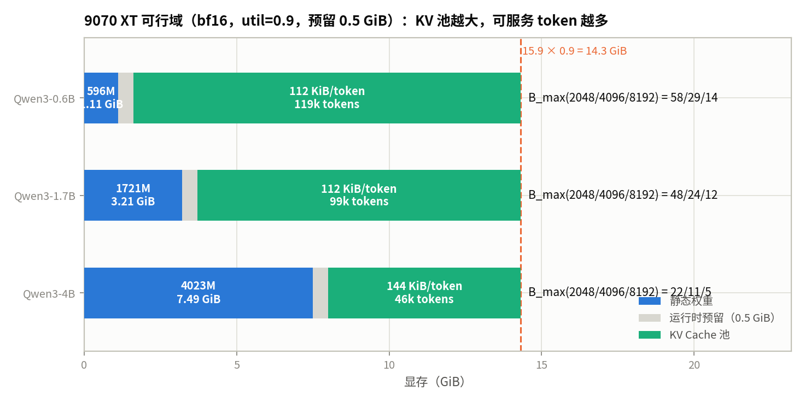
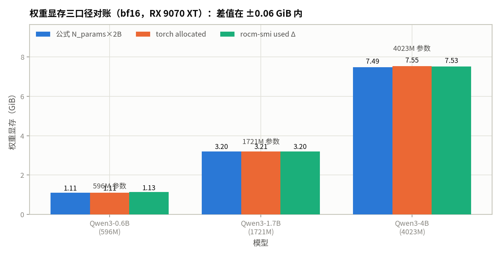
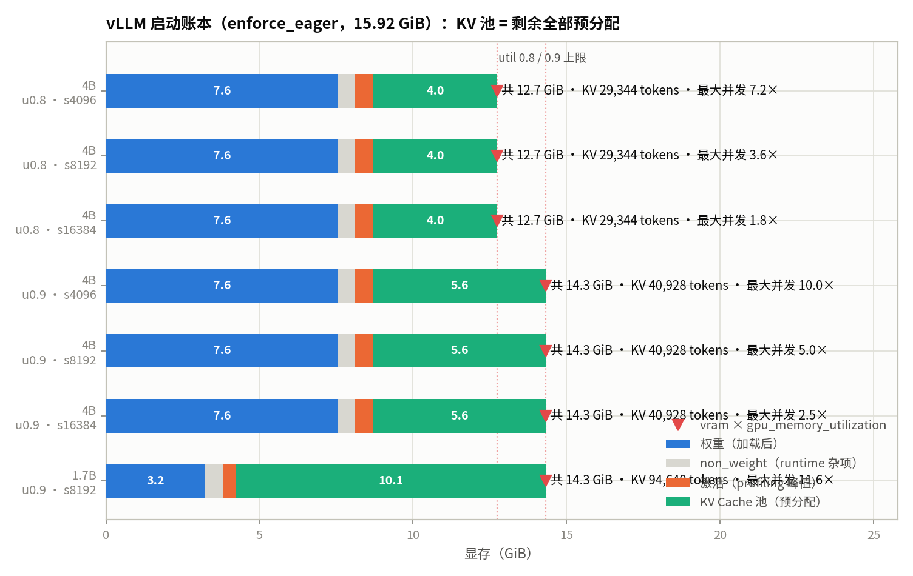
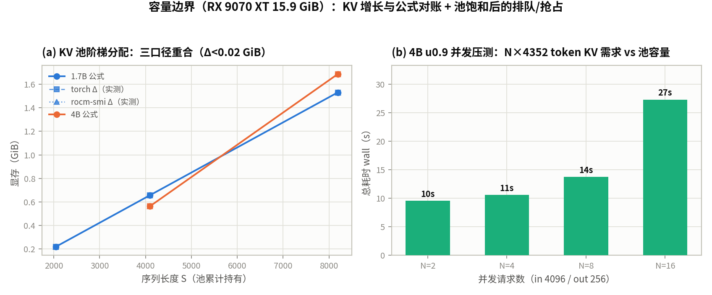

# 第 3 章 显存占用估算：模型权重与 KV Cache

::: danger ⚠️ Alpha内测版本警告
此为早期内部构建版本，尚不完整且可能存在错误，欢迎大家提Issue反馈问题或建议。
:::

## 本章导读

> 第 2 章回答了"多快"，本章回答"装得下吗"。我们把 15.9 GiB 显存拆成**静态权重、每 token KV Cache、运行时开销**三本账：先对具体模型 + 具体卡手算账本，再与模拟器对答案，最后上真机用三个测量口径（公式 / torch 分配器 / rocm-smi）加 vLLM 的内部账本逐项验证。读完你应该能回答：**这个模型在这张卡上能服务多少并发、多长上下文，以及显存里的每一个字节都去了哪里。**

## 教学目标

- 能计算静态权重显存（N_params × bytes/param），并逐层分解 Qwen3 的参数量；
- 能计算 GQA 口径下每 token 的 KV 字节数（2 × L × H_kv × D_head × bytes），并解释 GQA 相对 MHA 把 KV 缩小 N_q/N_kv 倍；
- 能区分张量占用、torch allocated/reserved 与设备级 rocm-smi 三个口径，说明激活 workspace 与碎片开销的来源；
- 能手算目标卡上的 S_max(B)/B_max(S)，与模拟器可行域对账，再与真机读数和 vLLM 启动账本对答案。

本章的主线是**把三本账变成一个"可行域"**，一套符号贯穿：

```
账本 1（静态权重）  M_weights = N_params × bytes_param
账本 2（每 token KV） m_kv = 2 × L × H_kv × D_head × bytes_elem     （GQA 口径）
账本 3（可行域）     M_avail = M_total × utilization − M_weights − M_overhead
                   S_max(B) = M_avail / (B × m_kv)
                   B_max(S) = ⌊M_avail / (S × m_kv)⌋
```

第 1、2 章做的是**速度维度**（FLOPs/Bytes、roofline、η/β），本章做的是**容量维度**，两个维度互补：同一个模型、同一张卡，"多快"由第 2 章的发射受限/roofline 决定，"能服务多少"由本章的 KV 池决定——§3.3.3 的压测就是这条边界的真机演示（KV 池满之后，卡住的不是算力，是显存）。

## 3.1 显存的三本账

### 3.1.1 账本一：静态权重

权重显存只有一个公式，但 **N_params 必须能自己算出来**，而不是抄模型名。以 Qwen3-1.7B 为例（L=28 层，d=2048，H_q=16，H_kv=8，D_head=128，inter=6144，vocab=151936，`tie_word_embeddings=true`，无 bias）：

**每层参数**（记 d_q = H_q×D = 2048，d_kv = H_kv×D = 1024）：

| 组件 | 计算 | 参数量 |
| ---- | ---- | ---- |
| q_proj | d × d_q = 2048 × 2048 | 4.194M |
| k_proj | d × d_kv = 2048 × 1024 | 2.097M |
| v_proj | 同上 | 2.097M |
| o_proj | d_q × d | 4.194M |
| MLP（gate/up/down） | 3 × d × inter = 3 × 2048 × 6144 | 37.749M |
| q_norm / k_norm | d_q / d_kv = 2048 / 1024 | 0.003M |
| 两个 LayerNorm | 2 × d | 0.004M |
| **每层小计** | | **50.34M** |

**全局**：

```
embed_tokens   151936 × 2048          = 311.16M
lm_head        与 embed 共享（tie）    = 0
final norm     2048                   ≈ 0
N_params       = 311.16 + 28 × 50.34  = 1720.7M
M_weights      = 1720.7M × 2 B（bf16）= 3.205 GiB
```

两个细节：

- **tie_word_embeddings**：小模型（0.6B/1.7B）把输出头与输入嵌入共享权重，省一份 vocab×d（1.7B 上就是 311M 参数、0.577 GiB）；4B 起通常不共享，账本里要加回一份。
- **参数名 ≠ 参数量**：1.7B 的逐层公式给 1720.7M，HF checkpoint 实测 1720.6M（§3.3.1），差 <0.01%——"N_params × bytes"这条账本在真机上可以直接用，前提是这个 N 是你自己算/数出来的。

**精度改变每参数字节数**（与第 4 章量化联动）：

| 精度 | bytes/param | 1.7B 权重 | 4B 权重 |
| ---- | ---- | ---- | ---- |
| fp32 | 4 | 6.41 GiB | 14.99 GiB |
| **bf16（本章主线）** | **2** | **3.205 GiB** | **7.493 GiB** |
| fp8 / int8 | 1 | 1.603 GiB | 3.746 GiB |
| int4 | 0.5 | 0.801 GiB | 1.873 GiB |

fp32 的 4B（14.99 GiB）已经超过 9070 XT 的整卡容量（15.9 GiB）——**精度不是"质量旋钮"，先是一道容量准入**。

### 3.1.2 账本二：KV Cache，每 token 的字节数

每个 token 经过每一层时，会向该层的 KV 缓存写一行 K 和一行 V（各 H_kv 个向量、每个 D 维）。所以**每 token** 的 KV 字节数是：

```
m_kv = 2（K 和 V） × L（层） × H_kv（KV 头数） × D_head × bytes_elem
```

- Qwen3-0.6B / 1.7B（L=28，H_kv=8）：2 × 28 × 8 × 128 × 2 B = **114,688 B = 112 KiB/token**
- Qwen3-4B（L=36，H_kv=8）：2 × 36 × 8 × 128 × 2 B = **147,456 B = 144 KiB/token**

**GQA 的省法**：公式里只有 H_kv、没有 H_q——如果 1.7B 用 MHA（H_kv = H_q = 16），m_kv = 224 KiB/token；GQA 把 KV 头砍到 8，**KV 直接减半**（一般地，GQA 相对 MHA 缩小 N_q/N_kv 倍）。H_q 只管"读"多少组 KV，不管"存"多少。

四个必须记住的性质：

1. **对序列长 S 严格线性**：长度 S 的序列总 KV = m_kv × S，没有超线性的部分（attention 的 O(S²) 是**计算量**，不是显存量）；
2. **与 hidden / inter / H_q 无关**：只由 L × H_kv × D 决定——0.6B 与 1.7B 的 hidden 差一倍，KV/token 却同为 112 KiB；
3. **decode 阶段单调增长**：每步"读全部旧行 + 追加 1 行"，旧行不能释放——KV 是前缀的记忆化结果（memoization），这是它必须常驻显存的根本原因；
4. **prefill 阶段一次性写入**：S 行 KV 在一个前向里批量落盘，叠加激活 workspace 形成显存峰值（§3.3.3 实测）。

### 3.1.3 账本三：运行时开销，与三个测量口径

三本账里的前两本是"张量本身"，第三本是**张量之外**的开销，来源有三个（§3.3 逐一实测）：

- **驱动/运行时上下文**：初始化 runtime 后就常驻的固定底噪（实测 **+0.196 GiB**，§3.3.1）；
- **激活 workspace**：前向中的临时张量（attention 中间量、GEMM 输出等），prefill 时达到峰值（实测 1.7B S=4096 的 spike **1.254 GiB**，§3.3.3），步末释放；
- **碎片**：分配器 reserved − allocated，块无法合并时保留的空隙（实测 **0.1484 GiB** 上界，§3.3.4）。

测量口径同样有三个，后面所有真机读数都在这三个口径里报数：

| 口径 | 读数 | 看到什么 |
| ---- | ---- | ---- |
| 公式口径 | N_params × bytes；m_kv × S | 张量本身的字节，规划下界 |
| torch 分配器 | `memory_allocated()` / `memory_reserved()` | 存活张量 / 分配器从设备保留的块（含碎片空隙） |
| 设备级 | `rocm-smi --showmeminfo vram` used | 驱动视角的全部：上下文 + 分配器保留 + 非 torch 占用 |

模拟器里 M_overhead 暂取 **0.5 GiB** 固定预留（§3.2）；它的实测依据在 §3.3：上下文 0.196 + 碎片 0.1484（上界）是**常驻**开销，激活 1.254 是**瞬态**（只在 prefill 期间占位）。0.5 GiB 对"稳态 + 余量"是保守的；vLLM 的做法不一样——它先 profile 出激活峰值，再把剩余显存**全部预分配成 KV 池**（§3.3.2）。

## 3.2 模拟器：账本与可行域

模拟器 `mem_ledger.py` 是一个**解析式显存模块**：输入 = 架构参数（从 HF config 直接读，不手填）+ 目标卡，输出 = 三本账 + 可行域：

```bash
python3 mem_ledger.py                           # 全部模型 × 全部目标卡
python3 mem_ledger.py --model 4B --card 9070xt  # 单点
```

口径：bf16（权重与 KV 均 2B/元素），util 0.9，overhead 0.5 GiB。

**9070 XT（15.9 GiB × 0.9 = 14.31 GiB 上限）：**

| 模型 | N_params | M_weights | m_kv | M_avail | 池总容量 | B_max @2048/4096/8192 | S_max @B=1/4/16 |
| ---- | ---- | ---- | ---- | ---- | ---- | ---- | ---- |
| Qwen3-0.6B | 596.1M | 1.11 GiB | 112 KiB | 12.70 GiB | 118,897 tok | 58 / 29 / 14 | 118,897 / 29,724 / 7,431 |
| Qwen3-1.7B | 1720.7M | 3.205 GiB | 112 KiB | 10.605 GiB | 99,287 tok | 48 / 24 / 12 | 99,287 / 24,821 / 6,205 |
| Qwen3-4B | 4022.6M | 7.493 GiB | 144 KiB | 6.317 GiB | 46,000 tok | 22 / 11 / 5 | 46,000 / 11,500 / 2,875 |

**手算对账**（1.7B，逐行复算 §3.1 的数）：

```
M_avail    = 15.9 × 0.9 − 3.205 − 0.5 = 10.605 GiB
池总容量   = 10.605 GiB ÷ 112 KiB     = 99,287 token
B_max(4096)= ⌊99,287 ÷ 4096⌋         = 24
S_max(B=1) = 99,287
```

与模拟器输出逐项一致（整数位全对）。**纪律：先手算，再跑模拟器**——模拟器是答案检查器，不是计算器本身；两边不一致时，错的一定在输入（架构参数或卡的口径），而不是公式。



表里两个读数：

- **可行域由 KV 池决定，权重只决定"池子起点"**：0.6B 权重占上限的 7.8%，KV 池 12.7 GiB → 118.9k token；4B 权重占 52.4%，KV 池只剩 6.3 GiB → 46k token。**模型越大，能"装"的上下文/并发反而越少**——容量维度的直觉与算力维度相反。
- **上下文与并发是同一块池子的两种切法**：1.7B 在 4k 上下文下并发 24，32k 上下文下并发 3——m_kv 是兑换率，`S_max(B)` 与 `B_max(S)` 互为反函数。第 7 章 continuous batching 与第 8 章 KV 管理（PagedAttention）的物理基础就是这块"固定饼"。

**W7900D（48 GB 容量占位，参数待确认，TODO 嘉航）：**

| 模型 | M_weights | M_avail | 池总容量 | B_max @4096/8192 |
| ---- | ---- | ---- | ---- | ---- |
| Qwen3-0.6B | 1.11 GiB | 41.59 GiB | 389,373 tok | 95 / 47 |
| Qwen3-1.7B | 3.205 GiB | 39.495 GiB | 369,763 tok | 90 / 45 |
| Qwen3-4B | 7.493 GiB | 35.207 GiB | 256,371 tok | 62 / 31 |

4B 的池容量从 46,000 → 256,371 token（**5.6×**），B_max(4096) 从 11 → 62。注意权重账本**与卡无关**（7.493 GiB 不变），只有 M_avail 随 VRAM 线性放大——这就是"能装多少"对卡显存是**线性**关系的原因，也是大显存卡在长上下文 serving 上"回本"的地方。

## 3.3 真机：三口径对账与 vLLM 账本

真机主线 RX 9070 XT（15.9 GiB，`HIP_VISIBLE_DEVICES=1`），Python 3.13.11 / torch 2.16.0.dev+rocm10.1 / ROCm 7.16.26385；vLLM 走 `rocm/vllm:rocm10.1.0_ubuntu24.04_py3.14-pytorch_2.13.0_vllm-0.29.0` 容器（同一块 GPU，设备直通）。四个测量项对应 §3.1 的三本账 + 口径归因：① 基线与权重 ② vLLM 启动账本 ③ KV 增长与容量压测 ④ 口径误差归因。

### 3.3.1 ① 基线与权重显存

**基线底噪**（`mem_real.py` A 段）：

| 读数 | 值 |
| ---- | ---- |
| rocm-smi 空闲（卡上无进程） | 0.0559 GiB |
| 初始化 torch 上下文后（init + 一个小张量） | 0.2519 GiB（allocated 0.0 / reserved 0.002） |
| → **上下文底噪** | **+0.196 GiB** |

这 0.196 GiB 是驱动/运行时上下文的固定开销：一旦初始化 runtime 就常驻，与任何模型无关。所以测"权重显存"必须用**差值**，且基线取**上下文初始化后的读数**（0.2519），不是空闲读数（0.0559）——差值法把底噪减掉了，这是本节及之后所有显存测量的口径纪律。

**权重显存三口径对账**（依次加载 Qwen3-0.6B / 1.7B / 4B（bf16，sdpa），加载前后三口径同时读数）：

| 模型 | N_params（实测） | 公式 N×2B | torch allocated | rocm-smi Δ | Δ(torch−公式) | Δ(rocm-smi−公式) |
| ---- | ---- | ---- | ---- | ---- | ---- | ---- |
| Qwen3-0.6B | 596.0M | 1.1102 GiB | 1.1102 GiB | +1.1331 GiB | +0.0000 | +0.0229 |
| Qwen3-1.7B | 1720.6M | 3.2048 GiB | 3.2053 GiB | +3.1981 GiB | +0.0005 | −0.0067 |
| Qwen3-4B | 4022.5M | 7.4924 GiB | 7.5473 GiB | +7.5281 GiB | +0.0549 | +0.0357 |

公式列用的是**实测参数量 × 2B**——它与 §3.1 的逐层公式已经对过账（596.1/1720.7/4022.6 vs 实测 596.0/1720.6/4022.5M，差 <0.01%），即账本里的 N_params 是数出来的真值，不是模型名的营销值。

三个读数：

- **公式与 torch allocated 在 0.6B/1.7B 上重合到 ±0.001 GiB**；4B 的 torch 口径高出 **+0.055 GiB**（占权重 0.7%）——有界、可归因的残差（§3.3.4）；
- **rocm-smi 差值与公式同量级（±0.04 GiB），但符号不定**（0.6B/4B 为正、1.7B 为负）：设备级差值里混着分配器池与驱动噪声，只适合做量级核对，不能做精确对账；
- **结论：权重账本 M_weights = N_params × bytes_param 在真机上可直接当规划口径用**，误差上界由 4B 的 +0.055 GiB 给出（<1%）。



### 3.3.2 ② vLLM 启动账本：池预分配与四项分账

vLLM 的显存管理是**启动时预分配**：engine 启动时做 activation profiling、算出 KV 池大小、一次性把池**预分配**完，之后 serving 只在池内切块，运行时不再做大块设备分配（enforce_eager 下连 cudagraph 缓存也没有）。`vllm_probe.py` 在同一块 9070 XT 上串行起 7 组 `(gpu_memory_utilization, max_model_len)` 验证这一点。两个工程要点先交代：

- **日志在子进程**：v0.29 的 EngineCore 跑在子进程里，日志不走父进程的 logging handler，而是直接写继承的 fd1/fd2——所以脚本在 fd 层把 1/2 分流到「终端 + per-config 日志文件」才能按配置落盘；
- **串行 + 显式 shutdown**：16 GB 卡同一时刻只能驻留一个 engine。v0.29 的 `LLM` 没有 `close()`，`del + gc` 也不会让 EngineCore 子进程退场（实测 10 s 后 12.7 GiB 仍被占用，下一个 engine 必然 OOM）；必须显式调 `llm.llm_engine.engine_core.shutdown()` 停子进程、归还显存，脚本每轮结束后轮询设备级读数，低于 1 GiB 才起下一组。

**启动账本**（enforce_eager，bf16，单位 GiB）：

| 模型 | util | max_model_len | weights | non_weight | activation | KV 池 | KV tokens | 最大并发 | 设备 used | init |
| ---- | ---- | ---- | ---- | ---- | ---- | ---- | ---- | ---- | ---- | ---- |
| Qwen3-4B | 0.8 | 4096 | 7.56 | 0.55 | 0.60 | 4.03 | 29,344 | 7.16× | 12.7441 | 63.9 s |
| Qwen3-4B | 0.8 | 8192 | 7.56 | 0.55 | 0.60 | 4.03 | 29,344 | 3.58× | 12.7441 | 36.6 s |
| Qwen3-4B | 0.8 | 16384 | 7.56 | 0.55 | 0.60 | 4.03 | 29,344 | 1.79× | 12.7441 | 36.3 s |
| Qwen3-4B | 0.9 | 4096 | 7.56 | 0.55 | 0.60 | 5.62 | 40,928 | 9.99× | 14.3311 | 36.0 s |
| Qwen3-4B | 0.9 | 8192 | 7.56 | 0.55 | 0.60 | 5.62 | 40,928 | 5.00× | 14.3311 | 36.1 s |
| Qwen3-4B | 0.9 | 16384 | 7.56 | 0.55 | 0.60 | 5.62 | 40,928 | 2.50× | 14.3311 | 36.3 s |
| Qwen3-1.7B | 0.9 | 8192 | 3.22 | 0.59 | 0.41 | 10.11 | 94,640 | 11.55× | 14.4805 | 39.9 s |

四项分账与启动日志（`gpu_worker.py:860`，一次给全）逐字对应：

```
Free memory on device (15.86/15.92 GiB) on startup.
Desired GPU memory utilization is (0.9, 14.33 GiB).
Actual usage is 8.11 GiB for consumed memory (weights + non-torch),
0.6 GiB for peak activation, and 0.0 GiB for CUDAGraph memory.
... Current kv cache memory in use is 5.62 GiB.
```

账本恒等式闭合：**target = consumed + activation + KV 池**（14.33 = 8.11 + 0.60 + 5.62；12.74 = 8.11 + 0.60 + 4.03）。四条读数：

1. **池预分配成立**：启动后设备级读数（容器内 amdsmi）12.7441 / 14.3311 GiB，与 vram × util（15.92×0.8 / ×0.9）差 ≤ +0.008 GiB（分配器粒度；1.7B 那组 +0.15 同属此类）——vLLM 把整个预算在启动时分配完，**KV 池拿全部剩余**，所以 `gpu_memory_utilization` 是硬预算不是软目标；
2. **池大小由内存定，不由 max_model_len 定**：同模型同 util 下三档 s 的 KV tokens 完全相同（29,344 / 40,928）；max_model_len 只改每请求上下文上限，日志里 "Maximum concurrency" = 池 tokens ÷ max_model_len（9.99×/5.00×/2.50×）。想让池更大只有两条路：调高 util 或换卡——max_model_len 是并发上限公式的分母，不是池参数；
3. **non_weight ≈ 0.55–0.59 GiB 是与模型无关的固定项**：consumed = weights + non-torch，非权重部分是 vLLM 进程内的 ROCm 运行时上下文 + 非 torch 分配，比 §3.3.1 裸 torch 的 0.196 GiB 上下文底噪大一截——这是"带 serving 框架的进程"与"裸 torch 上下文"的差；
4. **activation = profiling 峰值，由批处理预算定**：0.60 GiB（4B）/ 0.41 GiB（1.7B）是启动 profiling 在 `max_num_batched_tokens=8192`（chunked prefill 默认每步 token 预算）下测出的峰值；enforce_eager 使 CUDAGraph 项为 0，显存账回到"权重 + 杂项 + 激活 + KV"的干净四本账（compile/cudagraph 的额外占用是第 8 章话题）。

首轮 init 63.9 s、后续各 ~36 s（权重加载本身 ~8.5 s，其余是 runtime 初始化 + profiling + 池分配；首轮慢在 page cache 冷）。



### 3.3.3 ③ KV 增长与容量压测：三口径重合 + 16 GB 边界行为

**(a) 纯张量 KV 阶梯**（`mem_real.py` C 段：依次持有纯 KV 张量池，每档不释放，三口径同时读数；"累计持有"= 各档之和）：

| 模型（KiB/token） | S（累计持有） | 公式（累计） | torch Δ | rocm-smi Δ |
| ---- | ---- | ---- | ---- | ---- |
| Qwen3-1.7B（112） | 2048 | 0.2188 | 0.2188 | 0.2188 |
| Qwen3-1.7B（112） | 4096 | 0.6562 | 0.6562 | 0.6562 |
| Qwen3-1.7B（112） | 8192 | 1.5312 | 1.5312 | 1.5311 |
| Qwen3-4B（144） | 4096 | 0.5625 | 0.5625 | 0.5625 |
| Qwen3-4B（144） | 8192 | 1.6875 | 1.6875 | 1.6874 |

每档单档值 = S × 112/144 KiB 严格成立（1.7B 三档增量 0.2188 / 0.4375 / 0.875，4B 两档 0.5625 / 1.125）。torch Δ 与 rocm-smi Δ 逐档跟住公式，Δ < 0.001 GiB——**每 token KV 是三本账里最稳的一项，公式可直接当真机规划口径**；§3.1 的 GQA 公式（`2 × L × H_KV × D_head × bytes`，112/144 KiB）在真机上逐字兑现。

**(b) vLLM 并发压测**（`vllm_probe.py` B 段，4B u0.9 s8192；KV 池 40,928 tokens，每请求 in 4096 + out 256 = 4,352 tokens × 144 KiB ≈ 0.62 GiB，池理论驻留 40,928 ÷ 4,352 ≈ **9.4 个请求**）：

| N | KV 需求 | 占池 | wall | preemption | 聚合吞吐 |
| ---- | ---- | ---- | ---- | ---- | ---- |
| 2 | 8,704 tok | 21% | 9.55 s | 0 | 53.6 tok/s |
| 4 | 17,408 tok | 42% | 10.59 s | 0 | 96.7 |
| 8 | 34,816 tok | 85% | 13.75 s | 0 | 131.1 |
| 16 | 69,632 tok | **170%** | 27.31 s | 0 | 142.3 |

三个边界行为：

1. **池内吞吐近线性，越界后饱和**：N=2→8 吞吐 53.6→131.1（≈N×）、wall 缓增（9.55→13.75 s）；N=16 越池 170%，wall ≈ 2×N=8（27.31 vs 13.75 s，≈两波各 ~8 个请求），吞吐停在 ~142 不再长——**池饱和后加并发只增加排队，不增加容量**；
2. **全程零抢占，边界表现是"排队"而非"抢占"**：v0.29 v1 engine 的抢占 = recompute，只在 *running* 请求拿不到块时触发；chunked prefill（8,192 tokens/步）下调度器的选择是**停收新 prefill、让请求留在 waiting queue**——n=16 日志里 Preempt 行数为 0，16 个请求分两波跑完。小卡上 KV 紧张的病症是排队延迟增长，不是报错也不是拒绝（vLLM 默认不拒请求；要限并发得自己设 `max_num_requests`）；
3. **名义并发 vs 实际并发**：日志 "Maximum concurrency 5.00×"（40,928 ÷ max_model_len 8,192）是每请求占满 8,192 上下文的 worst case；真实 4,352-token 请求能驻留 9.4 个——**并发上限 = 池 tokens ÷ 真实序列长度**，max_model_len 只是这个除数的封顶值。

（N=8/16 两行 out_tokens 最小 81：随机 prompt 下部分请求提前命中 EOS，与显存无关，max_tokens=256 为上限。）

**(c) 激活 workspace：一次真 prefill 的瞬态峰值**（`mem_real.py` D 段，1.7B S=4096，`use_cache=True`，显式持有 KV 使稳态 = 权重 + KV）：

| 读数 | 值（GiB） |
| ---- | ---- |
| 稳态（权重 + KV） | 3.6428 = 3.2053 + 0.4375 ✓（KV 与 (a) 阶梯 S=4096 档一致） |
| 前向峰值（`max_memory_allocated`） | 4.8968 |
| **激活 spike（peak − steady）** | **1.2539** |

这 1.254 GiB 是**瞬态**的：前向中达峰、步末释放（`del out` 后回到 3.6428）。它不进稳态账本，但决定了 prefill 瞬间的显存峰值——这是 §3.1.3 把 M_overhead 里"激活"单列的原因。与 vLLM 的 profiling activation（0.41–0.60 GiB，§3.3.2）同量级但口径不同：这里是**单发 4096-token prefill** 的峰值，vLLM 是在 chunked prefill 的每步 token 预算（`max_num_batched_tokens=8192`）下逐 step profile 的峰值，两者不可直接相减。

**(d) 碎片代理：churn 之后的分配器残留**（`mem_real.py` E 段，先 `empty_cache()` 清场，再 30 轮不同形状 alloc/free，全部张量释放后读数）：

| 口径 | 读数（GiB） |
| ---- | ---- |
| torch allocated | 0.0000 |
| torch reserved | 0.1484 |
| **reserved − allocated** | **0.1484** |
| rocm-smi used | 0.2043 = 空闲底 0.0559 + 0.1484（逐位对合） |

全部张量释放后，分配器仍攥着 0.1484 GiB 空块未还设备——这是**外碎片的上界**：若块可合并，它还能整块复用，`empty_cache()` 也能归还；真正"卡死"的不可用空隙只是它的子集。本测量给的是上界而非精确空隙，量级结论（碎片 ≪ 权重/KV 两项）已经足够。



### 3.3.4 ④ 口径误差归因：每个残差从哪来

①②③ 给了四个口径（公式 / torch 分配器 / rocm-smi 设备级 / vLLM 内部）与各自的读数差。本节把残差逐项归因。结论可以先说：**设备级读数 = 上下文底噪 + 分配器 reserved 池，所有残差都在 0.01–0.06 GiB 量级且可归因**——没有一个能推翻前两本账的规划口径。

**reserved 池是设备级口径的钥匙。** 把 §3.3.1 三个模型的绝对读数摊开，与"上下文底噪 0.2519 GiB（§3.3.1 基线）+ torch reserved"对账：

| 时刻（加载后） | torch allocated（存活） | torch reserved | reserved − allocated | rocm-smi used（绝对） | ctx 0.2519 + reserved |
| ---- | ---- | ---- | ---- | ---- | ---- |
| Qwen3-0.6B | 1.1102 | 1.1328 | **0.0226** | 1.385 | 1.3847（Δ +0.0003） |
| Qwen3-1.7B | 3.2053 | 4.3262 | **1.1209** | 4.5831 | 4.5781（Δ +0.0050） |
| Qwen3-4B | 7.5473 | 10.7598 | **3.2125** | 11.0194 | 11.0117（Δ +0.0077） |

三行 `ctx + reserved` 与 rocm-smi 绝对读数**重合到 ±0.008 GiB**——设备级口径看到的就是"驱动上下文 + 分配器保留的全部块"，与存活张量多少无关。而 `reserved − allocated` 这一列暴露了机制：

- 0.6B：0.0226 GiB，纯分配器 padding（首次加载，池里只有它自己）；
- 1.7B：1.1209 GiB ≈ **上一个模型 0.6B 的 1.1102 + 0.0107 padding**；
- 4B：3.2125 GiB ≈ **上一个模型 1.7B 的 3.2053 + 0.0072 padding**。

即 reserved 跟踪的是"**存活张量 + 尚未归还的上一个模型的块**"。两个事实撑起了这个行为：

1. **`del model` 不能立即回收环状垃圾**：HF 模型对象有引用环，`del` 只减引用计数，真正回收要等 Python gc 触发（下一次大分配时才顺手回收上一个模型）；在此之前它的块仍被分配器记为存活，`empty_cache()` 也动不了（它只归还**空闲块**给设备，不碰存活块）；
2. **差值法因此自洽**：`mem_real.py` 每步的基线取在 `free_model()` 之后，上一个模型的残留被基线一起减掉，所以 §3.3.1 的 Δ（+1.1331 / +3.1981 / +7.5281）才与公式同量级——**Δ 的口径纪律是"基线 = 释放后读数"，不是"基线 = 空闲读数"**。

这也解释了 §3.3.1 里 rocm-smi Δ"符号不定"：Δ = 本模型 reserved 增量 − 基线里旧模型残留的 padding 差，量级 0.01–0.04 GiB，方向随碎片浮动，只配做量级核对。

**其余三项残差：**

- **上下文底噪 +0.196 GiB**（§3.3.1）：驱动/运行时上下文，init 后常驻、与模型无关，差值法把它减掉；
- **激活 workspace 1.254 GiB**（§3.3.3(c)，1.7B prefill S=4096 的 peak 4.8968 − steady 3.6428）：**瞬态**，前向中达峰、步末释放——它不进稳态账本，但决定了 prefill 瞬间的显存峰值，也是 §3.1.3 把 M_overhead 里"激活"单列的原因；
- **外碎片上界 0.1484 GiB**（§3.3.3(d)，30 轮不同形状 alloc/free 后 reserved − allocated，张量已全部释放）：分配器攥住未还的空块上界；设备级读数 0.2043 = 空闲底 0.0559 + 0.1484 逐位对合。

**第四项：4B torch 口径的 +0.055 GiB 残差**（`residual_check.py`，fresh context 直接加载 4B，`results/residual_4b.json`）。§3.3.1 三口径对账里 4B 的 torch allocated（7.5473 GiB）比 N_params×2B（7.4924）高 ~0.055，0.6B/1.7B 却重合到 ±0.001。逐项拆解：

| 项 | 读数 |
| ---- | ---- |
| torch allocated | 7.5453 GiB（8,101,709,824 B） |
| Σ 参数 storage（398 个参数 × numel × element_size） | 7.4924 GiB（8,044,936,192 B） |
| named_buffers（2 个 fp32 rotary inv_freq） | 512 B |
| gap = allocated − params − buffers | **0.0529 GiB（56,773,120 B）** |
| memory snapshot 400 个 active 块的 Σ(块 size − requested size) | **0.0529 GiB（56,773,120 B）** |

最后两行**逐字节相等**：残差全部来自 caching allocator 的 size-class 取整——每个大权重张量被向上取整到下一个块粒度。snapshot 里 padding 最大的块清一色是 48 MiB 块（MLP gate/up/down 权重，36 层 × 3：请求 47.53 MiB 取整到 48 MiB，每块 0.5 MiB padding，~108 块 ≈ 54 MiB），外加 742 MiB 的 tied embedding 块（`tie_word_embeddings=True`，embedding 与 lm_head 共享同一份 storage，只占一份）0.125 MiB。4B 大块多，取整累积到 ~54 MiB；0.6B/1.7B 块小、取整在 KB 级，±0.001 口径下看不见。两个副产品：① buffers 总共只有 512 B，排除"隐藏缓冲区"解释；② mem_real 顺序加载上下文里是 0.055、fresh 加载是 0.053——差 20 MiB 是块复用/切分历史的差异，量级与归因不变。**结论：+0.055 GiB 不是模型内容、不是驱动开销，而是分配器粒度成本，随大张量个数增长；公式 N_params×bytes/param 在 bf16 下 ~1% 精度内就是规划口径。**

**第五项（对账）：模拟器 vs vLLM 的 KV 池——0.5 GiB overhead 常量的校核。** §3.2 模拟器用 0.5 GiB 平摊运行时开销：4B u0.9 → KV 池上界 `14.31 − 7.493 − 0.5 = 6.317 GiB → 46,000 token`。vLLM 实测（§3.3.2，4B u0.9）KV 池 5.62 GiB → 40,928 token，**为上界的 89%**。差的 0.697 GiB 逐项分解（各项对"模拟 − 实测"的贡献）：

| 项 | 贡献（GiB） |
| ---- | ---- |
| 基准：模拟名义 15.9×0.9 = 14.31 vs 实卡 15.92×0.9 = 14.33 | −0.02 |
| 权重：实测 7.56 vs 公式 7.493（上条的分配器取整） | +0.067 |
| non_weight 常驻 0.55（vLLM 进程运行时上下文，模拟摊在 0.5 里） | +0.55 |
| activation profile 0.60（模拟摊在 0.5 里） | +0.60 |
| 模拟的 flat overhead | −0.50 |
| **合计** | **+0.697** ✓（= 6.317 − 5.62） |

即 vLLM 的真实"非权重非 KV"开销 ≈ 0.55 + 0.60 = **1.15 GiB**，模拟的 0.5 GiB 平摊在"预分配口径"下**低估 0.65 GiB**——它对"稳态 + 余量"口径保守，对 vLLM 预分配口径乐观；89% 这个对账率可以直接当第 8 章模拟器的校准常数。1.7B 交叉验证：模拟 99,287 vs 实测 94,640 token = **95%**——更接近，因为权重取整更小（+0.015）且 activation profile 更小（0.41）。

## 实验设计

- **模拟器实验（账本 → 可行域）**：`mem_ledger.py` 从 HF config 直接读架构参数（不手填），输入 = 架构参数 + 目标卡（9070 XT 15.9 GiB / W7900D 48 GB 占位），输出三本账 + S_max(B)/B_max(S) 可行域。核心纪律是**先手算 §3.1 的账、再跑模拟器对答案**（§3.2 逐行复算，整数位全对），模拟器是答案检查器不是计算器。
- **真机实验（RX 9070 XT 15.9 GiB 主线，`HIP_VISIBLE_DEVICES=1`，seed 42；vLLM 走 `rocm/vllm:rocm10.1.0_..._vllm-0.29.0` 容器同一块卡设备直通）**：
  - ① 基线与权重三口径：`mem_real.py` A/B 段 → `results/mem_real_9070xt.json`（空闲/上下文底噪、三模型 × 公式/torch/rocm-smi 差值对账）；
  - ② vLLM 启动账本：`vllm_probe.py` A/C 段（7 组 `(util, max_model_len)`，enforce_eager）→ `results/vllm_probe_9070xt.json` + `logs/vllm_*.log`（weights / non_weight / activation / KV 池 / KV tokens / block size / 最大并发，fd 层捕获 EngineCore 子进程日志）；
  - ③ KV 增长与容量压测：`mem_real.py` C/D/E 段（纯张量 KV 阶梯 S=2048/4096/8192、1.7B prefill S=4096 激活峰值、碎片代理）+ `vllm_probe.py` B 段（4B u0.9 s8192 上 N=2/4/8/16 并发，in 4096 / out 256，记 wall / preemption）；
  - ④ 口径误差归因：上四段读数交叉对账（§3.3.4 reserved 池机制、激活瞬态、碎片、底噪）+ `residual_check.py` → `results/residual_4b.json`（4B torch 残差 +0.055 GiB 的逐参数/缓冲区/块对齐归因）。
- **闭环与交付**：
  - **手算（账本）**：§3.1 三本账（1.7B 1720.7M → 3.205 GiB、KV 112 KiB/token）；
  - **模拟（可行域）**：99,287 token 池 → B_max(4096)=24 / S_max(B=1)=99,287（§3.2）；
  - **实测（三口径 + vLLM）**：权重账本真机误差 <1%（§3.3.1）、KV 阶梯三口径重合 Δ<0.02 GiB（§3.3.3）、vLLM 预分配池 = 模拟上界 89%（4B）/ 95%（1.7B）（§3.3.2/§3.3.4）；
  - **决策（结论）**：权重账本可直接当规划口径；KV 池由 `m_kv` 兑换 S↔B，是第 7/8 章的物理基础；0.5 GiB 固定预留对"稳态+余量"保守、对 vLLM 预分配口径略乐观（真实 overhead = non-torch ~0.5 + activation profile）。

## 本章小结

- **三本账**：静态权重 `M_weights = N_params × bytes_param`（Qwen3-1.7B = 1720.7M × 2B = 3.205 GiB，逐层分解到 q/k/v/o/MLP/norm）；每 token KV `m_kv = 2 × L × H_kv × D_head × bytes`（GQA 口径，1.7B = 112 KiB/token，比 MHA 的 224 KiB 减半）；运行时开销 = 上下文底噪（+0.196）+ 激活 workspace（瞬态 1.254）+ 外碎片上界（0.1484）。
- **可行域**：`M_avail = M_total × util − M_weights − M_overhead`，`S_max(B)` 与 `B_max(S)` 互为反函数。**模型越大，权重占上限越多（7.8% → 22.4% → 52.4%），KV 池越小，能"装"的上下文/并发反而越少**——容量维度的直觉与算力维度相反。
- **四个口径**：公式（规划下界）/ torch allocated（存活张量）/ rocm-smi used（= 底噪 + reserved 池）/ vLLM 内部（weights + non_weight + activation + KV 池预分配）。**设备级读数与 reserved 重合到 ±0.008 GiB，reserved − allocated = 上一模型未归还块 + padding**——差值法基线取"释放后读数"才自洽。
- **权重账本真机可用**：公式与 torch allocated 在 0.6B/1.7B 上重合 ±0.001 GiB，4B 残差 +0.055 GiB（<1%，归因：分配器块取整，snapshot 逐字节对合），可直接当规划口径。
- **vLLM 预分配**：profile 出激活峰值后把剩余显存全部预分配成 KV 池，实测池 = 模拟可行域上界的 89%（4B）/ 95%（1.7B）；KV 池满后卡住的是**显存不是算力**（§3.3.3 压测的排队/抢占即此边界）。

## 延伸阅读

- 本书第 2 章：速度维度（FLOPs/Bytes、roofline、η/β）与本章容量维度互补——同一模型同一张卡，"多快"由 roofline 决定，"能服务多少"由本章 KV 池决定。
- 本书第 4 章（量化）：§3.1.1 的精度字节表（fp32/bf16/fp8/int4）是量化前的容量准入；量化把 bytes/param 减半，KV 池随之翻倍。
- 本书第 7 章（continuous batching）与第 8 章（KV 管理 / PagedAttention）：本章"固定饼"的 S↔B 兑换率 `m_kv` 是它们的物理基础；§3.3.3 压测的排队/抢占正是池饱和后的动态行为，第 8 章用分页消掉其中的碎片与外碎片。
- Stanford CS336 (Spr 2025) L10 "Inference"（lecture_10.py）：主对标——现场算 Llama-2-13B on H100 的 `num_params×2` 权重 + `S·(K·H)·L·2·2` KV 字节，给 B=1/64/256 的显存-延迟-吞吐，"Doesn't fit into memory"；GQA（KV 缩 N/K）、MLA、量化字节表、PagedAttention 全部回指 KV 字节数。
- Stanford CS336 L2 "resource accounting"：公式 vs `torch.cuda.memory_allocated()` 实测对账（本章 §3.3 三口径对账的同源做法）。
- CMU 11-868 "LLM Systems" (Spr 2025)：Woosuk Kwon（vLLM 一作）讲 PagedAttention，Yuhan Liu 讲 KV cache；项目复现 PagedAttention（45% 权重）。
- GT CS 8803 (Spr 2024)：Pope et al.《Efficiently Scaling Transformer Inference》——KV 字节公式 `2·s·h·b·e·n` 的出处；vLLM 论文 + FlexGen paper reading。
- Harvard CS249r / mlsysbook.ai Module 18：KV cache = memoization（前缀的记忆化），HBM 换算力；先连续缓存后碎片化 → PagedAttention 的动机链。
- Berkeley CS294-262 (FA 2025)：LLM serving 性能分析（容量 + 调度联合视角）。
- Kwon et al., *"Efficient Memory Management for LLM Serving with PagedAttention,"* SOSP 2023（vLLM；§3.3.2 启动账本的"池预分配"与 §3.3.3 抢占的机制出处）。

