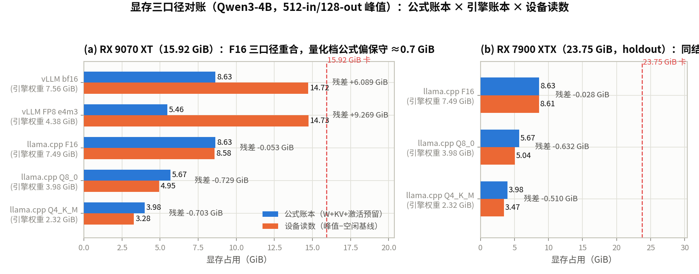
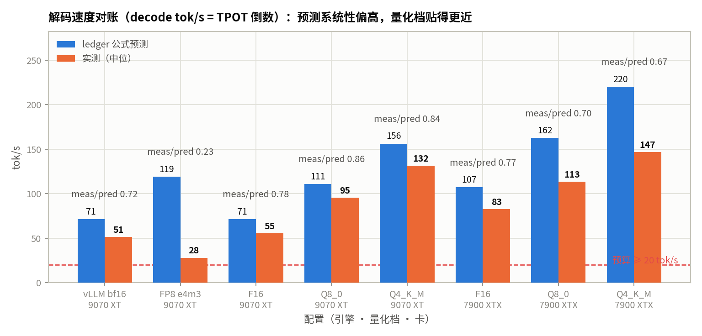
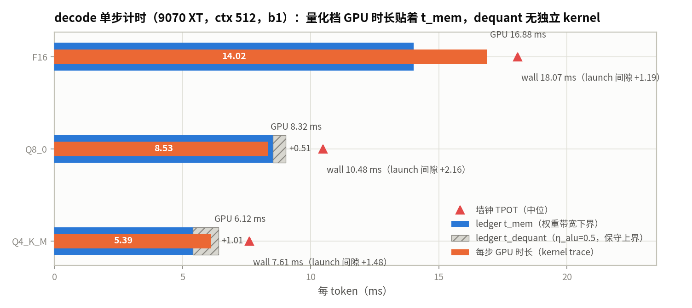
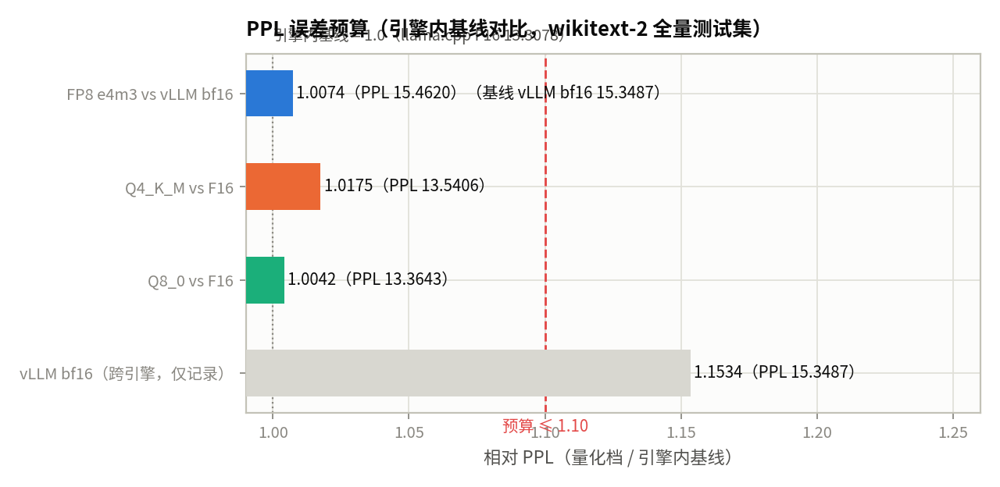

# 第 4 章 精度、量化方法与误差预算

::: danger ⚠️ Alpha内测版本警告
此为早期内部构建版本，尚不完整且可能存在错误，欢迎大家提Issue反馈问题或建议。
:::

## 本章导读

> 第 2 章回答了"多快"，第 3 章回答了"装得下吗"。本章回答"**能不能换个精度换空间换速度，代价是多少**"。我们把量化当成一个多约束设计问题：先按数值格式与缩放方法把每参数字节数算清楚（注意 GGUF 引擎布局 ≠ 公式 bpw），再在**显存 / 解码速度 / TTFT / 质量（PPL）**四个预算下做测量前预测，然后用 9070 XT 主线 + 7900 XTX holdout 的真机测量逐项对账——显存三口径（公式 / 引擎文件 / 设备读数）、速度 gap（框架开销 vs 系数 vs kernel 暴露）、PPL 相对退化 vs 1.10 预算，外加 kernel 级 trace 回答"反量化开销到底在哪"。读完你应该能回答：**INT4 真的可能比 BF16 慢吗，FP8 e4m3 在这套 stack 上真的比 BF16 快吗，误差预算花在哪里，四个预算哪一个先破。**

## 教学目标

- 能写出各数值格式（bf16 / f16 / int8 / Q4_K_M / fp8）的 bytes/param，并区分"公式 bpw"与"引擎文件实测 bpw"（GGUF 布局差）；
- 能区分 FP8 的 **W8A8**（动态激活量化，运行时 per-token act-quant）与 ledger 的 **W8A16 式** profile（仅权重 dequant），并解释路径错位如何造成 0.235 的速度 gap（§4.4.3）；
- 能解释块缩放（absmax）与 k-quant 混合精度（Q4_K/Q5_K/Q6_K 按层敏感度分配 bit），并把 llama-quantize 报告 + GGUF 文件字节当引擎口径锚点；
- 能在显存 / 速度 / TTFT / PPL 四个预算下手算量化账本（含独立的 dequant ALU 项），并给出"哪个约束先破"的判据；
- 能用三口径（公式 / 引擎 / 设备）对账显存残差、用 wall − GPU/step − t_mem 分解速度 gap，并用 kernel trace 定位 dequant 开销（或证明它不存在为独立 kernel）。

本章的主线是**把"换精度"变成一个带误差预算的多约束决策**，一套符号贯穿：

```
账本（测量前）   W        = N_quant × bpw + N_f16held × 2 B      # GGUF-aware：不是全参数 × bpw
                 vram_need = W + KV(4096) + act_reserve
                 t_step   = max(t_comp, t_mem) + t_dequant       # dequant 是独立 ALU 项，η_alu = 0.5（假设）
预算（四维）     VRAM    ≤ 15.92 − 0.2 (idle floor)     tok/s   ≥ 20
                 TTFT(512) ≤ 2.0 s                      PPL     ≤ 1.10 × 引擎内基线
对账（测量后）   显存残差 = 设备读数(峰值−空闲) − 公式          速度 gap = wall TPOT − GPU/step − (GPU/step − t_mem)
```

第 1、2 章做的是**速度维度**（发射受限 / roofline / η、β），第 3 章做的是**容量维度**（权重 + KV 池）。本章的"精度维度"同时改变容量与速度——bytes/param 变小，权重显存与 decode 流量同比例下降，但多出一笔**反量化**开销（dequant：读回低精度字节后还原成可计算精度）。这笔开销是量化的独有成本：它的量级决定"字节减半"能不能兑现成"速度翻倍"，§4.4/§4.5 的 kernel trace 就是来回答它的。

## 4.1 设置与环境

**硬件**（两卡，Ch2 校准常数沿用；`HIP_VISIBLE_DEVICES=1` → 9070，`=0` → 7900）：

| 参数 | RX 9070 XT（主卡） | RX 7900 XTX（holdout） |
| ---- | ---- | ---- |
| 架构 | gfx1201 (RDNA4) | gfx1100 (RDNA3) |
| VRAM | 15.92 GiB | 23.75 GiB |
| PEAK（稠密，Ch2 标定） | 195 TFLOPS | 214 TFLOPS |
| 带宽（Ch2 标定） | 640 GB/s | 960 GB/s |
| η / β（Ch2 §2.3 校准） | 0.6243 / 0.9054 | **名义复用 9070 校准值（未校准，仅方向性对照）** |
| ALU fp32 | 28.8 TFLOPS | 30.7 TFLOPS |
| 空闲基线（rocm-smi） | 0.0558 GiB | 0.0261 GiB |

W7900D（48 GB）参数待确认（TODO 嘉航），不进本章账本。

**模型**：Qwen3-4B（HF BF16；FP8 e4m3 档用官方 `Qwen/Qwen3-4B-FP8`，从 HF 下载，§4.2.3），L=36，d=2560，H_q=32，H_kv=8，D_head=128，inter=9728，vocab=151936，`tie_word_embeddings=true`，无 bias。参数量分解（ledger 输入，与第 3 章 §3.1 同一口径）：

| 组件 | 参数量 |
| ---- | ---- |
| embed_tokens（= lm_head，tie） | 389.0M |
| attention（q/k/v/o，36 层） | 943.7M |
| MLP（gate/up/down，36 层） | 2689.6M |
| norms（q/k norm + LayerNorm，36 层）+ final norm | 0.4M + 2560 |
| **合计** | **4022.6M**（每层 100.9M） |

**引擎**：vLLM 0.29.1.dev0（`rocm/vllm` 容器，GPU 1，host 侧 serving `127.0.1.1:8000`，enforce_eager，util 0.9；FP8 档 `quantization=fp8` 由 checkpoint 自动检出，kernel 走 TritonFp8BlockScaledMMKernel）；llama.cpp b12169（容器 `ch4-mlsys`，`convert_hf_to_gguf.py` + `llama-quantize` 出 F16 / Q8_0 / Q4_K_M 三个 GGUF）。

**测量协议**（速度/TTFT）：in 512 / out 128，greedy（temperature 0），固定 prompt（`eval/prompt.txt`，512 token / 2002 字符），warmup 5 + 采样 10，报中位数；请求间隔 1.0 s；显存峰值 = rocm-smi 4 Hz 采样期间的峰值（设备口径）。**质量协议**（PPL）：wikitext-2 test 全量，`llama-perplexity -c 1024 -b 512`（291 chunk × 1023 token = 297,693 token，尾 955 token 因非 1024 倍数丢弃）；vLLM 侧 292 窗 / 298,647 token。

**课程定位**：① 显存三口径对账（公式 vs 引擎文件 vs 设备）；② 显式 dequant 项 + kernel 级标定；③ PPL 预算 1.10 + "哪个约束先破"；④ 消费级 RDNA 口径（FP8 e4m3 有真机样本——vLLM W8A8 路径、无 tuned kernel，§4.2.3/§4.4.3；无 FP4 路径；GGUF 文件字节 vs 公式 bpw）。

## 4.2 数值格式与量化方法

### 4.2.1 格式与缩放

量化 = 用更少的 bit 存权重（W4/W8）+ 推理时还原（dequant）。两件事：**每参数多少 bit**（容量账）与**怎么缩放**（质量账）。格式表（bytes/param 用本章 ledger 的 profile bpw，结构列是方法侧事实）：

| 格式 | B/param（ledger） | 结构与缩放 | 本章引擎路径 |
| ---- | ---- | ---- | ---- |
| BF16 | 2.0（16 bpw） | sign 1 + exp 8 + mantissa 7；范围 ~±3.4e38，~2 位十进制精度 | vLLM（HF bf16 原样） |
| F16 | 2.0（16 bpw） | sign 1 + exp 5 + mantissa 10；±65504，~3–4 位精度 | llama.cpp F16 GGUF |
| INT8（Q8_0） | 1.125（profile）/ 1.0625（Q8_0 名义 8.5 bpw） | int8 权重 + **每 32 块 int16 absmax scale** | llama.cpp Q8_0 |
| Q4_K_M | 0.625（profile）/ 0.6208（文件实测） | 4-bit 权重 + 每 64 子块 int6 scale/min（256 块），Q4_K/Q5_K/Q6_K + 部分 f16 混合 | llama.cpp Q4_K_M |
| FP8 e4m3 | 1.0625（profile）/ 1.0000（F8 张量实测） | sign 1 + exp 4 + mantissa 3；max 448，~2–3 位精度；**128×128 块 scale（每块一个 fp32）+ 动态激活量化（W8A8）** | vLLM（官方 Qwen3-4B-FP8，§4.2.3） |
| FP4 † | 0.5625（profile） | 4-bit + 块 scale；范围极窄 | **not_covered**（RDNA 无硬件路径） |

† FP4 行是 ledger 的**公式外推**（给"如果存在样本"的 what-if 数），本机无样本、无路径，不做真机验证——`not_covered` 是口径纪律，不是遗漏。FP8 e4m3 本章有真机样本（§4.2.3）。

缩放方法两档（方法出处见延伸阅读：CMU L19 + Nagel et al. 2021）：

- **per-tensor vs per-block**：全局一个 scale 太粗（离群值吃掉动态范围）；Q8_0/Q4_K 用**块 absmax scale**——每 32/每 64 个权重一个 scale，块内误差有界。Q4_K 额外带 per-子块 min 偏移（相当于块级 zero-point）。
- **离线 vs 在线**：本章路径全部是**离线 RTN 族**（llama-quantize，按块独立量化，无跨块误差补偿）。GPTQ（Hessian 逆 Cholesky + 逐列误差回补）、SmoothQuant/ZeroQuant（把激活离群值折进权重再量化）、LLM.int8()（outlier 混合精度）在本机**没有运行路径**，只作方法对照——Q4_K_M 的 PPL 退化（§4.6）里没有离线误差补偿这一项，这是它 +1.75% 的直接来源之一。

### 4.2.2 k-quant 家族：文件字节是引擎口径锚点

Q4_K_M 是 k-quant 家族的"M"预设：**bit 分配本身就是按层敏感度做的**（大部分张量 Q4_K，attn_v / 部分 ffn 升到 Q5_K/Q6_K，个别保持 f16）——这不是"4-bit 量化"，而是"~5 bpw 预算下的 bit 分配"。课程里没有讲 GGUF k-quant 的（CMU/UIUC/GT 都不覆盖 llama.cpp 工程布局），所以本章的锚点换成**机器产物**：

| GGUF 文件 | 字节 | GiB | 文件整体 bpw（字节/4.0226e9 参数） | llama-quantize 报告 |
| ---- | ---- | ---- | ---- | ---- |
| f16 | 8,051,285,408 B | 7.488 | 16.01 | `16.00 BPW`（原样转换） |
| q8_0 | 4,280,405,408 B | 3.984 | 8.51 | `7672.62 MiB (16.00 BPW) → 4076.43 MiB (8.50 BPW)` |
| q4_k_m | 2,497,280,928 B | 2.322 | 4.97 | Q4_K/Q5_K/Q6_K + f16 混合 |

三个读数：

1. **f16 文件整体 16.01 bpw = 名义 16**——转换不改 bit，文件字节是公式 `N × 2B` 的直接验证（7.488 vs 7.493 GiB，−0.005）；
2. **q8_0 文件整体 8.51 bpw **（int8 + per-32 int16 scale）——平均意义上**没有大块 f16 保留**（若 389.3M embed 留在 f16，文件整体会被拉到 ~9.2 bpw）；
3. **q4_k_m 文件整体 4.97 bpw**，介于 Q4_K（~4.3）与 Q5_K（~5.4）之间，与"Q4_K 为主 + 少量升档"的 M 预设一致。

**公式 bpw ≠ 文件 bpw** 是本章显存对账残差的主要来源之一（§4.4.2）：ledger 的 gguf-aware 权重账假设 389.3M embed/norms 参数留在 f16（2 B/param），而实际 llama-quantize 布局没有这么大的 f16 保留块——公式侧系统性偏保守 ~0.5 GiB/档。

### 4.2.3 FP8 e4m3（本章 covered）与 FP4（not_covered）

**FP8 e4m3**：9070 XT 有 `ai_f8` 指令路径。本章从 HF 下载官方 `Qwen/Qwen3-4B-FP8` 做真机测量，checkpoint 布局（safetensors header 逐张量核算，651 tensors）：

| 张量组 | 参数量 | 存储 | 字节 |
| ---- | ---- | ---- | ---- |
| 量化权重（linear 层） | 3,633.3M | F8_E4M3，1 B/weight + 128×128 块 fp32 scale | 3.3838 GiB（scale 开销 ≈ 0.45 MB） |
| embed_tokens + lm_head + norms | 778.4M | BF16（原样） | 1.4498 GiB |
| **合计** | 4,411.7M | | 5,189,976,192 B = **4.8335 GiB** |

三个结构事实，都是后面读数的前置：

1. **lm_head 副本**：config `tie_word_embeddings=true`，但 checkpoint 里 embed 与 lm_head **各自完整存了一份 BF16**（各 741.9 MB）——文件比"tie 语义"多出 0.708 GiB。vLLM 加载时把 lm_head 重新 tie 回 embed，所以引擎 weights 是 4.38 GiB 而不是文件 4.8335（§4.4.1 的引擎锚点口径）；
2. **块 scale 开销极小**：128×128 块 = 每 16,384 个权重一个 fp32 scale（0.00024 B/weight，全模型 ≈ 0.45 MB）。ledger profile 假设的 per-16 int16 scale 是 0.0625 B/weight（≈ 227 MB）——公式在 scale 项上**偏保守三个数量级**，方向安全；
3. **W8A8，不是 W8A16**：`activation_scheme: dynamic` → 权重 fp8、**激活运行时 per-token 动态量化**。ledger 的 fp8 profile 是 W8A16 式（`ops_dequant=1`，只算权重 dequant，激活保持 bf16 参与计算）——这条路径差是 §4.4.3 速度 gap 的主来源之一，此处先记下，不展开。

**FP4**：RDNA 无 FP4 硬件路径，无样本，只给公式外推（3.771 GiB / 181.6 tok/s）。

`not_covered` 的口径（现只针对 FP4）：正文不引用 FP4 档的任何"实测"数字；它只出现在 ledger 预测表里，作为 what-if 上界。

## 4.3 三维预算账本（测量前预测）

预测脚本 `quant_ledger.py` 在**测量开始之前**运行并落盘（`results/quant_ledger_9070xt.json`），holdout 的 7900 Q4_K_M 配置在测量前冻结。这是本书的预测纪律：先有数，后有真机，对账才有意义。

### 4.3.1 账本模型

沿用 Ch2 的 roofline 时间模型，加上一笔量化独有的 dequant 项：

```
W_gguf_aware = N_quant × bpw + N_f16held × 2 B      # 不是 N × bpw：f16 保留张量按 2B 算
vram_need    = W_gguf_aware + KV(4096 tok × 147,456 B) + act_reserve(0.58 GiB)
t_step       = max(t_comp, t_mem) + t_dequant
             t_comp = 2N×1 / (PEAK × η)            t_mem = bytes_per_step / (BW × β)
             t_dequant = N_bytes × ops_dequant / (ALU_fp32 × η_alu)，η_alu = 0.5（假设值，§4.5 讨论）
```

ops_dequant（每元素反量化算子数）：bf16/f16 = 0，int8 = 2，int4 = 4，fp8 = 1，fp4 = 2。KV 用第 3 章的 m_kv（4B = 147,456 B/token），预算 4096 token → 0.562 GiB。

### 4.3.2 9070 XT 预测（主卡）

预算：VRAM ≤ 15.92 − 0.2（idle floor）= 15.72 GiB；decode ≥ 20 tok/s；TTFT(512) ≤ 2.0 s；PPL ≤ 1.10 × 引擎内基线。

| profile | bpw | W（gguf-aware） | vram_need | VRAM 占用 | 参数断点 | t_step | 预测 tok/s | TTFT(512) | 限流 |
| ---- | ---- | ---- | ---- | ---- | ---- | ---- | ---- | ---- | ---- |
| bf16 | 2.0 | 7.493 GiB | 8.635 GiB | 54.9% | 7.8B | 14.02 ms | 71.4 | 31.8 ms | memory |
| int8_w8a16（Q8_0） | 1.125 | 4.532 GiB | 5.674 GiB | 36.1% | 12.9B | 9.03 ms | 110.7 | 31.8 ms | memory |
| int4_w4a16（Q4_K_M） | 0.625 | 2.84 GiB | 3.983 GiB | 25.3% | 20.6B | 6.40 ms | 156.2 | 31.8 ms | memory |
| fp8_e4m3 | 1.0625 | 4.32 GiB | 5.463 GiB | 34.8% | 13.6B | 8.39 ms | 119.2 | 31.8 ms | memory |
| fp4 † | 0.5625 | 2.629 GiB | 3.771 GiB | 24.0% | 22.3B | 5.51 ms | 181.6 | 31.8 ms | memory |

† fp4 not_covered，公式外推。

四个读数：

1. **四档 covered 全部 memory-bound**（t_comp 0.06 ms ≪ t_mem 5.4–14.0 ms）——4B 单请求 decode 离算力边界还很远，量化省的是**流量**不是算力；
2. **断点随精度上移**：bf16 在 7.8B 参数时打满 15.72 GiB 预算，FP8 e4m3 推到 13.6B，Q8_0 推到 12.9B，Q4_K_M 推到 20.6B——**同一张卡，量化把"装得下"的模型规模上移 1.64×/2.64×**（§3.1.1 的"精度是容量准入"在这里兑现）；
3. **t_dequant 是独立加的**：Q4 1.009 ms / Q8 0.505 ms（η_alu=0.5 假设）——如果反量化开销真的这么大且**串行暴露**，量化档的速度提升会低于字节比；§4.5 的 kernel trace 来检验这个假设；
4. **TTFT 三档同为 31.8 ms**：prefill 是 batch 计算，compute-leaning，对 weights 的 bit 数不敏感——prefill 不是量化的敏感区，decode 才是。

### 4.3.3 7900 XTX holdout（辅助卡）

同一模型、同一 profile，η/β 名义复用（未校准，仅方向性对照）；VRAM 预算 23.75 − 0.2 = 23.55 GiB：

| profile | vram_need | VRAM 占用 | 参数断点 | t_step | 预测 tok/s | TTFT(512) |
| ---- | ---- | ---- | ---- | ---- | ---- | ---- |
| bf16 | 8.635 GiB | 36.7% | 12.0B | 9.34 ms | 107.0 | 29.0 ms |
| int8_w8a16 | 5.674 GiB | 24.1% | 19.9B | 6.16 ms | 162.4 | 29.0 ms |
| int4_w4a16 | 3.983 GiB | 16.9% | 31.7B | 4.54 ms | 220.2 | 29.0 ms |

W 账本与卡无关（8.635/5.674/3.983 GiB 与 9070 完全相同），变的只有 VRAM 占用、断点（12.0/19.9/31.7B）与速度（带宽 960 vs 640 GB/s → 名义 1.5×）。holdout 的意义：**7900 Q4_K_M 在测量前冻结不跑**（用户指令：不动 7900 上的任务），它的预测值只作为"换卡不换模型"的对照列，不进本轮对账。

### 4.3.4 可行性判定：4B 点四预算全过，最紧的是质量

按预测数算四个预算的占用率（9070，covered 档中最坏者）：

| 预算 | 最坏点 | 占用率 |
| ---- | ---- | ---- |
| PPL ≤ 1.10 | Q4（§4.6 实测 1.0175） | 92.5% |
| VRAM ≤ 15.72 GiB | bf16（8.635） | 54.9% |
| decode ≥ 20 tok/s | bf16（71.4） | 28.0%（= 20/71.4） |
| TTFT ≤ 2.0 s | 全档 31.8 ms | 1.6% |

**4B 点上没有预算被打破**，最紧的是质量预算（Q4 预测占 1.10 的 ~90%+，实测后校准到 92.5%）；VRAM 其次（bf16 54.9%）。沿"模型变大"的方向，**VRAM 先破**——断点就是 §4.3.2 的 7.8B/12.9B/20.6B（9070）。这个"谁先破"的判据是本章的决策规则，§4.7 用实测复验。

## 4.4 真机：显存三口径对账与速度对账

真机 8 组配置（9070 × {vLLM bf16, vLLM FP8 e4m3, llama F16, Q8_0, Q4_K_M} + 7900 × {F16, Q8_0, Q4_K_M}；7900 Q4_K_M 为 holdout）。显存三口径：**公式**（ledger vram_need）/ **引擎**（vLLM 启动账本 weights、GGUF 文件字节）/ **设备**（rocm-smi 峰值 − 空闲基线）。

### 4.4.1 显存三口径

| 配置 | 公式 vram_need | 引擎锚点 | 设备峰值 | 设备 Δ（−空闲） | **残差（设备Δ − 公式）** |
| ---- | ---- | ---- | ---- | ---- | ---- |
| vllm_bf16_9070 | 8.635 GiB | weights 7.56 GiB | 14.7797 | 14.7239 | **+6.0889** |
| vllm_fp8_9070 | 5.463 GiB | weights 4.38 GiB（启动账本；文件 4.8335 GiB 含 0.708 lm_head 副本） | 14.7875 | 14.7317 | **+9.2687** |
| llama_f16_9070 | 8.635 GiB | GGUF 7.488 GiB | 8.6378 | 8.5820 | **−0.0530** |
| llama_q8_9070 | 5.674 GiB | GGUF 3.984 GiB | 5.0011 | 4.9453 | **−0.7287** |
| llama_q4_9070 | 3.983 GiB | GGUF 2.322 GiB | 3.3363 | 3.2805 | **−0.7025** |
| llama_f16_7900 | 8.635 GiB | GGUF 7.488 GiB | 8.6331 | 8.6070 | **−0.0280** |
| llama_q8_7900 | 5.674 GiB | GGUF 3.984 GiB | 5.0681 | 5.0420 | **−0.6320** |
| llama_q4_7900 | 3.983 GiB | GGUF 2.322 GiB | 3.4987 | 3.4726 | **−0.5104** |



残差四种行为：llama F16 ≈ 0（±0.03，两卡一致）；llama 量化档 −0.5～−0.7（9070 −0.73/−0.70，7900 −0.63/−0.51）；vLLM 两行为正残差——bf16 **+6.09**、FP8 e4m3 **+9.27**，同为 KV 池预分配主导，且权重越小、vLLM 预分配的池越大、残差越大（§4.4.2(a')）。四个都不是"公式错了"，而是口径差——逐项归因在 §4.4.2。

### 4.4.2 残差归因：每个 GiB 从哪来

**(a) vLLM bf16：+6.0889 GiB = KV 池预分配（+5.51）主导。** 启动账本（`vllm_startup_bf16_9070xt.json`，enforce_eager，util 0.9）：target 14.33 = consumed 8.11（weights 7.56 + non_weight 0.55）+ activation 0.15 + **KV 池 6.07 GiB（44,208 token）**。逐项对"设备Δ 14.7239 − 公式 8.635"：

| 项 | 贡献（GiB） |
| ---- | ---- |
| weights：实测 7.56 vs 公式 7.493 | +0.067 |
| KV 池：6.07（vLLM 把剩余预算全部预分配成 KV，44,208 tok）vs 公式 KV(4096) 0.562 | **+5.508** |
| non_weight 0.55 + activation 0.15 = 0.70 vs 公式 act 预留 0.58 | +0.12 |
| 运行时增长：设备峰值 14.7797 vs 启动 target 14.33（4 Hz 采样窗口内的 serving 期增长） | +0.394 |
| **合计** | **+6.089 ✓**（与残差逐位闭合） |

这是第 3 章 §3.3.2 的"池预分配"行为在残差里的投影：**vLLM 的显存读数 ≈ 整张卡的预算，而不是这个模型的 vram_need**——对账时口径必须对齐（"模型需要多少" vs "框架占了多少"），否则 +6 GiB 的残差会被误读成公式失效。

**(a') vLLM FP8 e4m3：+9.2687 GiB = 同机制、池更大。** 启动账本（`vllm_startup_fp8_e4m3_9070xt.json`，enforce_eager，util 0.9）：target 14.33 = consumed 5.42（weights 4.38 + non_weight 1.04）+ activation 0.09 + **KV 池 8.82 GiB（64,208 token）**。逐项对"设备Δ 14.7317 − 公式 5.463"：

| 项 | 贡献（GiB） |
| ---- | ---- |
| weights：实测 4.38 vs 公式 4.32 | +0.06 |
| KV 池：8.82（vLLM 把剩余预算全部预分配成 KV，64,208 tok）vs 公式 KV(4096) 0.562 | **+8.258** |
| non_weight 1.04 + activation 0.09 = 1.13 vs 公式 act 预留 0.58 | +0.55 |
| 运行时增长：设备峰值 14.7875 vs 启动 target 14.33 | +0.402 |
| **合计** | **+9.269 ✓**（舍入内闭合 9.2687） |

两个读数：① **容量口径验证**——consumed 5.42 vs vram_need 5.463 = **−0.043（−0.8%）**，引擎对"模型真实消耗"的读数比公式略低，公式保守方向正确；② **non_weight 1.04 ≈ bf16 的 0.55 的 2×**——W8A8 的运行时开销（act-quant 缓冲 + Triton kernel 的编译/缓存）在这里可见。KV 池 8.82 > bf16 的 6.07，因为权重更小 → 剩余预算更大 → 预分配池更大——**权重省下的 GiB 全部回流成池，模型侧净收益只体现在"能装的模型更大"，不体现在"同一模型的显存读数更低"**（对 vLLM 口径而言）。

**(b) llama F16：−0.0530（9070）/ −0.0280（7900）≈ 0。** 公式 W（7.493）比文件字节（7.488）高 0.005；非权重开销实测 1.094/1.119 GiB vs 公式 1.142（KV 4096 0.562 + act 0.58）——实测小上下文（~640 token）的 KV + 瞬态激活低于公式预留。**F16 行是公式口径的校准行**：它 ≈ 0，才说明量化档的 −0.7 不是公式系统性偏差。

**(c) llama Q8_0 / Q4_K_M：−0.7287 / −0.7025（9070），−0.6320（7900 Q8）。** 拆成两项：

| 项 | Q8_0 | Q4_K_M |
| ---- | ---- | ---- |
| W：公式 gguf-aware vs 文件字节（保守方向） | 4.532 vs 3.984 → **−0.548** | 2.84 vs 2.322 → **−0.518** |
| 非权重开销：实测（Δ − 文件）vs 公式 1.142 | 0.961 → −0.181 | 0.959 → −0.184 |
| **合计** | **−0.729 ✓** | **−0.702 ✓**（舍入内） |

7900 同构：Q8 −0.632 = W 项 −0.548 + 非权重 −0.084；Q4 −0.510 = W 项 −0.518 + 非权重 **+0.009**（实测非权重开销 1.151 vs 公式 1.142）。两卡的非权重项量级都小（9070 −0.18，7900 ≈ 0），残差主体是"公式 bpw vs 文件 bpw"的保守 W 口径。

主项（−0.55/−0.52）就是 §4.2.2 说的**公式 bpw vs 文件 bpw**：ledger 假设 389.3M embed/norms 留在 f16（+0.779 GiB）且 profile bpw（1.125/0.625）略高于名义，而实际 llama-quantize 布局文件整体 8.51 / 4.97 bpw，没有大块 f16 保留。**方向保守**（公式高估显存需求），对"装得下吗"的判断安全；但做精确容量规划时应以**文件字节**为引擎锚点。

### 4.4.3 速度对账与 gap 分解

| 配置 | 实测 tok/s | TTFT med（ms） | TPOT med（ms） | 预测 tok/s | 实测/预测 |
| ---- | ---- | ---- | ---- | ---- | ---- |
| vllm_bf16_9070 | 51.2 | 58.3 | 19.5 | 71.4 | 0.717 |
| vllm_fp8_9070 | 28.0 | 85.0 | 35.7 | 119.2 | **0.235** |
| llama_f16_9070 | 55.3 | 25.0 | 18.1 | 71.4 | 0.775 |
| llama_q8_9070 | 95.4 | 17.3 | 10.5 | 110.7 | 0.862 |
| llama_q4_9070 | 131.5 | 14.1 | 7.6 | 156.2 | 0.842 |
| llama_f16_7900 | 82.8 | 20.8 | 12.1 | 107.0 | 0.774 |
| llama_q8_7900 | 113.2 | 16.8 | 8.8 | 162.4 | 0.697 |
| llama_q4_7900 | 146.9 | 14.3 | 6.8 | 220.2 | 0.667 |



四个读数：

1. **FP8 行的预测被证伪（0.235，比其余各档的 0.67–0.88 低 2.9–3.7×）**：预测 119.2 tok/s，实测 28.0（TPOT 35.7 vs bf16 的 19.5 ms；t_mem 公式 8.136 ms vs 实测 TPOT 35.65 ms，暴露部分远超 llama 各档的 ~1–3 ms）。三个来源——前两个有直接证据，第三个是标注为解读的推断：
   - **路径错位（主项）**：ledger 的 fp8 profile 是 W8A16 式（`ops_dequant=1`，只算权重 dequant，激活以 bf16 参与计算）；官方 checkpoint 是 `activation_scheme: dynamic` → **W8A8**，运行时 per-token 激活量化（启动日志可见 norm_quant/act_quant 融合路径）——这笔开销 ledger 完全没有建模；
   - **kernel 未调优**：vLLM 选中 `TritonFp8BlockScaledMMKernel`，但 **RX9070XT 没有 tuned kernel config**——四个 shape（N=6144/K=2560、N=2560/K=4096、N=19456/K=2560、N=2560/K=9728）都落在默认配置上，启动日志原话 *"Using default W8A8 Block FP8 kernel config. Performance might be sub-optimal!"*；
   - **M=1 GEMV 在块 FP8 kernel 的设计区间外**（块 scale 查表 + scale 乘法对 M=1 不利——解读：vLLM 侧拿不到 kernel 级时间，rocprofv3 SIGABRT）。
2. **其余六档：预测系统性偏高 15–30%，且量化档贴得更近**（0.84–0.86 vs 0.72–0.78）。gap 不是单一来源，拆成两段（§4.5 的 kernel trace 给 GPU 内时间）：
   - **launch gap** = wall TPOT − GPU/step：F16 +1.19 ms、Q8 +2.16、Q4 +1.48——每步几十个小 kernel 的发射间隙，第 1 章"发射受限"结论的量化版（量化档 kernel 更多更碎，gap 反而更大）；
   - **exposed** = GPU/step − t_mem（公式字节口径）：F16 +2.87 ms（attention/norm 的 GPU 时间 + η/β 漂移）、Q8 **−0.20**、Q4 +0.73。
3. **Q8 的 −0.20 是口径差，不是超带宽**：t_mem 按公式 W（4.532 GiB 口径）算，实际文件只有 3.984 GiB——按真实字节，纯权重流量下界是 8.528 × 3.984/4.532 ≈ 7.49 ms，实测 GPU/step 8.32 只比它高 ~0.83 ms（attention/norm）。**反量化在 Q8 上完全藏在 GEMV 里，没有独立开销**（§4.5）；
4. **跨卡方向性验证**：卡间速度比随精度降低单调收窄——F16 82.8/55.3 = 1.497 ≈ 带宽比 960/640 = 1.50（memory-bound 预测的跨卡缩放在最纯的档位成立），Q8 1.187，Q4 146.9/131.5 = **1.117**；7900 的 实测/预测也随量化下降（0.774 → 0.697 → 0.667）。方向与 7900 名义 η/β 复用（未校准）的已知偏差一致，且量化档每步时间越短、非权重开销（attention/norm/launch）占比越大——只作对照，不进结论。

**TTFT**：全部 ≤ 85.0 ms ≪ 2.0 s 预算（余量 23–142×）。引擎差：vLLM 58.3 vs llama F16 25.0 ms——同 bf16 档、同卡、同 prompt，差 2.3× 是框架开销（Python 调度 + 请求路径）。FP8 的 85.0 ms 比 vLLM bf16 又高 2.7×，主项不是框架开销而是上面读数 1 的 W8A8 + 未调优 kernel（prefill 走同一路径）。kernel 级对照做不了（rocprofv3 包裹 vLLM 整进程会 SIGABRT，Ch2 已验证的 LLVM 冲突），只能停在引擎级。

### 4.4.4 "INT4 比 BF16 慢"的假设与实测

实验设计阶段的假设（来自课程材料里"低精度 dequant 开销"的一般性警告）是：**INT4 W4A16 单请求下可能比 BF16 慢一个量级**。实测把它**证伪**了：

| 对比（9070） | tok/s | 比值 |
| ---- | ---- | ---- |
| Q4_K_M vs F16 | 131.5 vs 55.3 | **2.38×（更快，不是更慢）** |
| Q4_K_M vs vLLM bf16 | 131.5 vs 51.2 | 2.57× |
| Q8_0 vs F16 | 95.4 vs 55.3 | 1.73× |

"快"的机制与 §4.3.2 的账一致：单请求 decode 是 **memory-bound**，Q4 把每步流量从 7744.7 MiB 砍到 2980.3 MiB（0.38×），step 时间同比例下降；而假设里那个"慢一个量级"需要 dequant **作为独立 ALU pass 串行暴露**（2N×4 ops 在 28.8 TFLOPS × 0.5 上 ≈ 1 ms/步）——kernel trace（§4.5）显示它**不是独立 kernel**，dequant 融合在 GEMV 内部，Q4 的 exposed 只有 +0.73 ms（< 1.009 ms 的串行上界，且其中还含 attention/norm）。**结论：在本机 ROCm + llama.cpp 路径上，dequant 开销基本被隐藏，量化的速度收益 ≈ 字节比**；"低精度反而慢"的场景存在于 dequant 未被融合的实现或 compute-bound 的 batch 区间，不是这里。

**镜像假设「FP8 比 BF16 快」（vLLM 路径）在本 stack 同样被证伪。** 预测口径 FP8/bf16 = 119.2/71.4 = 1.67×（ledger 的 fp8 profile 更省流量）；实测 28.0/51.2 = **0.55×——更慢**。但这个"慢"不是"量化本身慢"：**容量过**（weights 4.38 vs 公式 4.32；consumed 5.42 vs vram_need 5.463，−0.8%，§4.4.2(a')）、**质量过**（PPL 1.0074，+0.74%，§4.6），只有速度不过。机制在 §4.4.3 读数 1：**ledger profile（W8A16 式）与 checkpoint（W8A8）的路径错位 + 未调优的默认 Triton 块 FP8 kernel**——是 stack 成熟度问题（vLLM 0.29 + ROCm + gfx1201），不是 RDNA4 的算力问题。两个证伪是对称的："INT4 比 BF16 慢"对应 dequant 未被融合，"FP8 比 BF16 快"对应激活量化与 kernel 不在 ledger 里——**两次都是"ledger profile 与实际运行路径不一致"，不是算术能力问题**。

## 4.5 dequant 开销：kernel 级归因

**方法**：`rocprofv3 --kernel-trace` 包裹 `llama-cli`（容器内），decode = 1-token prefill + 128 步 decode（GEMV 主导、KV 很小），prefill = 512-token prompt + 1 步；同一引擎，profile 间差异全部来自量化格式 → dequant 归因干净。vLLM 侧不做 kernel 级（SIGABRT），用 §4.4.3 的引擎级对照。

**核心发现：llama.cpp ROCm 没有独立 dequant kernel。** dequant 融合进 GEMV/GEMM kernel 本身——decode 的 `mul_mat_vec_q<(ggml_type)N>` 内部完成"读量化字节 → 子块 scale 还原 → MAC"，prefill 的 `mul_mat_q<(ggml_type)N, 128, ...>` 同理。ggml_type 编号：Q8_0 = 8，Q4_K = 12，Q5_K = 14。六组 trace 里 dequant 类 kernel ≈ 0%（`class_pct` 无 dequant 项，gemv_matmul 占 99.0/99.4/99.0%）。

**decode（9070，每步 GPU 时间 = trace 总时长 ÷ 128 步）：**

| profile | GPU/step | t_mem（公式） | exposed（GPU−t_mem） | ledger t_dequant（上界） | 主导 kernel |
| ---- | ---- | ---- | ---- | ---- | ---- |
| F16 | 16.884 ms | 14.015 ms | +2.869 ms | 0 | `mul_mat_vec_f<__half,…>` ×3 变体（34.6+30.9+27.5%）；flash_attn 1.14%、rms_norm 1.05% |
| Q8_0 | 8.324 ms | 8.528 ms | **−0.204 ms** | 0.505 ms | `mul_mat_vec_q<(ggml_type)8>` 84.5%+1.6%；`quantize_q8_1` 4.5%；flash 2.01% |
| Q4_K_M | 6.123 ms | 5.393 ms | **+0.730 ms** | 1.009 ms | `mul_mat_vec_q<(ggml_type)12>` 57.3% + `<14>` 20.6%（Q4_K+Q5_K 混合直接可见）；`quantize_q8_1` 6.6% |

三个读数：

1. **Q4_K_M 的混合布局在 trace 里直接可见**：(ggml_type)12（Q4_K）与 (ggml_type)14（Q5_K）两类 GEMV 并存，占比 57.3%/20.6%——§4.2.2 的"M 预设按层敏感度分配 bit"不是文档说法，是 kernel 调用记录；
2. **`quantize_q8_1` 不是权重 dequant**：它是**运行时激活量化**（attention/交叉熵路径把激活 cast 成 Q8_1），4.5–6.6% 的占比与权重精度无关的常数项；权重侧的 dequant 在 trace 里找不到独立条目，就是融合进 GEMV 的那部分；
3. **η_alu 无法独立标定**：ledger 的 `t_dequant = N_bytes × ops / (ALU × η_alu)` 假设 dequant 是串行 ALU pass，而实测它不存在为独立 kernel——`η_alu = 0.5` 保持为假设值，**ledger 的串行 t_dequant 保留为保守上界**（Q4 1.009 ms），正文所有"dequant 开销"的实数都用 exposed（GPU/step − t_mem）并报口径（含 attention/norm 的 GPU 时间，不是纯 dequant）。



**prefill（batch 区间，GPU 总时长，512 token）：Q8_0 91.44 < Q4_K_M 99.94 < F16 113.62 ms。** 排序与 decode 相反（decode 是 Q4 最快）：prefill 的 `mul_mat_q<(ggml_type)N, 128, …>` 是 batch GEMM，更接近 compute-leaning，4-bit 的解包/子块 scale 查表在 GEMM 里比 8-bit 的 scale 乘法贵，F16 则输在流量最大。**哪个格式快是区间问题**：单请求 decode（memory-bound）Q4 赢，batch prefill（compute-leaning）Q8 赢——这也是"量化选型必须按负载区间报数"的实证。

## 4.6 PPL：误差预算

质量口径：wikitext-2 test 全量（§4.1 协议）。**基线取引擎内对比**——llama.cpp F16 是 GGUF 量化档的参照（同一引擎、同一 GGUF 转换链、同一协议），vLLM bf16 与 llama F16 之间的差**不进预算**；FP8 e4m3 行同引擎，基线取 vLLM bf16 15.3487（同一 292 窗 / 298,647 token 协议，token 数逐位相同）。

| 配置 | PPL（± 95% CI） | 相对引擎内基线 | vs 预算 1.10 |
| ---- | ---- | ---- | ---- |
| llama F16（基线） | 13.3078 ± 0.1209 | 1.0000 | — |
| Q8_0 | 13.3643 ± 0.1216 | **1.0042（+0.42%）**（vs F16 13.3078） | 通过（余量 1.095×） |
| Q4_K_M | 13.5406 ± 0.1226 | **1.0175（+1.75%）**（vs F16 13.3078） | 通过（余量 1.081×） |
| vLLM FP8 e4m3 | 15.4620 | **1.0074（+0.74%）**（vs vLLM bf16 15.3487） | 通过（余量 1.092×） |
| vLLM bf16（仅记录） | 15.3487 | 1.1534（跨引擎 offset，vs F16） | 不进预算 |



四个读数：

1. **FP8 e4m3 的质量代价几乎免费（+0.74%）**：介于 Q8_0 +0.42% 与 Q4_K_M +1.75% 之间——128×128 块 scale（每 16,384 权重一个 fp32，§4.2.3）保住了离群权重附近的动态范围，e4m3 的动态范围对正态分布权重接近 f16；同引擎同协议下这是"8-bit 换 4B 权重显存"的干净质量读数；
2. **两档量化都在 1.10 预算内，且余量 ≥ 8%**：Q4_K_M +1.75% 是主要消耗项——无离线误差补偿（§4.2.1）+ 4-bit 分辨率，但 M 预设的 bit 分配（部分层 Q5_K/Q6_K/f16）把它从"纯 Q4"的退化压下来了；
3. **跨引擎 offset 1.1534 是口径差，不是质量差**：vLLM bf16 15.3487 vs llama F16 13.3078，含协议差（292 窗 / 298,647 token vs 291 chunk / 297,693 token，chunk 间无跨窗上下文）与 bf16→f16 GGUF 表示差（f16 无 bf16 的 8-bit 指数，大 logit 上的舍入路径不同）。只作记录——若把它算进预算，Q4 会被误判"超预算 1.75% × 1.1534 = 10.6%"，这就是"基线必须引擎内"的原因；
4. **误差预算的实际形态**：预算 1.10（10% 相对退化）在 4B 上只用了 1.75%——**质量不是 4B 的紧约束**（§4.7 的 92.5% 占用率是预测口径，实测后是 1.0175/1.10 = 92.5% 的预算余量 8.1%）。若换更小的模型或更激进的档（纯 Q4_0、更低 bpw），退化会向预算靠近——预算的意义在于给"更激进的档"留判定线，而不在于 4B 本身。

## 4.7 哪个约束先破

把 §4.3.4 的判定用实测数复算（9070，covered 档最坏点）：

| 预算 | 实测最坏点 | 占用率 | 判定 |
| ---- | ---- | ---- | ---- |
| PPL ≤ 1.10 | Q4_K_M 1.0175（FP8 e4m3 1.0074 也通过） | 92.5% | 最紧，通过（8.1% 余量） |
| VRAM ≤ 15.72 GiB | vLLM bf16 设备 14.72（公式口径 8.635；FP8 公式口径 5.463） | 54.9%（公式）/ 93.7%（vLLM 预分配口径） | 公式口径通过（FP8 34.8%）；vLLM 口径下池占满（§4.4.2(a)/(a')） |
| decode ≥ 20 tok/s | **vllm fp8 28.0** | 71.4%（= 20/28.0） | 全档通过 1.4–6.6×（FP8 最紧） |
| TTFT ≤ 2.0 s | **vllm fp8 85.0 ms** | 4.3% | 全档通过 ≥ 23× |

两个方向两个答案：

- **固定 4B 模型，看预算余量**：质量最紧（Q4 92.5%），速度/TTFT 有大量余量。要提质量余量就换档（Q4 → Q8：+1.75% → +0.42%，代价是 36 tok/s 与 1.67 GiB 显存）；
- **沿模型规模轴（4B → 更大）**：**VRAM 先破**。9070 断点 bf16 7.8B / Q8_0 12.9B / Q4_K_M 20.6B；7900 为 12.0 / 19.9 / 31.7B。量化把断点整体上移（×1.64 / ×2.64），但 16 GB 卡在 bf16 下 ~8B 就到顶——这是"精度是容量准入"（§3.1.1）的规模版。诚实边界：断点假设 Qwen3-4B 的组成比例与 KV 预算 4096（上限近似），更大模型 KV 占比更高，实际断点更低。

**决策记录**（16 GB 卡 + ≥ 20 tok/s + PPL ≤ 1.10）：**Q4_K_M**——131.5 tok/s（预算 6.6×）、设备 3.28 GiB（4B 点最省）、PPL 1.0175；需要质量余量时退 **Q8_0**（95.4 tok/s、4.95 GiB、1.0042）。BF16（F16 55.3 / vLLM 51.2 tok/s）过预算但没有质量优势、显存 2.6–4.5× 于 Q4——**在本负载区间，bf16 不是"更高质量"，只是"没量化的 Q4"**（PPL 基线本来就是它）。**FP8 e4m3 在本 stack 不作选项**：容量/质量都过（4.38 GiB、1.0074），速度 0.55× vLLM bf16（28.0 tok/s，§4.4.3 读数 1）——若 gfx1200 出现 tuned W8A8 路径，其容量论证（断点 13.6B）成立，届时需复测速度。

## 实验设计

- **模拟器实验（账本 → 预测）**：`quant_ledger.py` 输入 = Qwen3-4B 架构参数（逐层分解，§4.1）+ 两卡常数（Ch2 校准）+ 五个数值 profile（bf16/int8/int4/fp8 covered，fp4 not_covered），输出 = 每 profile 的 W（naive/gguf-aware）/ vram_need / 断点 / t_step（含独立 t_dequant）/ 预测 tok/s / TTFT。**测量前落盘**（09:34:34Z，早于全部测量），holdout（7900 Q4_K_M）测量前冻结、11:34 卡空闲后补测用后即烧。
- **真机实验（RX 9070 XT 主线 + 7900 XTX holdout，vLLM 走 `rocm/vllm` 容器、llama.cpp commit 3ed7284：9070 主线走 `ch4-mlsys` 容器构建、7900 holdout 走宿主侧同 commit 构建）**：
  - 速度/TTFT：`latency_client.py`（in 512 / out 128，greedy，warmup 5 + 采样 10，rocm-smi 4 Hz 峰值）→ `latency_{vllm_bf16,vllm_fp8_e4m3,llamacpp_f16,q8_0,q4_k_m}_9070xt.json` + `latency_llamacpp_{f16,q8_0,q4_k_m}_7900xtx.json`（q4 holdout 11:34 补测）；
  - 质量：`ppl_llamacpp.py` / `ppl_vllm.py`（wikitext-2 test 全量）→ `ppl_*.json`（5 份）；
  - 引擎口径锚点：`gguf_files.json`（三档文件字节 + llama-quantize 报告）、`vllm_startup_bf16_9070xt.json` / `vllm_startup_fp8_e4m3_9070xt.json`（weights/non_weight/activation/KV 池，`vllm_startup_ledger.py` 从启动日志提取）+ `idle_baseline.json`（两卡空闲基线）；
  - kernel 级：`kernel_trace.py`（rocprofv3 --kernel-trace × 3 profile × {decode, prefill}，9070）→ `kernel_trace_rx_9070_xt.json`（top kernel + 分类占比；.db 落 `_rocprof_*/`，gitignore）；
  - 对账：`reconcile.py` → `results/reconciliation.json`（三口径 VRAM 残差 + 速度 gap + PPL 预算 + dequant 归因，正文数字唯一来源）。
- **闭环与交付**：
  - **预测（测量前）**：9070 四档 covered 全 memory-bound、断点 7.8/13.6/12.9/20.6B、预测 tok/s 71.4/119.2/110.7/156.2（§4.3.2）；
  - **实测**：三口径 VRAM 残差全可归因（vLLM bf16 +6.09 / FP8 +9.27 = KV 池预分配主导，池随权重缩小而变大；llama F16 ≈ 0；量化档 −0.70/−0.73 = 公式 f16-retained 假设保守，§4.4.2）；速度实测/预测 0.72–0.86（gap = launch 1.2–2.2 ms + exposed，§4.4.3），唯 vLLM FP8 e4m3 = **0.235**（路径错位，非系数漂移，§4.4.3 读数 1）；dequant 无独立 kernel、融合进 GEMV（§4.5）；PPL +0.42%/+1.75%/+0.74%（FP8）< 1.10（§4.6）；
  - **校准**："INT4 比 BF16 慢"假设被证伪（Q4 = 2.38× F16，§4.4.4）；"FP8 比 BF16 快"假设在本 stack 被证伪（28.0 vs 51.2 tok/s = 0.55×；ledger fp8 profile 为 W8A16 式 ≠ checkpoint 的 W8A8 + 无 tuned kernel，§4.4.4）；η_alu 不可独立标定，串行 t_dequant 保留为保守上界（§4.5）；
  - **决策**：Q4_K_M 主选 / Q8_0 质量余量档 / bf16 非更高质量 / FP8 e4m3 在本 stack 不作选项（§4.7）。
- **未覆盖（如实报告）**：FP4（RDNA 无硬件路径、无样本，§4.2.3）；W7900D（参数 TODO 嘉航）。FP8 e4m3 本章已 covered——结论：容量过（4.38 vs 公式 4.32）、质量过（1.0074）、速度在本 stack 为 0.55× bf16（§4.4.3/§4.7）。

## 本章小结

- **量化是三维权衡 + 一个误差预算**：bytes/param 变小 → 权重显存与 decode 流量同比例下降（容量准入，断点 7.8B→13.6B/12.9B→20.6B on 9070），代价是一笔 dequant 开销——本机实测它**融合进 GEMV、无独立 kernel**，Q4 单请求 decode = 2.38× F16，"低精度反而慢"的假设在 ROCm + llama.cpp 路径上不成立（§4.4.4/§4.5）。
- **FP8 e4m3 是本章第一个"预测不成立"的配置**：容量过（weights 4.38 vs 公式 4.32）、质量过（PPL 1.0074，+0.74%），但速度 0.55× vLLM bf16（28.0 vs 51.2 tok/s，实测/预测 0.235）——三个来源：ledger W8A16 式 profile vs checkpoint W8A8（动态激活量化未建模）、RX9070XT 无 tuned 的默认 Triton 块 FP8 kernel、M=1 GEMV 在 kernel 设计区间外（解读）。**哪个格式快是 stack 问题，不只是负载区间问题**（§4.4.3/§4.4.4）。
- **公式 bpw ≠ 引擎 bpw**：GGUF 文件字节是引擎口径锚点（Q8_0 8.51 / Q4_K_M 4.97 bpw vs 公式假设的 f16-retained 布局），公式侧系统性保守 ~0.5 GiB/档——残差 −0.70/−0.73 的主项；vLLM 的 +6.09 GiB 残差则是 KV 池预分配口径（+5.51 主导），不是公式失效（§4.4.2）。
- **速度 gap 两段分解**：wall TPOT − GPU/step = launch gap（1.2–2.2 ms，Ch1 发射受限的量化版）；GPU/step − t_mem = exposed（F16 +2.87 attention/norm，Q8 −0.20 口径差，Q4 +0.73 < 1.009 上界）。其余六档预测系统性偏高 15–30%、量化档更准（0.84–0.86）；vLLM FP8 的 0.235 是**路径错位**（W8A8 未建模 + kernel 未调优），不是这套两段分解里的系数漂移（§4.4.3）。
- **dequant 归因是 kernel 级事实**：llama.cpp ROCm 无独立 dequant kernel（dequant 类 ≈ 0%），`quantize_q8_1` 是激活量化不是权重 dequant，Q4_K/Q5_K 混合在 trace 里直接可见（57.3%/20.6%）；η_alu 不可独立标定，ledger 串行 t_dequant 保留为保守上界。prefill 区间 Q8 最快（91.44 < 99.94 < 113.62 ms）——**哪个格式快是区间问题**（§4.5）。
- **PPL 预算引擎内对比**：Q8_0 +0.42% / Q4_K_M +1.75% vs 预算 1.10，均通过（余量 8–10%）；跨引擎 offset 1.1534 是协议 + 表示差，只记录不进预算（§4.6）。
- **哪个约束先破**：4B 点上质量最紧（Q4 占预算 92.5%），速度最紧点在本 stack 是 vLLM FP8（28.0 tok/s，占 20 tok/s 预算的 71.4%——它同时是 decode 与 TTFT 预算的实测最坏点），沿模型规模轴 VRAM 先破（9070：7.8/13.6/12.9/20.6B）；决策 = Q4_K_M 主选（131.5 tok/s、3.28 GiB、1.0175），Q8_0 质量余量档，bf16 在该负载区间没有质量优势，FP8 e4m3 在本 stack 不作选项（§4.7）。

## 延伸阅读

- 本书第 2 章 §2.3：两系数校准（η/β，`cal_9070xt.json`）与 roofline 时间模型——本章 ledger 的 `t_comp/t_mem` 与 7900 名义常数的出处；"发射受限"结论在 §4.4.3 的 launch gap 里复现。
- 本书第 3 章 §3.1.1 / §3.3.2：精度字节表是量化前的容量准入；vLLM"池预分配"机制是 §4.4.2(a) 残差 +5.508 GiB 的机制出处。
- Stanford CS336 (Spr 2025) L10 "Inference"：量化约 5 分钟带过（格式表 + "低精度省带宽"），无实验——本章的测量层是其缺口的直接补法。
- CMU 11-868 "LLM Systems" (Spr 2025) L19 "Basic Methods of Quantization"：低精度格式、absmax/zero-point、AdaQuant / ZeroQuant / LLM.int8()（§4.2.1 缩放方法的方法出处）；L20 "GPTQ"：Hessian 逆 Cholesky、块量化 + 误差补偿（§4.2.1 离线误差对照）。
- Frantar & Alistarh, *"GPTQ: Accurate Post-Training Quantization for Generative Pre-trained Transformers,"* ICLR 2023（CMU L20 的 reading；本章路径未运行 GPTQ，作方法对照）。
- UIUC CS498 "LLM Quantization"：serving 成本视角（量化为何按负载区间选型）+ ZeroQuant / SmoothQuant（激活平滑，§4.2.1）。
- Georgia Tech CS 8803 (Spr 2024)：量化主题课表快照（方法层覆盖，无测量）。
- Nagel, Amman, Lu, Genz, & Hoefler, *"A White Paper on Deep Learning Model Quantization for Efficient Inference,"* 2021（CMU L19 引用；格式-精度-动态范围对照的二级引用）。
- Harvard CS249r / mlsysbook.ai：LLM 推理性能分析（容量 + 速度联合视角，与本章三维预算同构）。
- llama.cpp b12169：`convert_hf_to_gguf.py` / `llama-quantize`（GGUF k-quant 家族；无课程讲授，本章以 llama-quantize 报告 + 文件字节为工程锚点，§4.2.2）。
